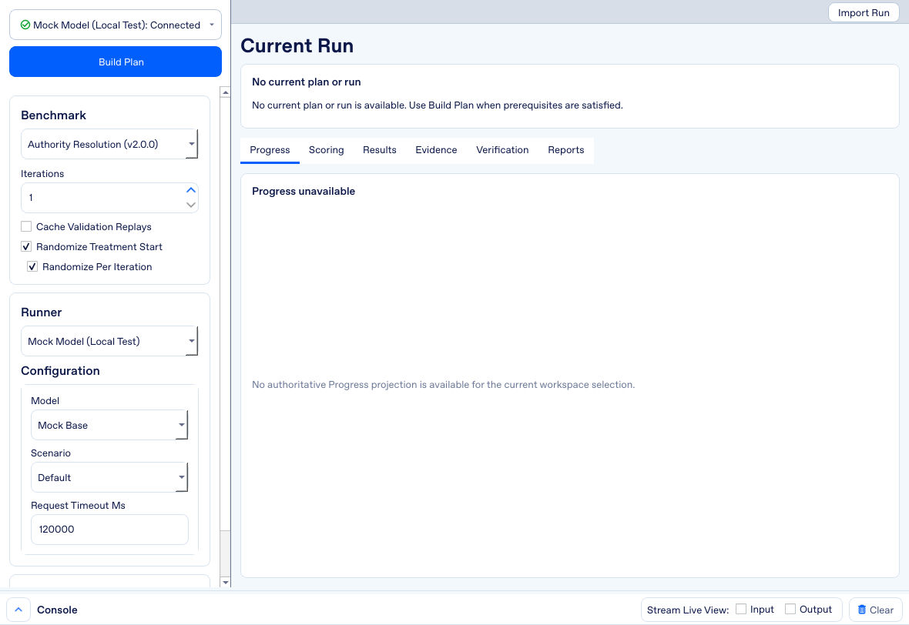
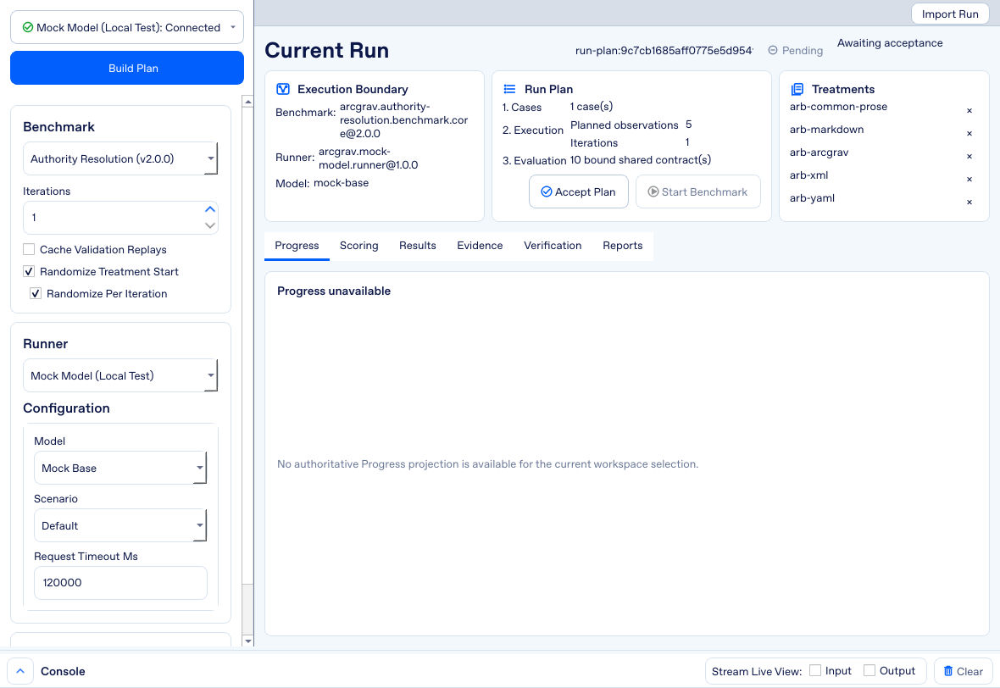
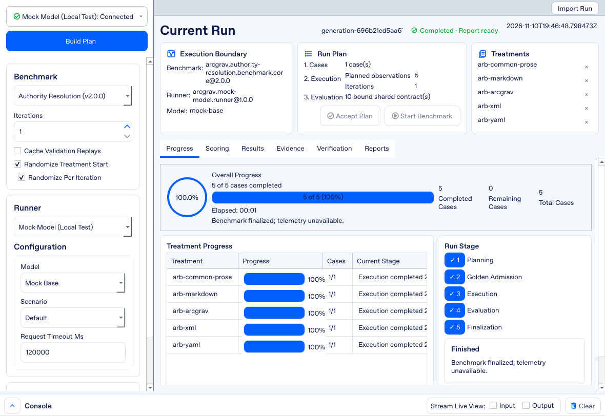
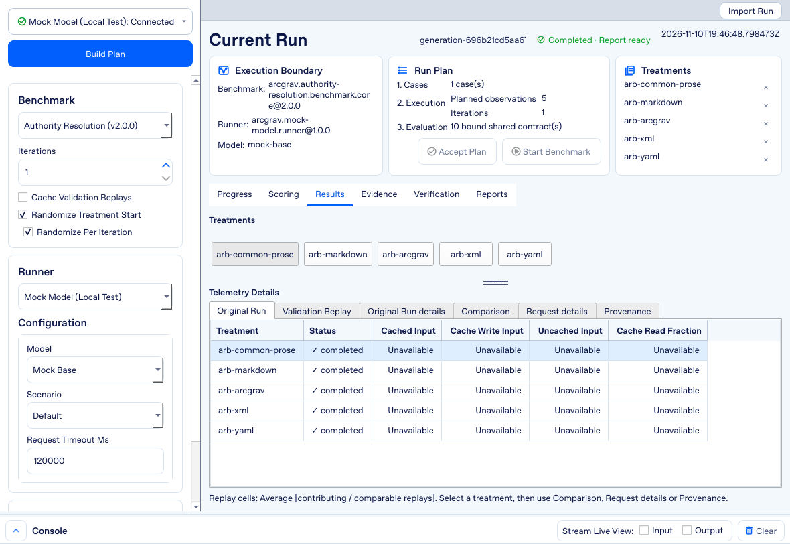
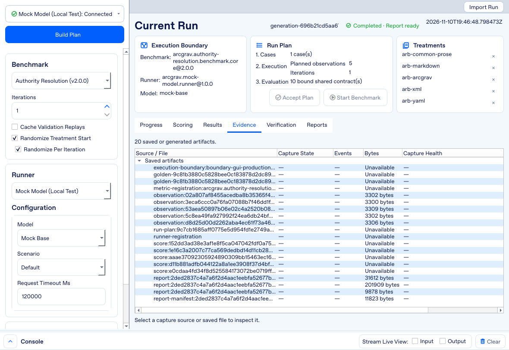
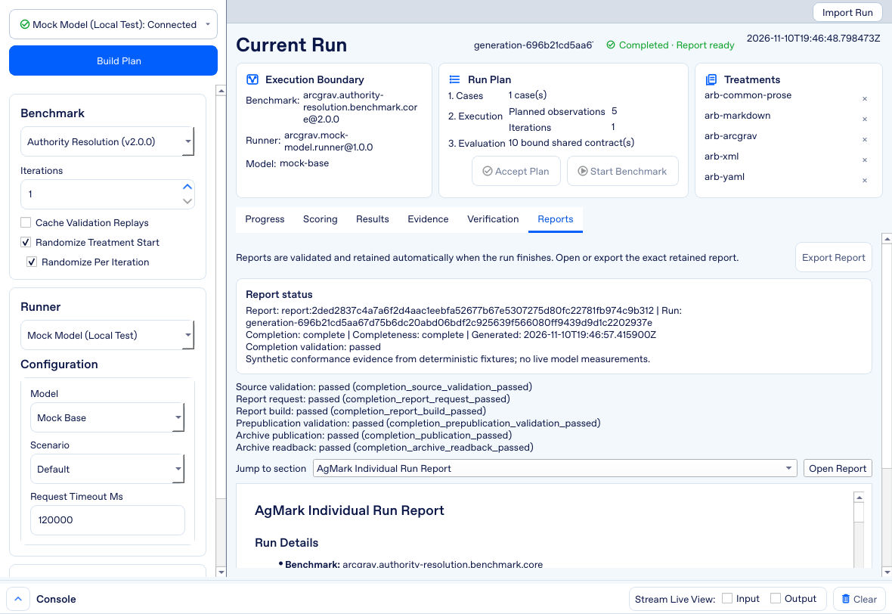

# AgMark — Architectural Gravity Benchmark

AgMark is a native desktop application for running controlled prompt-treatment experiments. It turns a registered benchmark and a selected model runner into a reviewable execution plan, retains what actually happened, and presents benchmark-specific scores alongside the evidence needed to interpret them.

Use it to compare prompt treatments on a defined task, inspect individual responses and failures, and reopen retained experiments without spending another model invocation. AgMark is the benchmarking application in the Architectural Gravity research and engineering program. It is not a universal model leaderboard: a score means what the selected benchmark and registration define.



## What you can do

- **Prepare before executing.** Select a benchmark, runner, model and supported controls; build and review the plan before accepting it.
- **Compare prompt treatments.** Run registered cases and repetitions with explicit execution and evaluation settings.
- **Inspect the whole experiment.** Follow progress, review scoring and treatment results, inspect retained evidence, and read completion diagnostics and reports.
- **Try the workflow without a provider.** The bundled Mock Model uses a local process and deterministic scenarios. Its synthetic output is for diagnostics, not evidence of real-model ability.
- **Run your own prompts.** Custom Benchmark accepts a folder of prompt files for unscored execution and resource measurements.
- **Revisit retained runs.** Inspect history and import supported `.agmark` archives without executing a provider or regenerating a report.

## Requirements and installation

The supplied setup and launch scripts target **Windows** and require **Python 3.10–3.14**, available through the Windows launcher as `py -3`. The GUI dependency is pinned in [`gui/requirements.txt`](gui/requirements.txt) to PySide6 6.11.2. Setup needs access to install those Python packages.

From a Windows terminal opened in this directory:

```bat
Windows_Setup.bat
Windows_Run.bat
```

Setup creates `AgMark/Runtime/.venv` and installs a runtime hook that keeps caches and temporary files inside `AgMark/Runtime/`. **Rerunning setup recreates that environment**, so do not put personal files in it. The launcher expects this managed environment; a system-Python `python -m AgMark.gui` is intentionally rejected.

External runners need their own credentials or installed tooling. No provider credential is required to install the GUI or use Mock Model. Never commit credentials or paste them into screenshots.

## First experiment: provider-free walkthrough

1. **Choose a benchmark.** Start with the shipped Authority Resolution Benchmark. Check its registration and task documentation before interpreting any result.
2. **Choose Mock Model.** Select the bundled local runner and its model/scenario. Set **Iterations** to 1 for an initial check. Runner-specific configuration changes with the selected adapter.
3. **Check readiness.** Read the sidebar prerequisites and the bottom console's **Environment** and **Diagnostics** tabs. Planning, acceptance and execution have distinct requirements.
4. **Build Plan.** Review the current plan's benchmark, runner, model, treatments, cases, execution settings and evaluation information. If you change inputs, build and review the resulting plan again.
5. **Accept Plan**, then **Start Benchmark**. These are separate actions: building a plan is not execution. For an external runner, starting can submit prompts and incur provider usage.
6. **Inspect the outcome.** Use Progress while the run is active, then Results, Scoring and Evidence. Check Verification and Reports for the completion outcome rather than assuming that a finished process produced a report-ready run.

Mock Model results remain synthetic. A successful mock run confirms that the exercised application path works; it does not validate another runner's authentication, billing, model quality or platform compatibility.

## Finding your way around

### Plan, configure and select runs

The left sidebar groups **Build Plan**, **Benchmark**, **Runner**, **Configuration** and **Runs**. The current-run area summarizes the execution boundary and plan. It is the place to distinguish a pending plan from an accepted or completed run.



The controls are adapter-specific. Select a runner first, then use only the model and options it exposes. Prerequisite diagnostics explain why a later operation is unavailable. Do not work around a blocked operation by substituting another model or interpreting missing evidence as a score.

### Progress and scoring

**Progress** shows overall activity and treatment/case progress. **Scoring** presents the evaluation information available for the selected run. Failed execution, malformed output, unavailable evidence and a low correctness score are different outcomes; their treatment depends on the benchmark's registered rules.



### Results and evidence

**Results** presents treatment comparisons and the execution/resource details retained for that adapter. **Evidence** exposes retained artifacts and capture sources, with Open or Reveal actions where available. Use these together to understand a surprising score instead of relying on a summary alone.





The bottom console provides **Live View**, **Diagnostics**, **Environment** and **History**. Live View follows available execution output; the other tabs help explain readiness, failures and prior activity.

### Verification and reports

Scored execution automatically performs completion validation and report construction. There is no separate Generate, Verify or Re-verify workflow. **Verification** displays the retained validation outcome, while **Reports** shows report status, completion diagnostics and readable content when available.

Use **Jump to section** to navigate a report, **Open Report** for a larger reader and **Export Report** to save its retained readable Markdown. If completion fails or the run is unscored, do not expect a ready scored report.



### Retained runs and import

Select a retained run in **Runs**, or use **Import Run** to open a supported `.agmark` archive. Import validates the archive and opens its retained content rather than running a provider, rescoring responses or rebuilding the report. Unsupported or invalid archives are rejected. Treat archives and exported reports as experimental records: they may contain private prompts and model output.

## Benchmark modes and interpretation

### Authority Resolution Benchmark (ARB)

ARB executes its registered Golden implementation once for the selected case, retains the structured result and compares every treatment/repetition against that result. The active registration selects five prompt treatments and uses **ARB field accuracy**:

```text
correct_units / (expected_units + unexpected_units)
```

The default case has 48 expected field units. Field content accuracy is not the same as ordering compliance or exact-result match; reports retain these companion diagnostics separately. See the [ARB README](Authority_Resolution_Benchmark/README.md) for matching rules, malformed-output handling, aggregation and limitations.

Changed treatment prompts can produce a **Treatments Contaminated** warning. A score does not certify an uncontaminated experiment. Automatic report admission rejects contaminated evidence rather than offering a manual verification workaround.

### Custom Benchmark

Choose a prompt folder containing non-empty, readable top-level files. Each file supplies a complete prompt; files are loaded in filename order rather than recursively. Empty folders and empty or unreadable prompt files are rejected.

This mode provides **execution and resource measurements only**. It does not provide correctness scoring, reconstruction verification or scored reports. Use a registered scored benchmark when the question is whether an answer is correct.

## Troubleshooting

- **Managed runtime missing or outdated:** rerun `Windows_Setup.bat`, then use `Windows_Run.bat`. Setup replaces the isolated environment.
- **Build/accept/start is unavailable:** inspect the prerequisite messages and Environment/Diagnostics console tabs. Resolve the requirement for that operation and selected runner.
- **No score or report:** check whether the run is Custom/unscored, failed, missing evidence or blocked during completion. Review retained diagnostics before comparing outcomes.
- **Import fails:** use a supported intact `.agmark` archive. Import does not repair missing components or regenerate a report.
- **Unexpected results after editing resources:** registrations bind resource identities. Consult the benchmark's maintenance rules rather than silently treating modified resources as the same experiment.

## Architecture and local data

The workflow is **registration → plan → accepted execution → retained evidence → benchmark-specific evaluation → automatic completion**.

```text
AgMark/
├── Windows_Setup.bat                 # Rebuild the isolated GUI environment
├── Windows_Run.bat                   # Launch with the managed runtime
├── gui/                              # Desktop presentation and application composition
├── shared/                           # Lifecycle, adapters, evidence, evaluation and reporting
│   └── software_testing/             # Developer-only tests and lifecycle harness
├── Authority_Resolution_Benchmark/   # ARB registrations, cases and scoring resources
├── Structured_Extraction_Benchmark/ # Structured-extraction task resources and specifications
├── Custom_Benchmark/                # Unscored prompt-folder mode
├── Images/                          # Desktop walkthrough screenshots
└── Runtime/                         # Generated local environment, caches and temporary files
```

Benchmark-specific semantics stay in their packages; common mechanics live in `shared/`. [`shared/config.json`](shared/config.json) includes the crash-logging switch. Do not commit generated runtime files, provider credentials or private experiment inputs.
