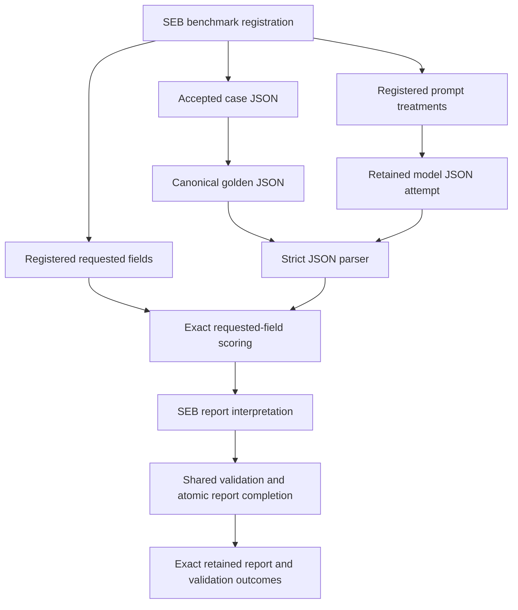

# Structured Extraction Benchmark Specification

## 1. Authority

Parent specification: `../SPECIFICATION.md`.

Scope: `AgMark/Structured_Extraction_Benchmark/`.

## 2. Purpose

The Structured Extraction Benchmark measures whether prompt treatments extract explicitly named fields from structured incident-ticket input and return exactly one strict JSON object without inference, rewriting, or extra fields.

SEB is materially different from ARB and serves as a shared-framework neutrality proof.

## 3. Ownership

SEB owns structured-extraction task meaning, strict JSON output rules, golden behavior, parser semantics, exact requested-field scorer semantics, missing/malformed/parse-failed state meaning, metric interpretation, report interpretation, and package diagnostics.

Shared owns lifecycle authority, generic evidence, scoring contract validation, terminal publication, automatic report completion, validation, and software-testing ownership.

## 4. Dependencies and Inputs

SEB integrates through benchmark registration, shared contracts, shared schemas, and registered parser/scorer/report resources.

SEB developer/CI tests belong under `shared/software_testing/benchmarks/structured_extraction/`.

Package verification records diagnostic test outcomes separately from benchmark measurements.

## 5. Required Behavior

The registered SEB golden consumes accepted case JSON through stdin and emits canonical compact JSON plus one line feed where required by registration.

Model output MUST be parsed as strict JSON according to SEB parser semantics.

The scorer MUST compare exactly the requested registered fields and must not infer, rewrite, repair, populate defaults, or accept extra semantic claims unless registered.

Missing output, malformed JSON, parse failure, missing required fields, unavailable evidence, excluded evidence, and non-comparable evidence MUST remain explicit under registered metric rules.

## 6. Prohibited Behavior

SEB MUST NOT:

- repair malformed structured output into a default mapping;
- infer missing fields;
- score extra unrelated input fields as requested output;
- treat failed runner execution as task incorrectness when registered semantics make it unavailable/non-scored;
- publish accepted authority through package verification or CI helpers;
- require shared or frontend SEB-name branches.

## 7. Authority and Lifecycle

SEB authority enters shared lifecycle through exact benchmark registration and accepted plan identity.

Golden stdin, parser invocation, scorer invocation, and report interpretation MUST be bound to the same accepted generation.

Scored accepted execution automatically validates retained evidence and builds its report under shared report-generation@3.0.0 and run-completion@2.0.0. There is no separate Generate, Verify or Re-verify operation.

## 8. Evidence and Observable Results

SEB evidence MUST preserve case JSON identity, retained golden JSON, prompt treatment identity, retained model output, parse result, score result, failure/availability states, report configuration, exact retained report components and completion record for the same accepted generation. Import validates the supported archive and opens those exact bytes without regeneration; unsupported archive formats are rejected.

## 9. Extension Points

SEB may add cases, treatments, requested fields, metrics, parser versions, scorer versions, report sections, and diagnostics through explicit versioned registration.

## 10. Child Specifications

- `evaluation/SPECIFICATION.md`
  Defines SEB parser and scorer semantics.

- `logic/SPECIFICATION.md`
  Defines structured extraction logic and treatment mapping semantics.

- `reporting/SPECIFICATION.md`
  Defines SEB-specific report interpretation.

- `registrations/SPECIFICATION.md`
  Defines SEB registration authority.

## 11. Non-Goals

SEB does not own generic lifecycle, runner protocol, artifact finalization, report completion mechanics, or GUI behavior.

## 12. Conformance

A conforming SEB package traverses the same shared lifecycle as ARB while preserving strict structured-output semantics locally.

## 13. Authority Flow

