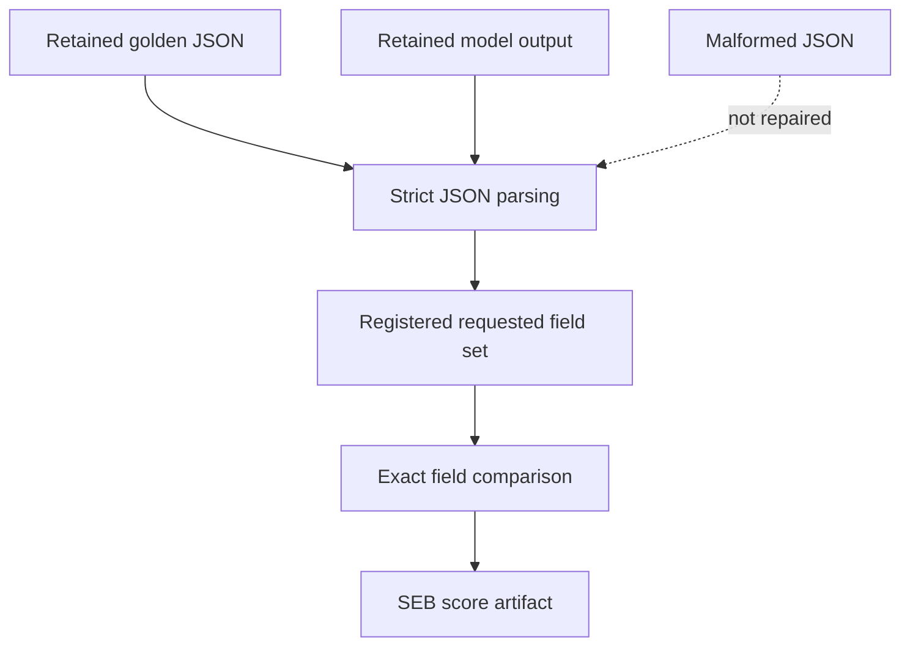

# Structured Extraction Evaluation Specification

## 1. Authority

Parent specification: `../SPECIFICATION.md`.

Scope: `Structured_Extraction_Benchmark/evaluation/`.

## 2. Purpose

SEB evaluation parses strict JSON model/golden output and scores exact requested-field extraction.

## 3. Ownership

Evaluation owns strict JSON parsing, parse failure semantics, field selection, exact field comparison, scorer availability behavior, and SEB-specific score artifact content.

## 4. Required Behavior

Parser and scorer MUST consume retained evidence bound to the same accepted generation.

The parser MUST reject malformed JSON rather than repairing it.

The scorer MUST compare only the registered requested field set and preserve missing, unavailable, invalid, excluded, and non-comparable states according to metric registration.

## 5. Prohibited Behavior

Evaluation MUST NOT infer missing values, rewrite output, accept extra fields as correctness evidence, or convert unavailable evidence into successful empty JSON.

## 6. Child Specifications

None.

## 7. Authority Flow

