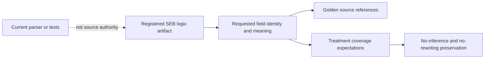

# Structured Extraction Logic Specification

## 1. Authority

Parent specification: `../SPECIFICATION.md`.

Scope: `Structured_Extraction_Benchmark/logic/`.

## 2. Purpose

Logic artifacts define the field-extraction behavior, golden source references, and treatment mappings used to verify that prompt treatments preserve the SEB task.

## 3. Ownership

Logic owns requested field identity, field meaning, source traceability, and treatment coverage/equivalence expectations.

## 4. Required Behavior

Logic artifacts MUST be registered and integrity-addressed before they can influence accepted execution or reporting.

No-inference and no-rewriting semantics MUST remain explicit in SEB-owned logic or metric/scorer configuration.

## 5. Prohibited Behavior

Logic MUST NOT be inferred from current parser/scorer implementation alone, current test behavior, or report prose.

## 6. Child Specifications

None.

## 7. Authority Flow

