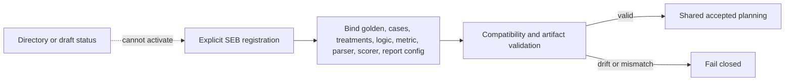

# Structured Extraction Registrations Specification

## 1. Authority

Parent specification: `../SPECIFICATION.md`.

Scope: `Structured_Extraction_Benchmark/registrations/`.

## 2. Purpose

Registrations bind SEB benchmark identity, golden, case set, treatment set, logic artifacts, metric registration, parser, scorer, report configuration, and package verification declaration.

## 3. Ownership

Registrations own active selection of SEB semantic resources and compatibility declarations.

## 4. Required Behavior

Only explicitly active registrations may influence accepted execution.

Registration drift, artifact mismatch, incompatible schema/contract version, or unresolved entry point MUST fail closed.

Active SEB metric registration MUST resolve every task-owned implementation choice left open by shared evaluation, including metric formulas, units, directionality, denominator behavior, missing-data treatment, strict JSON parse-failure treatment, missing-field treatment, extra-field treatment, normalization, repetition aggregation, case aggregation, scorer behavior, comparison rules, availability rules, required companion values, precision, and rounding.

Each SEB comparison track MUST register exactly one primary endpoint before execution. The registered endpoint MUST identify case-level requested-field correctness behavior, observation states included in the denominator, malformed/non-scorable/unavailable dispositions, and any adjudication procedure if one is allowed.

SEB prompt-construction, telemetry, portability, exploratory, diagnostic, or expanded-case metrics are active only when explicitly selected by active registration, classified, and bounded from primary correctness unless registered as the primary endpoint.

Report configuration registration MUST bind SEB-specific sections, strict non-success state presentation, metric display, availability handling, and conclusion boundaries without weakening shared reporting requirements.

## 5. Prohibited Behavior

Directory presence, filenames, README statements, or draft implementation status MUST NOT activate or weaken registration authority.

SEB metric or report behavior MUST NOT be changed after result evidence is observed. Any post-registration change requires a new registration or protocol version and MUST be reported as a deviation.

## 6. Child Specifications

None.

## 7. Authority Flow

