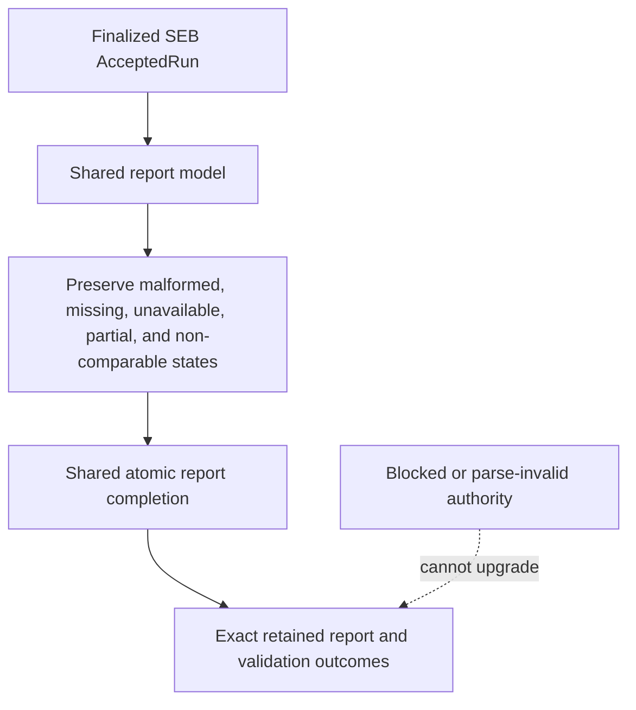

# Structured Extraction Reporting Specification

## 1. Authority

Parent specification: `../SPECIFICATION.md`.

Scope: `Structured_Extraction_Benchmark/reporting/`.

## 2. Purpose

SEB reporting interprets finalized accepted structured-extraction evidence while relying on shared automatic validation and report completion.

## 3. Ownership

SEB reporting owns field-level interpretation, strict non-success state presentation, limitations, and scope-bounded structured-extraction conclusion wording.

Shared reporting owns generic accepted-source validation, canonical report construction, atomic completion and exact retained-byte reading.

## 4. Required Behavior

Reports MUST start from finalized exact accepted evidence.

Reports MUST preserve missing, malformed, parse-failed, missing-field, invalid, unavailable, excluded, partial, blocked, and non-comparable states visibly instead of normalizing them to zero or successful empty output.

Report construction is automatic after the required source validation. The report uses schema `arcgrav.shared.schema.report@3.0.0`, the manifest uses `arcgrav.shared.schema.report-manifest@1.0.0`, and the report binds it through `report_manifest_id`. Completion retains factual validation and report-availability outcomes.

## 5. Prohibited Behavior

SEB reporting MUST NOT upgrade incomplete or failed completion, blocked, integrity-invalid, parse-invalid, unavailable, or mismatched-generation evidence into successful measurement results.

Open, import, restart and export MUST use the exact saved report bytes. They MUST NOT rerun providers, rescore, regenerate, reconstruct or recover reports from a GUI snapshot. Unsupported or older archives MUST be rejected explicitly.

## 6. Child Specifications

None.

## 7. Authority Flow

