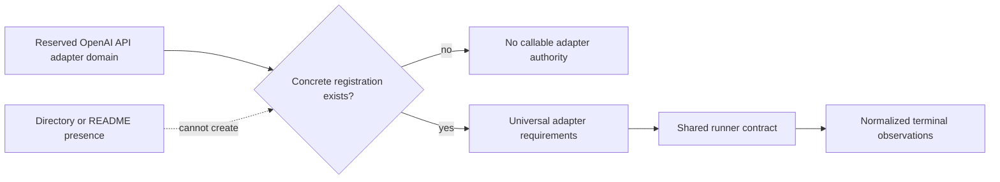

# OpenAI API Adapter Specification

## 1. Authority

Parent specification: `../SPECIFICATION.md`.

Scope: `AgMark/shared/adapters/OpenAI_API/`.

## 2. Purpose

The OpenAI API adapter domain is reserved for an adapter that would integrate a conforming OpenAI API surface with the shared runner contract.

## 3. Ownership

Any implementation in this domain would own API transport, authentication boundary, request translation, response normalization, retry evidence, telemetry evidence, and secret handling for OpenAI API execution.

It would not own benchmark semantics, scoring, planning, accepted authority, report conclusions, or frontend behavior.

## 4. Required Behavior

No OpenAI API-specific runtime behavior is specified beyond inherited universal adapter requirements until a concrete adapter registration and design are introduced.

Any future adapter MUST declare capabilities, supported controls, fixed controls, request framing, response retention, telemetry, and limitations explicitly through registration.

## 5. Prohibited Behavior

This domain MUST NOT invent functionality merely from directory presence or an empty README.

No caller may assume OpenAI API support without a valid runner registration and conforming implementation.

## 6. Evidence and Observable Results

Future observations MUST satisfy the shared runner contract and universal adapter evidence rules.

## 7. Child Specifications

None.

## 8. Conformance

Conformance begins only when a concrete registered adapter exists.

## 9. Authority Flow

