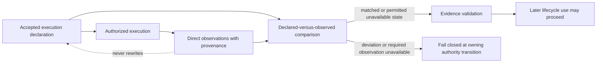

# Effective Execution Evidence Contract

- Contract ID: `arcgrav.shared.effective-execution-evidence`
- Version: `1.0.0`
- Status: published
- Compatibility scope: shared runtime, runner and launch adapters, evidence validation, evaluation, reporting, reconstruction, and other authority-sensitive consumers that compare accepted execution declarations with directly observed execution facts

## Purpose

This contract governs retained, directly observed facts about an accepted execution: runtime, model, environment, access path, request execution, and other comparison-relevant controls.

Effective-execution evidence supplements the immutable accepted execution boundary. It MUST NOT rewrite that boundary, manufacture observations for controls that were not observed, infer benchmark semantics, or turn runtime metadata into undeclared comparison authority.

## Current implementation limit

The runner [emitter](../adapters/execution/emission.py) labels runtime evidence `observed` but fills `model_id` from the accepted boundary or declared controls. That field is not independent evidence of the model actually used. The current path does not implement the full per-role observation/comparison record and admission gate below; a retained runtime label alone does not establish conformance.

## Authority and inputs

Effective-execution evidence MUST be bound to one exact accepted generation, accepted snapshot, execution-boundary fingerprint, and the exact request, observation, golden invocation, treatment invocation, or other execution event to which the evidence applies.

The accepted execution boundary remains the authority for what was declared and authorized. Direct observations establish what was actually observed. These are distinct evidence roles and MUST remain distinguishable.

A conforming producer MAY consume directly observed non-secret facts from compatible published boundaries, including:

- normalized runner observations governed by `arcgrav.shared.runner-invocation@2.0.0`;
- launch selection, preflight, and observed environment/runtime facts governed by `arcgrav.shared.launch-environment@1.0.0`;
- golden execution evidence governed by `arcgrav.shared.golden-execution@2.0.0`;
- run-plan and treatment-observation identities governed by `arcgrav.shared.run-lifecycle@1.0.0`;
- registered adapter/provider/runtime metadata whose provenance and observation semantics are declared before accepted use.

Secret or invocation-only material is governed by `arcgrav.shared.transient-invocation@1.0.0` and MUST NOT enter retained effective-execution evidence.

An implementation MUST NOT promote current module topology, ambient host state, frontend state, provider marketing names, filenames, logs without provenance, or post-hoc operator assertions into effective-execution authority.

## Observation requirements

For every retained effective-execution fact, a conforming producer MUST preserve enough evidence to determine:

1. the accepted generation, snapshot, execution-boundary, request, and observation or invocation identity to which the fact belongs;
2. the comparison-relevant control or metadata role being observed;
3. the accepted declared value or an integrity-verifiable reference to the declaration when that role was declared by accepted authority;
4. the directly observed value only when an authorized producer actually observed it;
5. the source and observation method, including adapter, runtime, provider response field, executable/runtime inspection, launch preflight, or other registered source class;
6. whether the value is provider-reported, runtime-reported, adapter-observed, framework-measured, or otherwise directly observed under a registered source class;
7. the observation availability state;
8. the declaration-to-observation comparison state when comparison is meaningful;
9. applicable contract, schema, registration, adapter, runtime, or source identity and version;
10. integrity identity or provenance sufficient to detect substitution or cross-generation reuse;
11. fixed diagnostic classifications for unavailable, conflicting, or nonconforming observations;
12. allowlisted registered namespaced extensions.

A directly observed value MUST preserve the value as observed subject only to explicitly registered canonical representation needed for stable comparison. A producer MUST NOT normalize two materially different observed values into equality merely because they are believed to be equivalent.

When relevant provider/runtime metadata cannot be retained under the allowlist, the evidence MUST preserve an explicit unavailability state or an integrity-verifiable reference to a permitted minimized source record. Identifying or unrelated metadata is excluded rather than fingerprinted. It MUST NOT guess the missing value.

## Availability and comparison states

Observation availability MUST distinguish, at minimum:

- `observed`: an authorized source produced a directly observed non-secret value;
- `unavailable`: the value was expected or requested from an authorized source but could not be obtained or retained;
- `not_observable`: the active registered execution path provides no authorized observation method for the role;
- `not_applicable`: the role does not apply to this execution path.

When a declared value and directly observed value are both available and comparable, the retained comparison state MUST distinguish:

- `matched`: the observed value conforms exactly to the accepted declaration under the registered comparison rule;
- `deviated`: the observed value conflicts with the accepted declaration;
- `not_comparable`: both values exist but the registered contract does not authorize an exact comparison;
- `not_evaluated`: comparison was not performed and no match may be inferred.

`unavailable`, `not_observable`, `not_applicable`, `not_comparable`, and `not_evaluated` MUST NOT be represented as `matched`.

An accepted declaration alone MUST NOT be copied into the observed field. Absence of a detected deviation MUST NOT be treated as evidence that execution matched the declaration.

## Required verification behavior

Before using effective-execution evidence for accepted finalization, scoring, reporting, reconstruction, or verification, the consumer MUST identify the observations required by the exact active registrations and contracts.

For each required role, the consumer MUST:

1. validate the exact effective-execution contract identity/version;
2. validate generation, snapshot, execution-boundary, request, observation, and invocation linkage;
3. validate source provenance and integrity;
4. validate availability against the active role requirement;
5. compare declared and observed values when the owning contract or registration requires exact conformance;
6. preserve every detected deviation or required-availability failure without repairing the source evidence;
7. pass the resulting evidence through `arcgrav.shared.evidence-validation@1.0.0` before an authority-sensitive transition.

If exact observed conformance is required and the observed value deviates, the affected authority transition MUST fail closed. If a required effective observation is unavailable or not observable, the transition MUST fail closed unless the exact active registration explicitly permits that availability state for that role.

A deviation MUST NOT silently rewrite the accepted execution boundary. Re-running under a corrected boundary requires new accepted authority and distinct generation/request/observation identities as required by the owning lifecycle.

Where a failure candidate is produced, classification and precedence MUST follow `arcgrav.shared.failure-taxonomy@1.0.0`. Effective-execution evidence MUST preserve the original observed facts even when a higher-precedence failure determines the terminal disposition.

## Evidence grain and aggregation

Effective-execution evidence MUST retain its true observation grain.

A fact observed once for a resolved launch environment or process MAY be referenced by multiple child invocations only when the registered execution path establishes that the fact remained invariant for those invocations and the provenance relationship is explicit.

Per-request or per-attempt facts MUST NOT be promoted to run-level facts by sampling one observation, choosing the first or last value, majority voting, or another undeclared aggregation rule.

If multiple authorized sources report the same role and their values conflict, the conflict MUST be retained explicitly. A consumer MUST NOT select the most convenient source, hide the disagreement, or synthesize a consensus value unless a pre-registered precedence rule for that role authorizes the resolution and retains all source observations.

Unknown namespaced effective-execution roles MUST NOT be retained. New roles require compatible registered authority and an explicit minimization allowlist before capture.

## Evidence and observable results

Retained effective-execution evidence MUST identify, where applicable:

- this contract ID and version;
- accepted generation and accepted-snapshot identity;
- canonical execution-boundary fingerprint;
- case, treatment, repetition, request, observation, golden invocation, treatment invocation, attempt, or process identity at the true evidence grain;
- the declared control role and declared non-secret value or integrity-verifiable reference;
- the observed role and directly observed non-secret value or integrity-verifiable reference;
- observation availability and declaration-comparison state;
- source class, producer identity/version, observation method, and source provenance;
- runner, launch-environment, golden, run-lifecycle, or other governing contract identities/versions as applicable;
- adapter/provider/runtime/model/access-method/environment identities when directly observed and permitted to retain;
- exact executable/runtime identity and version when directly observed and applicable;
- observed request/framing/tool/memory/retry/timeout or other controls only when an authorized source can establish them;
- timing, usage, or telemetry only with provenance and without converting measurements into control authority;
- conflicting source observations and any registered source-precedence result;
- deterministic validation/failure references for deviations, unavailable required roles, or provenance defects;
- fixed diagnostic classifications;
- allowlisted registered namespaced extensions.

Effective-execution evidence is execution/provenance evidence. Its existence alone MUST NOT establish task correctness, score authority, `AcceptedRun`, report authority, reconstruction success, or verification success.

## Prohibited behavior

A conforming producer or consumer MUST NOT:

- overwrite accepted declared controls with observed values;
- populate observed fields by copying declared values when no direct observation occurred;
- treat missing observation as proof of conformance;
- silently substitute a provider, model, runtime, executable, environment, access method, request framing, tool policy, memory policy, retry policy, timeout policy, or another comparison-relevant control;
- infer an effective value from ambient host defaults, GUI labels, benchmark names, filenames, current working directory, unregistered logs, or implementation topology;
- collapse `unavailable`, `not_observable`, `not_applicable`, `not_comparable`, or `not_evaluated` into `matched`;
- discard conflicting authorized observations;
- aggregate per-request or per-attempt facts into broader authority without a registered aggregation rule;
- mutate runner, launch, golden, plan, observation, score, or retained artifact evidence to make an effective-execution check pass;
- use effective-execution evidence to bypass accepted planning, golden admission, scoring, evidence validation, terminal classification, report generation, reconstruction, or verification gates;
- retain secrets, secret-bearing handles, credential values, or reversible secret derivatives in values, provenance, diagnostics, or extensions;
- infer benchmark-specific correctness, semantic equivalence, dependency meaning, metric disposition, or report conclusions in shared effective-execution logic.

## Extension rules

Effective-execution extensions MUST be namespaced, additive, benchmark-neutral at the shared boundary, and registered before they become required comparison authority.

A registered extension role MUST define its stable role identity/version, evidence grain, authorized source classes, value representation, availability requirements, comparison rule when applicable, and compatibility scope.

Benchmark-owned logic MAY interpret registered effective-execution or dependency evidence for benchmark-specific metrics or report sections. That interpretation MUST remain outside the shared contract and MUST NOT replace the retained shared identity, provenance, availability, or declared-versus-observed distinctions.

Extensions MUST NOT weaken exact accepted identity, permit ambient inference, hide deviations, suppress conflicts, retain secrets, or reinterpret an existing shared role.

A breaking change to declared-versus-observed meaning, availability semantics, comparison-state semantics, required provenance, or fail-closed behavior requires a new major contract version.

## Conformance expectations

Conformance MUST include deterministic provider-free checks showing that:

- accepted declarations and observed effective values remain separate;
- an unobserved value cannot be reported as observed or matched;
- directly observed deviations are retained and cannot rewrite accepted identity;
- a required deviation or required unavailable observation fails the applicable authority transition;
- optional unavailable and not-observable states remain explicit when permitted by registration;
- provider-reported, runtime-reported, adapter-observed, and framework-measured facts retain distinct provenance;
- conflicting authorized observations remain visible and deterministic source precedence applies only when pre-registered;
- per-attempt evidence cannot be silently promoted to run-level evidence;
- cross-generation, cross-boundary, cross-request, or cross-observation reuse is rejected;
- unknown or incompatible contract/registration identities fail closed;
- secret material is absent from retained values, provenance, diagnostics, and extensions;
- effective-execution evidence alone cannot create score, accepted-run, report, reconstruction, or verification authority.

## Current retention policy

All current evidence MUST follow
[`arcgrav.shared.evidence-minimization@1.0.0`](EVIDENCE_MINIMIZATION.md): retain
relevant scoring bytes and structured measurement sources; exclude identifying
or unrelated data before persistence. Extensions and diagnostic profiles grant
no exception. Host locators remain transient; retained references are relative.
