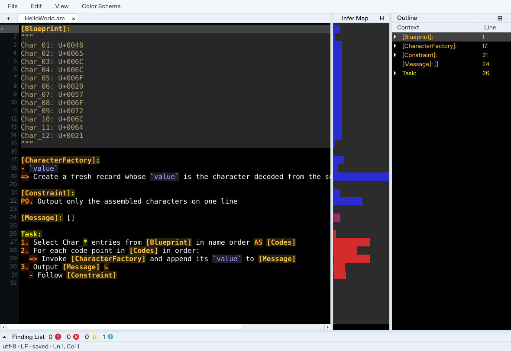
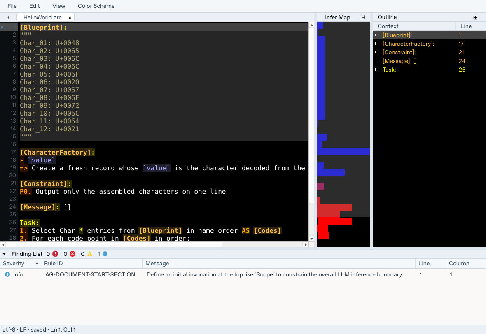
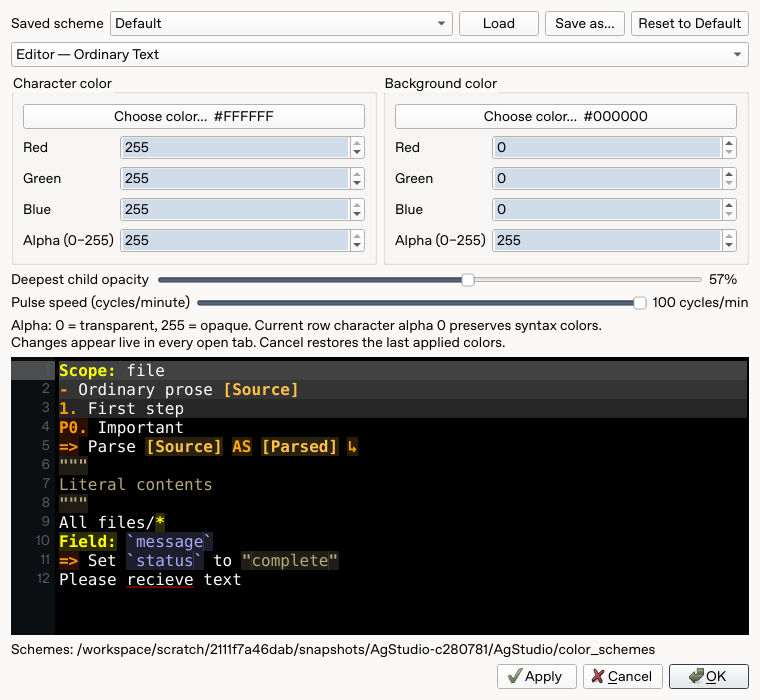

# AgStudio — Architectural Gravity Studio

## Overview

AgStudio provides authoring and analysis tools for the [ArcGrav](../ArcGrav/) Agent Control Language. It combines a local editor with structural recognition, navigation, and diagnostics so authors can inspect an ArcGrav document without submitting it to a model.

The desktop interface presents results from the underlying language engine. Analysis describes the source and its detected findings; it does not execute the instructions in the document or guarantee how a model will behave.



The editor keeps your source, its structural outline, and a compact inference map side by side. The screenshot shows the bundled [`HelloWorld.arc`](examples/HelloWorld.arc), which describes constructing a message from Unicode characters. AgStudio analyzes that source; it does not run the task or produce the message.

## Key Features

- **ArcGrav editing:** Open and save `.arc` and `.txt` source files.
- **Source-aware highlighting:** Visual distinction for recognized ArcGrav structure and syntax.
- **Navigation:** Document outline and map views for exploring source structure.
- **Diagnostics:** Findings and source locations from local language analysis.
- **Writing assistance:** Spelling suggestions and project vocabulary support.
- **Display options:** Color schemes and analysis-map presentation modes.
- **Command-line analysis:** A local CLI for inspecting one or more source files, with optional JSON output.

## Requirements

- **Windows** for the supplied desktop setup and launch scripts.
- **Python 3.10 or newer**, accessible through the Windows `py` launcher or `python` command.
- A checkout of this repository, including the `AgStudio/` directory.
- Access to install Python dependencies during setup. The GUI uses PySide6; setup also verifies the packaged Hunspell spelling backend and dictionary.

## Quick Start

### Installation

From a Windows terminal opened in this directory:

```bat
Windows_Setup.bat
```

Setup creates or uses the isolated environment at `AgStudio/Runtime/.venv`, installs the desktop dependencies, and verifies required imports.

### Running the Application

From the `AgStudio` directory:

```bat
Windows_Run.bat
```

The launcher uses the managed environment and selects the current ArcGrav language version.

## Guided Walkthrough

### 1. Open and edit a document

Launch `Windows_Run.bat`. Use **File → Open…** (`Ctrl+O`) to open
[`examples/HelloWorld.arc`](examples/HelloWorld.arc). The example may already be
open on the first launch. Open several documents in tabs, or create a new one
with the **+** button or `Ctrl+N`.

The main editor highlights recognized sections, symbolic references, operations,
list markers, and literal blocks. Line numbers and the status bar help locate
text; the status bar also shows encoding, line endings, and saved/modified state.
An asterisk on a tab indicates unsaved edits. Use `Ctrl+S` to save or
`Ctrl+Shift+S` to choose another `.arc` or `.txt` destination. Save a copy of the
example before experimenting if you want to preserve it.

### 2. Navigate with the Outline

The **Outline** lists recognized contexts and their source lines. Select an entry
to navigate to its source, expand a context to inspect its children, or use the
header's **Expand All** control. The **Correlations** area presents related
symbols when available. These views are projections of recognized source
structure, not a guarantee that every apparent relationship is resolved.

Use **View → Outline** to show or hide the panel. Drag the
splitters to give the editor or its supporting panels more room.

### 3. Read the Infer Map

The narrow **Infer Map** beside the editor provides a compact view of relative
inferential influence. In **Heuristic** mode, blue indicates less influence and
red more influence under the local correlation heuristic. Scroll the map to
adjust its line-height zoom and drag its divider to change its width.

Use **View → Inference mode**, or the mode button beside the map heading, to
choose **Heuristic**, **Semantic Triad 1**, or **Semantic Triad 2**. The triad modes
provide whole-block and source-aligned views respectively. Hover the mode button
for its explanation. These are local analytical proxies and visualizations,
**not measured model attention, token probabilities, or predictions of output**.

### 4. Inspect findings

Expand the **Finding List** with the arrow beside its heading. Each row includes
severity, rule ID, message, line, and column. Select a finding to inspect the
associated source. The heading summarizes critical, error, warning, and
information counts. Use **View → Finding List** to toggle it.



For the bundled example, this capture shows one informational finding,
`AG-DOCUMENT-START-SECTION`, suggesting an initial plain section such as `Scope`.
It is not an execution failure. Findings describe supported checks; even a clean
list does not establish complete language conformance or guarantee model behavior.

### 5. Find text and maintain vocabulary

Use **Edit → Find…** (`Ctrl+F`) to search within the current document. The find bar
has next/previous controls, case matching, whole-word matching, and a **Show
Replace** control for replacements. `F3` and `Shift+F3` navigate matches.

Spelling assistance uses the packaged Hunspell backend and English dictionary.
Use **Edit → Spelling vocabulary…** to manage vocabulary for domain-specific
terms. Spelling suggestions are writing aids, separate from structural findings.

### 6. Customize the display

Choose **Color Scheme** on the menu bar to edit syntax-role foreground and
background colors, alpha, current-row child opacity, and correlation pulse speed.
The sample source previews the settings. Use **Save as…** for a named scheme,
**Load** for an existing one, or **Reset to Default** to start over.



Changes appear live in open tabs. **Apply** retains the current changes;
**Cancel** restores the last applied colors. The dialog also displays the
scheme-storage directory.

## Keyboard Reference

| Action | Shortcut |
| --- | --- |
| New / open document | `Ctrl+N` / `Ctrl+O` |
| Save / Save As | `Ctrl+S` / `Ctrl+Shift+S` |
| Find | `Ctrl+F` |
| Next / previous match | `F3` / `Shift+F3` |

## How It Works

The analysis flow is **source text → language recognition and parsing → structural/semantic analysis → diagnostics → editor projections**.

- `arcgrav_language_engine/` contains the standalone language-analysis package and its contracts.
- `shared/` exposes analysis, document, diagnostic, and supporting services to the application.
- `gui/` handles editing, presentation, navigation, and user interaction.

The interface derives its structural and diagnostic views from source analysis rather than treating the editor's display state as language authority.

## Project Structure

```text
AgStudio/
├── Windows_Setup.bat         # Prepare the Windows desktop environment
├── Windows_Run.bat           # Launch the editor
├── gui/                      # Editor, visualizations, and desktop controls
├── shared/                   # Application analysis and support services
├── arcgrav_language_engine/  # Standalone ArcGrav language engine
├── Images/                   # Desktop screenshots used in this README
├── color_schemes/            # Editor color-scheme resources
└── examples/                 # Example ArcGrav source files
    └── HelloWorld.arc
```

## Configuration and Data

- `shared/config.json` contains shared application configuration, including the crash-logging switch.
- `color_schemes/` contains color-scheme resources used by the editor.
- User interface preferences and session state are managed by the desktop application.
- `Runtime/` is generated locally for the virtual environment and runtime caches.
- Documents are ordinary source files; save and manage them according to your own version-control and data-handling practices.

Analysis output can distinguish detected findings from unknown or unsupported conformance states.

## Troubleshooting

- **Launcher reports a missing environment:** run `Windows_Setup.bat` before
  `Windows_Run.bat`; use the managed interpreter rather than an unrelated Python.
- **Dependency or spelling-backend errors:** rerun setup and inspect its import
  checks. The GUI requirements include the shared Hunspell dependency.
- **A panel appears missing:** enable it from **View**, then check the splitters
  and the Finding List expansion arrow.
- **Source looks valid but a finding remains:** inspect the rule ID, source
  position, and rule limits. Analysis deliberately distinguishes supported checks
  from unknown or unresolved behavior.
- **Colors are difficult to read:** open **Color Scheme**, preview changes, and
  use **Reset to Default** or load a saved scheme.

### Exporting a code image

Choose **Export → Code Image** to save the active document (including unsaved text) as
one continuous PNG or JPG image. Only code is included: no line-number gutter,
menus, side panels, caret, or transient selections. Long lines are not wrapped
or cropped. The export preserves the font and syntax colors without changing
editor state. Uncheck **Include editor color scheme** for plain black text on
a white background instead of the editor background and syntax colors.

PNG defaults to lossless 24-bit color, with optional 8-, 4-, or 1-bit indexed
color and Median cut, Maximum coverage, or Fast octree quantization. JPG offers
a quality setting from 1 to 100. Grayscale is available for either format.
Choose a filename and destination after selecting the options. PNG palette
reduction and JPG quality reduce file size, not pixel dimensions.

Rendering uses horizontal bands for tall documents. A safety limit of 24 million
pixels and 32,760 pixels wide bounds memory and Qt raster coordinates; JPG also
has a 65,500-pixel height limit. Exceeding a limit produces an error, never a
truncated or split image. The exporter uses Pillow, included in the GUI
requirements.
