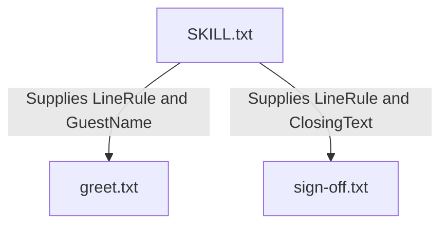
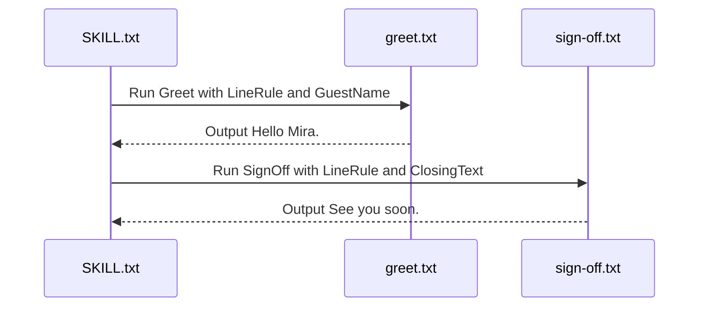
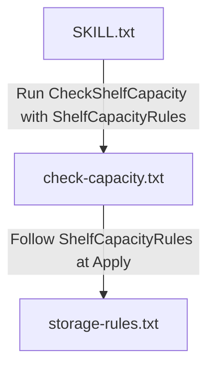
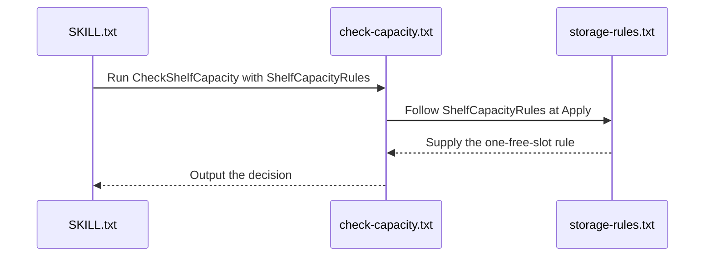
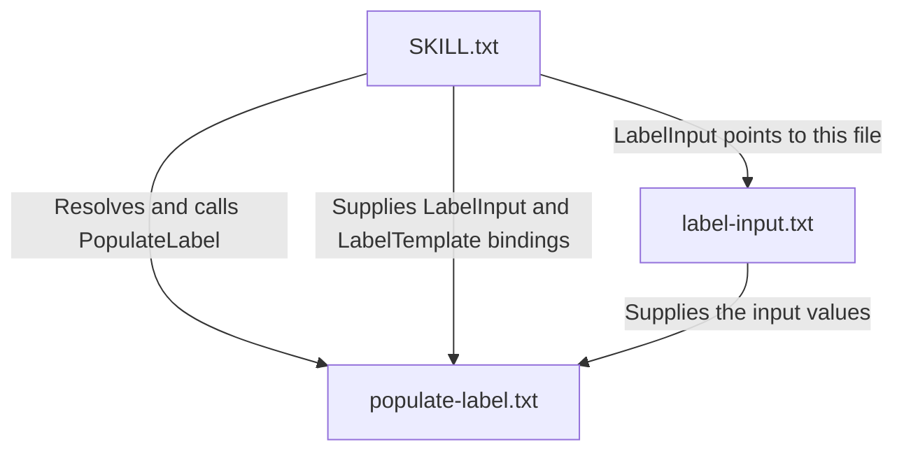
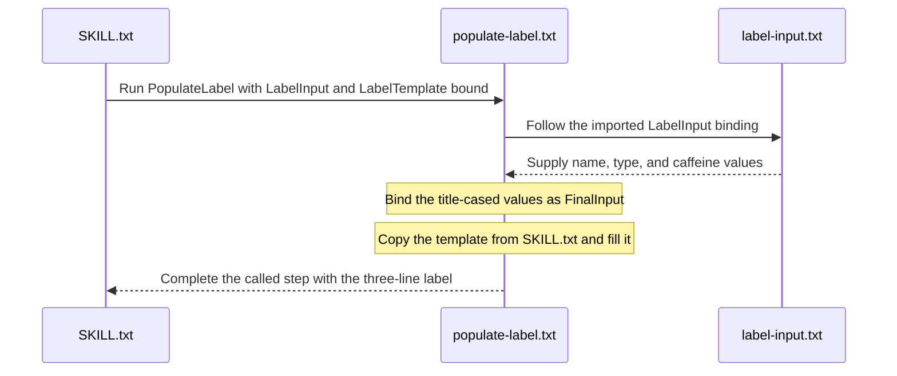
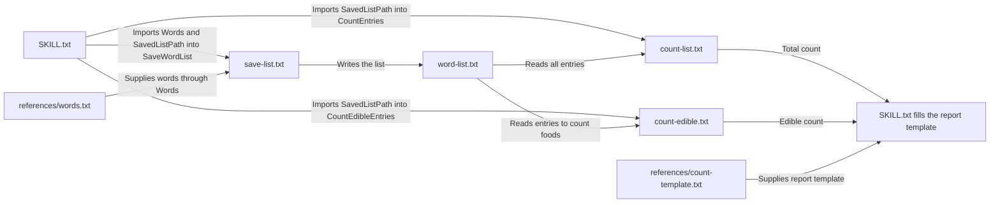
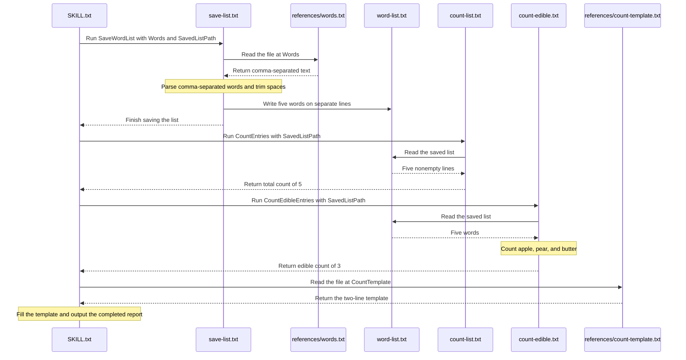

<a id="ag-using-multiple-arcgrav-instruction-files"></a>
# Multi-File Composition

**Multi-file composition** means organizing one ArcGrav workflow across several files. The agent starts with an entry file that defines the overall procedure and follows file references as the workflow calls for them. What each file contributes depends on how the workflow uses it.

The entry file keeps the sequence clear, while each reusable part has one place to be maintained. Keeping supporting context outside the main sequence also lets the agent load it only when a step needs it. This lazy loading reduces the context the agent has to take in up front and lets it skip files the workflow never uses on that run.

Multi-file composition separates concerns: The top level entry file defines the top level workflow, while supporting files handle separate or lower level workflow responsibilities.

You might isolate logic that changes independently, share rules across workflows, or keep input data and output templates separate from the steps that use them, so how you divide these files depends on the overall intended workflow.

<a id="ag-declare-and-bind"></a>
## Declare and Bind a Child

- The parent file’s importing `Import:` supplies the named bindings
- The child file’s opening `Import:` declares the names it expects

The parent and child import lists must be **identical**, and each binding must already exist when the importing file includes it in the child’s declaration. The imported instructions can refer to those bindings wherever the importing file uses them.

1. Create a symbolic reference for the imported child file
2. Add `Resolves:` in the symbol to reference the child’s file and path (absolute or relative depending on need)
3. Add `Import:` in the symbol to define what other symbolic references will be made available to the child as bound context
4. Mirror the exact same bound symbols at the top of the child with `Import:`, which will declare them as available to the child for use

Use the imported instructions at the step that needs them. A child file can supply operations, rules, templates, etc. without defining a `Task:`. The importing file applies those instructions as part of its own procedure. If the child defines a `Task:` and the caller needs to run it, call the child symbol with `Run` and the imported instruction will run at its `Task:` utilizing its imported bindings.

**Importing file (`SKILL.txt`)**

```text
[Audience]: "visitors"

[Tone]: "friendly"

[NoticeRules]:
1. Resolves: references/notice-rules.txt
2. Import: [Audience], [Tone]
```

**Receiving file (`references/notice-rules.txt`)**

```text
Import:
- [Audience]
- [Tone]

Rules:
- Address [Audience] using [Tone] as the tone
```

When two children work with a shared file, they can both import its path up front. Run the writer before the reader so the file exists when the reader needs it.

Define shared context once and supply only what each child needs.

<a id="ag-shared-instructions-different-imports"></a>
## Example: Greet and Sign Off

**Pattern: Shared instructions, different imports.** Supply the same rule to two child procedures alongside the distinct input each child needs.

`SKILL.txt` defines a punctuation rule that both children use. `references/greet.txt` also imports the guest's name, while `references/sign-off.txt` imports the closing phrase instead. Resolve both paths from the directory containing `SKILL.txt`.



<a id="ag-multi-file-greet-sign-off-entry"></a>
### `SKILL.txt`

```text
Scope:
- Produce a greeting and a sign-off

[LineRule]:
- Output one line ending with a period

[GuestName]: "Mira"

[ClosingText]: "See you soon"

[Greet]:
1. Resolves: references/greet.txt
2. Import: [LineRule], [GuestName]

[SignOff]:
1. Resolves: references/sign-off.txt
2. Import: [LineRule], [ClosingText]

Task:
1. Run [Greet]
2. Run [SignOff]
```

<a id="ag-multi-file-greet-sign-off-greet"></a>
### `references/greet.txt`

```text
Import:
- [LineRule]
- [GuestName]

Task:
1. Greet [GuestName] with "Hello" followed by the guest's name
2. Output the greeting according to [LineRule]
```

<a id="ag-multi-file-greet-sign-off-sign-off"></a>
### `references/sign-off.txt`

```text
Import:
- [LineRule]
- [ClosingText]

Task:
1. Output [ClosingText] according to [LineRule]
```

<a id="ag-multi-file-greet-sign-off-walkthrough"></a>
### Step-by-Step Walkthrough

1. **Run the greeting.**

   1. Resolve `greet.txt` and bind `[LineRule]` and `[GuestName]`.
   2. Use `[GuestName]` to form the greeting and `[LineRule]` to end it with a period.

2. **Run the sign-off.**

   1. Resolve `sign-off.txt` and bind the same `[LineRule]`, this time alongside `[ClosingText]`.
   2. Output the closing phrase with the same punctuation. This child doesn't need the guest's name.



The output is:

```text
Hello Mira.
See you soon.
```

<a id="ag-file-backed-rule"></a>
## Example: Check Shelf Capacity

**Pattern: Follow an imported reference to external instructions.** Pass a file-backed rule to a child. The child follows the reference when it applies the rule to its own local data, without running the rules file as a separate task.

`SKILL.txt` runs `references/check-capacity.txt` to decide whether four more boxes can go on a shelf. The child defines the shelf counts in `[Shelf]` and imports only `[ShelfCapacityRules]`. At the `Apply` step, the agent follows that binding to `references/storage-rules.txt` for the rule that determines the result.



<a id="ag-multi-file-shelf-capacity-entry"></a>
### `SKILL.txt`

```text
[ShelfCapacityRules]:
- references/storage-rules.txt

[CheckShelfCapacity]:
1. Resolves: references/check-capacity.txt
2. Import: [ShelfCapacityRules]

Task:
1. Run [CheckShelfCapacity]
```

<a id="ag-multi-file-shelf-capacity-check-capacity"></a>
### `references/check-capacity.txt`

```text
Import:
- [ShelfCapacityRules]

[Shelf]:
- Capacity: 10 slots
- Occupied: 6 slots
- Incoming: 4 boxes

Task:
1. Apply [ShelfCapacityRules] to [Shelf]
2. Output decision
```

<a id="ag-multi-file-shelf-capacity-storage-rules"></a>
### `references/storage-rules.txt`

```text
Rules:
- Each incoming box occupies one slot
- Allow loading only if at least one slot remains free after loading
```

<a id="ag-multi-file-shelf-capacity-walkthrough"></a>
### Step-by-Step Walkthrough

1. **Bind the reference.**

   1. At `Run [CheckShelfCapacity]`, resolve `check-capacity.txt` and supply `[ShelfCapacityRules]`, matching the child’s opening `Import:`.
   2. `[ShelfCapacityRules]` gives the child a path relative to `SKILL.txt`, where the binding was declared.

2. **Follow the reference at the point of use.**

   1. At `Apply [ShelfCapacityRules] to [Shelf]`, follow the path to `storage-rules.txt` and apply its rules to the local shelf counts. The rules file has no `Task:` to run.
   2. Four more boxes would fill all ten slots. The child outputs that the boxes cannot be added because one slot must stay free.



The output is:

```text
Cannot add the boxes: one slot must stay free.
```

<a id="ag-worked-example"></a>
## Example: Populate a Label Template

**Pattern: Separate data, template, and logic.** Keep the template in the entry file and the data in a separate file. Pass both bindings to the child that fills the template.

`SKILL.txt` defines the label template and calls `references/populate-label.txt` to fill it with values from `references/label-input.txt`. The logic imports both the template and the input binding. Resolve both paths from the directory containing `SKILL.txt`.



<a id="ag-multi-file-label-template-entry"></a>
### `SKILL.txt`

```text
Scope:
- Produce one label

[LabelInput]:
- references/label-input.txt

[LabelTemplate]:
"""
Label: <name>
Type: <type>
Caffeine: <caffeine>
"""

[PopulateLabel]:
1. Resolves: references/populate-label.txt
2. Import: [LabelInput], [LabelTemplate]

Task:
1. Run [PopulateLabel]
```

<a id="ag-multi-file-label-template-label-input"></a>
### `references/label-input.txt`

```text
Input:
- `name`: "mint tea"
- `type`: "herbal"
- `caffeine`: "none"
```

<a id="ag-multi-file-label-template-populate-label"></a>
### `references/populate-label.txt`

```text
Import:
- [LabelInput]
- [LabelTemplate]

Task:
1. Change each member value in [LabelInput] to title case AS [FinalInput]
2. Copy [LabelTemplate] AS [FilledLabel]
3. Populate [FilledLabel] ↳
  - "<name>" with [FinalInput].name
  - "<type>" with [FinalInput].type
  - "<caffeine>" with [FinalInput].caffeine 
4. Output only [FilledLabel]
```

<a id="ag-trace-the-expanded-procedure"></a>
## Step-by-Step Walkthrough

1. **Resolve the child procedure.**

   1. Start at `Run [PopulateLabel]` in the `Task:` section of `SKILL.txt`.
   2. Follow `Resolves:` in the `[PopulateLabel]` declaration to `references/populate-label.txt`.

2. **Bind the child's imports.**

   1. Match the child's opening `Import:` list to the bindings supplied in `SKILL.txt`.
   2. Bind `[LabelInput]` to the reference to `references/label-input.txt`.
   3. Bind `[LabelTemplate]` to the literal block defined in `SKILL.txt`.

3. **Follow the child's task at the parent call.**

   1. Read the values through `[LabelInput]`, change them to title case, and bind the resulting record as `[FinalInput]`.
   2. Copy `[LabelTemplate]` as `[FilledLabel]`.
   3. Populate the copy from `[FinalInput]`: `<name>` gets `Mint Tea`, `<type>` gets `Herbal`, and `<caffeine>` gets `None`. The `↳` attaches the three mappings to the same step.
   4. Output only `[FilledLabel]` to complete the parent call.



The output is:

```text
Label: Mint Tea
Type: Herbal
Caffeine: None
```

<a id="ag-sequential-child-calls"></a>
## Example: Save and Count a Word List

**Pattern: Sequential child calls.** Pass the same file path to the writer and readers. Run the writer first so the later children can read the file it creates.

`SKILL.txt` binds `[Words]` to `references/words.txt` and defines `[SavedListPath]`, the destination for the one-word-per-line list. `references/save-list.txt` imports both bindings, reads the words from the input file, and writes them to the output path. `references/count-list.txt` counts all entries, and `references/count-edible.txt` counts only entries that name foods. All three children import the same output path. Both counting procedures run after the writer because they need the saved list. `SKILL.txt` reads the report template from `references/count-template.txt` and fills it with the two counts. Resolve all paths from the directory containing `SKILL.txt`.



<a id="ag-multi-file-word-list-entry"></a>
### `SKILL.txt`

```text
Scope:
- Save word list
- Report total and edible counts

[Words]: "references/words.txt"

[SavedListPath]: "word-list.txt"

[CountTemplate]: "references/count-template.txt"

[SaveWordList]:
1. Resolves: references/save-list.txt
2. Import: [Words], [SavedListPath]

[CountEntries]:
1. Resolves: references/count-list.txt
2. Import: [SavedListPath]

[CountEdibleEntries]:
1. Resolves: references/count-edible.txt
2. Import: [SavedListPath]

Task:
1. Run [SaveWordList]
2. Run [CountEntries]
3. Run [CountEdibleEntries]
4. Read template at [CountTemplate]
5. Populate template ↳
  - "<total>" with count from [CountEntries]
  - "<edible-total>" with count from [CountEdibleEntries]
6. Output only populated template
```

<a id="ag-multi-file-word-list-words"></a>
### `references/words.txt`

```text
apple, pear, butter, car, computer
```

<a id="ag-multi-file-word-list-save-list"></a>
### `references/save-list.txt`

```text
Import:
- [Words]
- [SavedListPath]

Task:
1. Parse file at [Words] as comma-separated words
2. Trim spaces around each word
3. Write one word per line to [SavedListPath]
```

<a id="ag-multi-file-word-list-count-list"></a>
### `references/count-list.txt`

```text
Import:
- [SavedListPath]

Task:
1. Return nonempty line count in [SavedListPath]
```

<a id="ag-multi-file-word-list-count-edible"></a>
### `references/count-edible.txt`

```text
Import:
- [SavedListPath]

Task:
1. Return count of entries naming foods in [SavedListPath]
```

<a id="ag-multi-file-word-list-count-template"></a>
### `references/count-template.txt`

```text
Total items: <total>
Edible items: <edible-total>
```

<a id="ag-multi-file-word-list-walkthrough"></a>
### Step-by-Step Walkthrough

1. **Save the list.**

   1. Resolve `[SaveWordList]` and supply `[Words]` and `[SavedListPath]` through its declared `Import:`.
   2. Parse the comma-separated text at `[Words]`, trimming spaces around each word.
   3. Write the five words to `word-list.txt`, one per line.

2. **Count the saved entries.**

   1. Resolve `[CountEntries]` and supply `[SavedListPath]` through its declared `Import:`. The child receives the path, not `[Words]`.
   2. Run the child task. It reads the file written in step 1 and returns `5` to `SKILL.txt`.

3. **Count the edible entries.**

   1. Resolve `[CountEdibleEntries]` and supply the same `[SavedListPath]` through its declared `Import:`.
   2. Read the saved list and count the entries that name foods: `apple`, `pear`, and `butter`. Return `3` to `SKILL.txt`.

4. **Fill the report template.**

   1. Read the template file at `[CountTemplate]`.
   2. Replace `<total>` with the count from `[CountEntries]` and `<edible-total>` with the count from `[CountEdibleEntries]`.
   3. Output only the populated report.



The output is:

```text
Total items: 5
Edible items: 3
```
