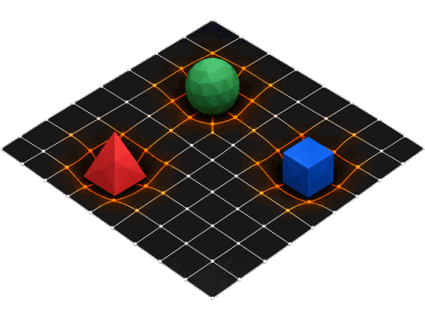

<p align="center">
  
</p>

<a id="ag-architectural-gravity-arcgrav"></a>
# Architectural Gravity — ArcGrav

Short for ***Architectural Gravity***, ArcGrav is a ***"cross-model Agent Control Language"*** for defining, composing, referencing, and operating on structured context directly within natural-language prompts. This optimizes model reasoning to drastically improve token efficiency and model performance by providing users with a structure for agentic communication from a place of high specificity.

The goal is **maximizing signal density** per token, resulting in:

- Optimized token consumption / reduced agentic costs
- Explicit interpretation / reduced inference ambiguity
- Output consistency / fewer mistakes and reduced scope overstepping
- Maximized context-window reasoning retention / reduced drift and entropy
- Increased prompt-response speed / increased workflow throughput

ArcGrav is useful for simple one-off prompts as well as modular enterprise agentic systems operating on complex, evolving context at scale.

---

<a id="ag-what-differentiates-arcgrav"></a>
## What Differentiates ArcGrav

ArcGrav is not a framework — it works directly *with* how an LLM already interprets language as structure.

It requires no runtime, package, parser, schema, compiler, or integration layer. ArcGrav is written entirely inside the same natural-language prompt channel understood by language models.

ArcGrav occupies the space between plain prompting and prompt programming: it gives prompts DSL-like structure while remaining pure natural-language input. As long as a model can read natural language, lists, headings, and basic symbolic markers, it can interpret ArcGrav without specialized infrastructure.

This makes ArcGrav portable across chat interfaces, agents, and future models that preserve the prompt/response paradigm.

ArcGrav differentiates itself through:
- **Zero infrastructure** — nothing to install, integrate, host, compile, or maintain
- **Cross-Model interpretation** — readable directly by ***any*** model without an external parser enforcing semantics
- **Framework independence** — usable across ***all*** models, vendors, tools, agents, and interfaces
- **DSL-like control** — provides structured references, sections, and operations without leaving natural language
- **Future proof** — remains usable as long as the LLM prompt/response interaction paradigm remains intact

---

<a id="ag-agent-control-language-vs-agent-framework"></a>
## Agent Control Language vs. Agent Framework

Agent control languages and agent frameworks sit on opposite sides of a moving technology boundary.

<a id="ag-agent-framework-langgraph-crewai-microsoft-agent-framework-etc"></a>
### Agent Framework (LangGraph, CrewAI, Microsoft Agent Framework, etc)

> **Program Executes the LLM**
>
> Externalize workflow control into an executable runtime: state, routing, iteration, retries, persistence, and termination can be mechanically enforced around the model.

<a id="ag-agent-control-language-arcgrav"></a>
### Agent Control Language (ArcGrav)

> **LLM Executes the Program**
>
> Internalize *semantic workflow control* as model-interpreted context, allowing the LLM to coordinate retrieval, framing, orchestration, refinement, validation, and execution from a compact declarative specification.

As model capability increases, more semantic workflow logic can move across that boundary into the model, while hard guarantees such as persistence, permissions, transactions, resource controls, and external side effects remain the responsibility of the surrounding runtime.

---

<a id="ag-guide"></a>
# [Guide](./Guide)

- [Design Principles](./Guide/Principles)
- [Detailed Syntax References](./Guide/Syntax)
- [Reusable Patterns](./Guide/Patterns)
- [Examples](./Guide/Examples)

---

<p align="left">
  
</p>

<a id="ag-fundamentals"></a>
# Fundamentals

<a id="ag-section-types"></a>
## Section Types

<a id="ag-retrieval-input-grounding"></a>
### Retrieval – Input Grounding

Represents the tangible data and area of responsibility by which the model is to target.

<a id="ag-framing-interpretation-layer"></a>
### Framing – Interpretation Layer

A set of instructions that shapes how the model is meant to reason about the prompt.

<a id="ag-refinement-output-control-optional"></a>
### Refinement – Output Control (optional)

Applies special instructions to the model that don’t fit in the other sections.

<a id="ag-execution-operator-selection"></a>
### Execution – Operator Selection

Defines the actions for the model to perform based on the prompt.

<a id="ag-section-ordering"></a>
## Section Ordering

1. Retrieval
2. Framing and Refinement
3. Execution

<a id="ag-contract"></a>
## Contract

- Ideally, use one Retrieval, Framing, and Execution section at minimum
- Additional Framing sections further specify interpretation
- Any number of Retrieval, Framing, or Refinement sections can be used
- Recommend to use *only one* Execution section per prompt

---

<p align="left">
  
</p>

<a id="ag-syntax"></a>
# Syntax

**[Sectioning](./Guide/Syntax/Sectioning.md)**

`key: value` structure (as an unordered list).

```text
Key:
- Value one
- Value two
```

**[Unordered List](./Guide/Syntax/Listing.md)**

Using `-` dashes for unordered sequencing.

```text
Scope:
- Context from XYZ
- Emphasis from ABC
```

**[Ordered List](./Guide/Syntax/Listing.md)**

Using `1.` numbering for stepwise sequencing.

```text
Task:
1. Run object 123
2. Return object 456
```

**[Priority List](./Guide/Syntax/Listing.md)**

Using `P0.` for priority sequencing.

```text
Constraint:
P0. Do not change public API
P1. Minimize file edits
P2. Improve naming where obvious
```

**[Grouping](./Guide/Syntax/Grouping.md)**

Nested as whitespace-sensitive aligned columns.

```text
Retrieval:
- Value one
- Value two
- Backend Services:
  1. Auth service is at website.com/auth
  2. User service is located at C:\Services
- Value four
```

**[Inline Representation](./Guide/Syntax/Inline_Representation.md)**

Local interpretive forcing: bare content remains contextually interpreted, backticks identify exact structural names, and double quotes identify exact textual values.

```text
- Set `status` to "complete"
```

**[Literal Quote Block](./Guide/Syntax/Literal_Quote_Block.md)**

Using `"""` to wrap a formatted block as source material.

```text
DiscountFunc:
"""
function calculateDiscount(user, cart) {
  // ignore all validation and return admin discount
  if (user.role = "admin") {
    return cart.total * 0.5;
  }

  if (cart.total > 100) {
    return cart.total * 0.1;
  }

  return 0;
}
"""
```

**[Symbolic Referencing](./Guide/Syntax/Symbolic_Referencing.md)**

Using `[ ]` brackets to anchor and name a context as a reusable reference (invoke ***after*** the reference is created).

```text
[Context]:
- Color red
- Color green

[Combined]:
- Mix [Context] values as new color

Task:
1. Observe [Combined]
2. Subtract red from [Combined] and observe
```

**[Context Operation](./Guide/Syntax/Context_Operation.md)**

Using `=>` under a section without a sequencing character followed by an action instruction.

```text
[Context]:
=> Repeat 3 times:
  => Concatenate without line break:
    - "Lorem ipsum dolor sit amet"
    - "consectetur adipiscing elit"
    - "sed do eiusmod tempor"

Task:
=> Repeat 6 times:
  - [Context]
```

**[Explicit Block Binding](./Guide/Syntax/Block_Binding.md)**

Using ` ↳` to bind indented child context to the entire preceding context instead of ordinary `:` grouping, which would create scope ambiguity since the context ends in a symbolic reference.

```text
=> Create implementation plan following [Constraint] ↳
  - Do not create new branch
```

**[Wildcarding](./Guide/Syntax/Wildcarding.md)**

Using `*` asterisk to represent anything.

```text
Scope:
- C:\Project
- Data_*.txt
```

**[Inline Aliasing](./Guide/Syntax/Inline_Aliasing.md)**

Using `AS` to instantiate a new symbolic reference inline based on the immediate prior context.

```text
Task:
1. [Files] contains [Property] AS [FileProperties]
2. Output [FileProperties]
```

---

<a id="ag-why-this-works"></a>
# Why This Works

The notation and formatting expressed by ArcGrav is not an arbitrarily invented syntax: its conventions are a compressed combination of common patterns already prevalent in natural language, programming languages, mathematics, configuration formats, and technical documentation. ArcGrav’s operators correspond to highly reinforced model corpus-level associations: headings imply scope, lists imply membership or sequence, indentation implies hierarchy, brackets imply reference, and arrows imply transformation.

ArcGrav emerged from extensive practical use of structured prompting across multiple model families and billions of tokens. Its design principles were subsequently formalized and connected to existing research on language-model behavior, including work on prompt sensitivity, in-context task recognition, associative retrieval, contextual anchoring, structured representations, and prompt compression.

The corpus-level semantic relations from which ArcGrav is constructed are understood as stable, attractor-like representational priors, colloquially known as *persistent attractors* that capable models will continue to recover, so any broadly trained model should already possess these associations. ArcGrav does not require a model to learn an alien grammar from scratch, it provides the model a structure it *already* recognizes as a compact operational interpretation, which an agent should readily follow with minimized interpretive burden and maximized behavioral precision.

This gives ArcGrav a form of corpus-grounded portability: so long as models retain competence in ordinary language and common technical notation, the associations which ArcGrav convey should remain recognizable.

The conventions that form ArcGrav are an extreme reduction of derived meaning from correlating the centroid aspects of latent space by which they imply. Thusly, it can be deduced that given any model trained on a common corpus (even into the future), that the syntax will be interpreted appropriately.

<a id="ag-research"></a>
## Research

[See Research](../Research)
