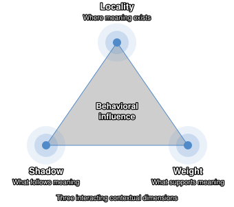

  

# Context Triad

## Abstract

Instructions, definitions, and task-state assertions may remain present and recoverable in a language model's context without reliably governing its later behavior. The Context Triad examines this gap through three complementary perspectives: **Semantic Locality**, the placement and distribution of representations relative to their points of use; **Semantic Shadow**, the effects of subsequent context and ordering on earlier influence; and **Semantic Weight**, the balance of coherent support among competing meanings. The framework distinguishes semantic objects from their contextual representations and separates consistency with an earlier object from correctness under an authorized update. It proposes positional profiles, semantic-continuation contrasts, and support–response measurements to assess how these relationships shape behavior, individually and in interaction. The central prediction is that changes in arrangement, contextual history, and represented support can suppress, preserve, or restore behavioral influence even when the underlying meaning remains available.

## Introduction

> **Behavioral influence of meaning in context depends on its position, subsequent context, and support relative to competing meanings**

The Context Triad develops this thesis through three complementary perspectives:

- **Semantic Locality** examines the placement and distribution of representations relative to use
- **Semantic Shadow** examines how subsequent context suppresses, amplifies, or redirects earlier influence
- **Semantic Weight** examines the balance of coherent support among competing objects

The framework distinguishes meaning’s presence and recoverability from its effectiveness in governing behavior. This paper develops the perspectives and their interactions, while the component papers propose operational measures, testable predictions, and controlled comparisons for evaluating their combined explanatory and predictive value.

Empirical investigations of these relationships are documented separately in the [Context Triad Studies](./Studies/README.md#context-triad-studies).

## Thesis: Semantic Presence Is Not Behavioral Influence

A model-facing requirement has three distinct statuses: it can be present in the input, recoverable when requested, and effective in governing a later operation. An evaluation that asks a model to repeat an instruction therefore answers a different question from an evaluation that tests whether the instruction governs a conflicting action.

The triad's thesis is:

> **Contextual influence must be studied through the arrangement, history, and relative support of represented meaning, not through its presence alone.**

A requirement appears somewhere, coexists with supporting and competing representations, and must remain effective across relevant operations. These relationships remain distinct even when a practical prompt edit changes several at once.

The program builds on research on long-context position sensitivity, contradictory information, and multi-turn state maintenance. The component papers connect that literature to definitions of the three concepts, their behavioral effects, their interactions, and their quantification.

## The Shared Object of Study

**In plain language.** The triad examines whether a meaning changes what the model does, not simply whether that meaning remains somewhere in the prompt.

A **semantic object** is a unit of intended meaning whose downstream behavioral consistency can be evaluated: for example, a constraint, definition, priority, interpretation rule, or task-state assertion. A **representation** is a contextual expression of that object. One object may have several representations, including restatements, examples, and references to a remotely defined rule.

A **point of use** is the operation at which that meaning must affect interpretation or behavior. An object can have several points of use, with different contextual relationships at each one.

**Consistency with an object is distinct from correctness under the authorized current state.** When an authorized update supersedes an earlier rule, correctness requires the updated rule to govern. Authority and scope are task properties distinct from recency and represented support.

### Quantification

Write $E_A(C)$ for measured behavioral consistency with object $A$ under complete active context $C$, including the task. Depending on the object, the score concerns instruction adherence, value preservation, definition-consistent interpretation, or state-consistent action. The component papers share a measurement convention and define contrasts that quantify changes in this quantity. Current-state correctness is separately represented by $Q(C;R_n)$ in the [Shadow paper](./Semantic_Shadow.md#shadow-task-state), where $R_n$ is the authorized current state.

## Three Complementary Perspectives

| Perspective | Distinctive question | Quantification |
| --- | --- | --- |
| [Semantic Locality](./Semantic_Locality.md#paper-semantic-locality) | How does behavior change when the same representations occupy different positions relative to use? | Positional geometry and position–response profiles |
| [Semantic Shadow](./Semantic_Shadow.md#paper-semantic-shadow) | How does subsequent context relevant to an earlier object change its influence, and how does that change depend on order? | Signed semantic-continuation, order, and matched-history contrasts |
| [Semantic Weight](./Semantic_Weight.md#paper-semantic-weight) | How does behavior change when the balance of coherent support changes? | Support proxies and support–response profiles |

### Locality: Where Representations Are Available for Use

Locality studies the placement of representations relative to use. Relevant geometry includes distance to use, position within the context, local structural surroundings, and the distribution of multiple representations. It includes the placement of relevant competitors.

A local reference can occur immediately before the task while its meaning depends on a remote definition. Adding a nearby restatement creates support and changes the placement profile; relocating an existing representation preserves the support total.

**Quantification.** Sequence distance, normalized position, and placement profiles describe where representations occur relative to use. Position–response functions and contrasts quantify the associated changes in behavioral consistency.

### Shadow: How Subsequent Context Changes Influence

Shadow studies order-sensitive changes in an earlier object's later influence. Subsequent material can compete with the object, reinforce it, reinterpret it, or explicitly supersede it.

**Quantification.** Signed contrasts distinguish suppression from reinforcement. Matched neutral continuations distinguish semantic exposure from added length. Before/after comparisons quantify order dependence while maintaining the declared amount of competing support. Consistency with an earlier object and correctness under the resolved current state remain separate quantities.

### Weight: How Support Is Balanced

Weight describes represented coherent support relative to the objects relevant to a decision. Support includes direct statements, repetition, paraphrase, examples, and other declared reinforcement.

**Quantification.** The Weight paper defines token- and unit-based support proxies, competitive shares and ratios, and absolute support totals. Support share measures represented balance; behavioral consistency measures the response. Support–response functions describe sensitivity, saturation, and the effect of absolute scale at equal ratios.

## How the Three Work Together

The perspectives describe interacting relationships with the same behavioral outcome. A contextual change's effect can vary with arrangement, contextual history, and support balance.

### Locality and Shadow

An earlier rule's response to later competition may depend on where the rule and competitor occur. A placement profile under neutral context need not have the same behavioral effect under conflicting examples or revisions.

Changing competitor order also changes competitor position. The order contrast measures the resulting order-dependent competition, including the position dependence of competition.

**Quantification.** Compare locality contrasts under neutral and competing histories, or compare Shadow's order contrast at different target layouts. The difference between these conditional effects measures the interaction on the chosen response scale.

### Locality and Weight

Additional support may compensate for unfavorable placements, and distributed support may differ from one concentrated block at the same measured total. Placement profiles and support measurements describe how amount and arrangement jointly relate to behavior.

**Quantification.** Compare a locality contrast at different support levels, or a support contrast at different placements. The component papers express these interactions as differences between conditional effects, with competitor and support-span positions included in the geometry.

### Shadow and Weight

Strongly and lightly supported objects may respond differently to subsequent competition, and later competition may change the support needed to retain an earlier rule's influence. Competing, reinforcing, and superseding material differ in their semantic relationship and intended state transition.

**Quantification.** Compare Shadow's order contrast at different support levels, or compare the same support-ratio contrast across matched contextual histories. Support amounts and semantic relations determine what each conditional comparison describes.

### Joint Behavior

A realistic context intervention can alter arrangement, history, and support simultaneously. The perspectives describe these interacting changes rather than separate internal mechanisms.

**Quantification.** The component papers quantify interactions as differences between conditional effects. A change in a pairwise interaction across levels of the remaining dimension describes a three-way interaction. Such differences depend on the response scale and the contexts being compared; they do not imply an additive decomposition of a compound change.

## Compound Context Changes

Consider a hypothetical early requirement:

~~~text
Preserve every source identifier exactly.
~~~

Later context supplies a long collection of examples that rename identifiers, followed by a transformation task.

From the locality perspective, the preservation rule is farther from use and the new examples occupy their own positions. From the shadow perspective, competing material follows the rule. From the weight perspective, more represented support favors renaming.

Suppose a local reminder restores exact preservation. The reminder creates a new representation, adds support, and changes the subsequent context.

Several common operations admit the same analysis:

| Operation | Why it is a compound change |
| --- | --- |
| Append a competing section | Changes the target-to-use geometry, subsequent context, and competing support |
| Repeat a rule near the task | Adds a local representation and support while changing the subsequent context |
| Replace amendments with a current-state block | Resolves history and changes wording, placement, length, and support distribution |
| Compress or reconstruct context | Can preserve propositions while changing their locations, prominence, and represented balance |

**Quantification.** The difference $E_A(C_2)-E_A(C_1)$ describes the overall change in consistency between two contexts. Locality, Shadow, and Weight measures describe the corresponding changes in placement, contextual history, and support. An overall difference alone does not assign the change to any one perspective.

## Everyday Examples of the Context Triad

The following hypothetical examples illustrate the three primary dimensions individually, followed by an example of their joint influence. These examples illustrate how semantic influence may support or undermine the user's initial intent. The dimensions describe contextual relationships rather than inherently beneficial or detrimental behavior.

### Summarizing a Project — Locality

> *Initial intent: The user wants a project summary that includes an important deadline.*

A lengthy project document states, “The deadline is Friday.” The statement appears near the beginning, far from the final summarization request. The agent produces a summary but omits the deadline.

When the same statement is relocated immediately before the summary request, the agent includes it.

- **Semantic Locality:** The requirement's position relative to use changes while its wording and amount of represented support remain constant.

No competing deadline or additional reinforcement is introduced. The example emphasizes how placement alone may affect behavioral consistency.

---

### Rescheduling a Meeting — Shadow

> *Initial intent: The user wants a meeting agenda reflecting the currently authorized schedule.*

A person tells an agent, “The meeting starts at 2 PM.”

Later, the organizer provides an update. Compare two possibilities:

- “We might move the meeting to 3 PM.”
- “We have moved the meeting to 3 PM.”

In the first case, the agent should retain 2 PM as the confirmed time. In the second, it should use 3 PM.

An inappropriate outcome would occur if the agent treated the tentative update as a confirmed change or retained the original time after the change had been confirmed.

- **Semantic Shadow:** The meaning of the later statement in relation to the original schedule determines whether the earlier information remains governing or is superseded.

The position and amount of represented scheduling information are similar. What changes is the meaning of the subsequent authorized communication.

---

### Comparing Designs — Weight

> *Initial intent: The user wants an evenhanded comparison of two equally viable designs.*

An agent receives descriptions of two logo designs. Design A is repeatedly described as attractive, memorable, and visually appealing. Design B receives one brief positive description.

Although no new objective evidence favors A, the agent strongly recommends it. Reversing the balance of positive descriptions could shift the recommendation toward B.

When both designs receive comparable descriptive support, the agent produces an evenhanded comparison without disproportionately favoring either design.

- **Semantic Weight:** Repeated coherent support favors one design over another, potentially influencing the outcome independently of their actual merits.

The example emphasizes how represented support can affect a decision without changing the user's original criteria.

---

### Choosing a Restaurant — Locality + Shadow + Weight

> *Initial intent: The user wants a restaurant that provides outdoor seating.*

A person tells an agent, “The restaurant must have outdoor seating.”

The conversation continues with numerous recommendations praising indoor dining rooms. When asked to choose a restaurant, the agent recommends one without outdoor seating.

Three dimensions may explain this behavior:

- **Semantic Locality:** The outdoor-seating requirement is far from the final decision.
- **Semantic Shadow:** Later descriptions of indoor dining compete with the earlier requirement.
- **Semantic Weight:** Repeated support for indoor dining outweighs the single representation favoring outdoor seating.

Repeating “Outdoor seating is required” immediately before the decision changes all three dimensions: it brings the requirement closer to use, reinforces it after competing context, and increases its represented support.

In this revised arrangement, the agent recommends a restaurant with outdoor seating, preserving the user's original requirement despite the competing descriptions.

The example illustrates how meaning can remain present yet fail to govern behavior. Determining each dimension's contribution requires controlled comparisons.

These examples emphasize the primary relationships being examined, not necessarily the absence of other influences. Controlled comparisons are required to isolate individual effects and establish their interactions.

Examples of the compound and higher-order relationships developed from these dimensions are provided in the [Extended Context Triad](./Extended_Context_Triad.md#paper-extended-context-triad).

## Common Behavioral Outcomes and Dynamics

Variations in Semantic Locality, Semantic Shadow, and Semantic Weight produce behavioral outcomes through their individual and combined influences. These effects are characterized through two complementary classifications: **behavioral outcomes**, describing how represented meaning ultimately governs behavior, and **behavioral dynamics**, describing how that influence changes as the triad's dimensions vary.

### Behavioral Outcomes

| Category | Description |
|---|---|
| **Preservation** | Intended meaning remains effective despite changes in contextual conditions |
| **Suppression** | Meaning loses some or all of its behavioral influence |
| **Displacement** | Competing meaning becomes behaviorally dominant over the original |
| **Transformation** | Meaning remains influential but is reinterpreted, blended, or altered in application |
| **Resolution** | Competing or changing meanings are reconciled according to their legitimate authority and scope |

These categories characterize the resulting behavioral influence of meaning under different dimensional configurations.

### Behavioral Dynamics

Behavioral dynamics characterize how the effects of Locality, Shadow, and Weight interact as their configurations change.

| Dynamic | Description |
|---|---|
| **Reinforcement** | Influences strengthen the same behavioral tendency |
| **Interference** | Influences oppose or weaken one another |
| **Compensation** | One influence offsets another's disadvantage |
| **Dominance** | One influence prevails despite competing influences |
| **Recovery** | Previously weakened meaning regains behavioral effectiveness |
| **Reversal** | An influence changes direction under different contextual conditions |
| **Saturation** | Additional favorable influence produces diminishing behavioral gains |
| **Threshold** | A relatively small contextual change produces a substantial behavioral shift |
| **Instability** | Behavioral consistency varies across otherwise matched conditions |

Different dimensional configurations produce distinct interaction patterns, while multiple configurations can converge on the same behavioral outcome.

### Relationship to the Triad

The three dimensions characterize the contextual relationships governing semantic influence. Their variation produces behavioral dynamics that shape observable outcomes.

Together, these classifications connect **contextual configuration, interaction behavior, and resulting semantic influence**, providing a structured vocabulary for describing how changes in Locality, Shadow, and Weight affect model behavior.

## Scope and Evidence Status

The triad describes interacting behavioral relationships within represented active context, rather than separate internal mechanisms. Changes in training, tool execution, and unavailable or truncated information are outside this account of represented context.

**Evidence status.** This paper develops the conceptual and measurement framework. Empirical investigations are reported separately in the [Context Triad Studies](./Studies/README.md#context-triad-studies).

| Study | Empirical focus | Evidence |
| --- | --- | --- |
| [Glip Preference Anchoring](./Studies/Glip_Preference_Anchoring.md) | Label, position, and competing-context sensitivity | 360 trials |
| [Fox–Leopard Displacement](./Studies/Fox_Leopard_Displacement.md) | Descriptive support, answer selection, and position-dependent effects | 360 trials |
| [Planetary Chain Activation](./Studies/Planetary_Chain_Activation.md) | Order-dependent associative recognition | Three-condition pilot |

These studies provide empirical grounding for aspects of the framework while identifying relationships requiring further controlled investigation and replication.

## Conclusion

The Context Triad connects placement, contextual history, and relative support to the behavioral effectiveness of represented meaning. Locality supplies position–response measurements; Shadow supplies semantic-history contrasts; Weight supplies support–response measurements. Together, they describe how represented meaning affects behavior, how the three perspectives interact, and how those relationships can be quantified.

## Research Atlas

The [Context Triad Research Atlas](./Research_Atlas.md#context-triad-research-atlas) overlays established research and engineering practices onto the primary Triad and proposed compound constructs, distinguishing direct factor evidence, related empirical evidence, and applied engineering.

## Related Papers

- [Context Triad Model](./Context_Triad_Model/README.md#paper-context-triad-model)
- [Model-Native Structural Representation](../Model_Native_Structural_Representation.md#paper-mnsr)
- [Interpretive Efficiency](../ArcGrav_Interpretive_Efficiency.md#paper-interpretive-efficiency)
- [Syntax Efficiency](../ArcGrav_Syntax_Efficiency.md#paper-syntax-efficiency)
- [Representational Capacity Reclamation](../Representational_Capacity_Reclamation.md#paper-rcr)
- [Operational Leverage](../Operational_Leverage/README.md#paper-operational-leverage)

