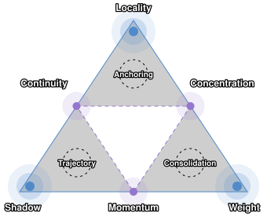

  

# Extended Context Triad

## Abstract

The Extended Context Triad develops the relationships between Semantic Locality, Semantic Shadow, and Semantic Weight through six compound and higher-order constructs. Semantic Continuity, Semantic Concentration, and Semantic Momentum characterize the persistence, distribution, and accumulation of semantic influence. Semantic Anchoring, Semantic Trajectory, and Semantic Consolidation characterize the attachment, progression, and convergence of that influence.

## Introduction

> **The interaction of semantic locality, shadow, and weight gives rise to compound relationships that characterize the persistence, direction, and organization of semantic influence**

The Extended Context Triad develops the relationships established within the [Context Triad](./Context_Triad.md#paper-context-triad) across three levels:

- **Primary dimensions** characterize the foundational relationships of contextual semantic influence.
- **Compound dimensions** characterize relationships between pairs of primary dimensions.
- **Higher-order dimensions** characterize relationships between pairs of compound dimensions.

The derived dimensions describe conceptual compositions rather than independent mechanisms. Examples of the primary dimensions and their joint influence are provided in the [Context Triad](./Context_Triad.md#everyday-examples-of-the-context-triad).

## Primary Dimensions

The three primary dimensions are established within the Context Triad:

- **[Semantic Locality](./Semantic_Locality.md#paper-semantic-locality)** — the placement and distribution of semantic representations relative to their points of use.
- **[Semantic Shadow](./Semantic_Shadow.md#paper-semantic-shadow)** — the effects of subsequent context and ordering on earlier semantic influence.
- **[Semantic Weight](./Semantic_Weight.md#paper-semantic-weight)** — the balance of coherent support among competing semantic objects.

## Compound Dimensions

The compound dimensions characterize relationships arising from the interaction of two primary dimensions.

### Semantic Continuity

*Locality + Shadow*

> **The persistence of semantic influence across contextual development**

Semantic Continuity characterizes the persistence of a semantic object's behavioral influence as context develops and positional relationships change.

Continuity concerns the relationship between the placement of representations and the effects of intervening context. Meaning can remain effective across successive operations despite increasing distance from its original representations and exposure to subsequent material.

Continuity can be maintained through existing representations or renewed through their reintroduction at relevant points within context.

### Semantic Concentration

*Locality + Weight*

> **The distribution of coherent semantic support relative to points of use**

Semantic Concentration characterizes the arrangement of represented support within context relative to the operations that support is intended to influence.

Concentration concerns the relationship between the amount of coherent support and its positional distribution. Equivalent amounts of support can be organized within a single contextual region or distributed across multiple regions, creating different relationships between support and use.

Concentration describes the organization of semantic support rather than its amount alone.

### Semantic Momentum

*Shadow + Weight*

> **The direction and accumulation of semantic influence through contextual history**

Semantic Momentum characterizes how the influence of meaning develops as supporting and competing representations accumulate through context.

Momentum concerns the relationship between the order of contextual exposure and the changing balance of coherent support. Successive representations can reinforce an established direction of influence, weaken it, or redirect it toward a competing semantic object.

Momentum describes the directional development of influence rather than the balance of support at a single contextual state.

## Higher-Order Dimensions

The higher-order dimensions characterize relationships arising from the interaction of two compound dimensions. Each encompasses all three primary dimensions through a distinct composition.

### Semantic Anchoring

*Continuity + Concentration*

> **The sustained attachment of semantic influence to relevant points of use**

Semantic Anchoring characterizes the persistence of semantic influence in relation to the operations it is intended to govern.

Anchoring concerns the relationship between continuity across contextual development and the distribution of coherent support around relevant points of use.

Where Continuity describes whether influence persists and Concentration describes how support is distributed, Anchoring describes whether that influence remains associated with the operations that depend on it.

### Semantic Trajectory

*Continuity + Momentum*

> **The evolution of semantic influence across successive operations**

Semantic Trajectory characterizes the course of semantic influence as context develops.

Trajectory concerns the relationship between the persistence of influence and its changing strength and direction. Across successive operations, meaning can retain its influence, become increasingly dominant, diminish, or undergo reinterpretation.

Where Continuity describes persistence and Momentum describes directional development, Trajectory describes the resulting progression of influence across contextual states.

### Semantic Consolidation

*Concentration + Momentum*

> **The organization and accumulation of coherent semantic support around a common meaning**

Semantic Consolidation characterizes the convergence of represented support around a semantic object as context develops.

Consolidation concerns the relationship between the distribution of coherent support and its accumulation through contextual history. Representations distributed across context can collectively reinforce a common interpretation, constraint, or behavioral direction.

Where Concentration describes the arrangement of support and Momentum describes its directional development, Consolidation describes the convergence of that support around a common meaning.

## Everyday Examples of the Extended Context Triad

The following hypothetical examples illustrate the three compound dimensions and the three higher-order dimensions. They are not empirical findings or controlled demonstrations of the derived constructs.

### Software Development — Semantic Continuity

> *Initial intent: The user wants a software bug fixed without changing the existing function interface.*

A developer tells an AI agent, “Fix the parsing bug, but do not change the function's parameters.”

After reviewing a lengthy collection of unrelated code, the agent encounters a newer example that fixes a similar bug by changing the parameters. It follows that example, unintentionally breaking existing callers.

Two dimensions are particularly relevant:

- **Semantic Locality:** The original constraint is far from the code modification where it must be applied.
- **Semantic Shadow:** The later example introduces a competing implementation pattern that redirects the earlier constraint's influence.

Moving the original constraint closer to the modification, or replacing the conflicting example with a compatible one, could improve adherence through different contextual changes.

This example illustrates **Semantic Continuity**: how placement and subsequent competition can affect the persistence of a constraint's influence without requiring extensive repetition of competing instructions.

---

### Preparing a Packing List — Semantic Concentration

> *Initial intent: The user wants a camping checklist that includes a rain jacket.*

A camper tells an agent, “Make sure I pack a rain jacket.”

After reviewing a lengthy itinerary, the agent produces a checklist but omits the jacket.

In a revised itinerary, the requirement appears again beside the hiking plans and once more near the final checklist request. The agent includes the jacket.

- **Semantic Locality:** Representations of the requirement now appear closer to where the checklist is created.
- **Semantic Weight:** Multiple consistent reminders provide greater support for including the jacket.

No competing packing instructions are introduced. The example illustrates **Semantic Concentration**: how proximity and repeated support can jointly strengthen a requirement's influence through the distribution of support relative to use.

---

### Writing an Announcement — Semantic Momentum

> *Initial intent: The user wants a factual, neutral announcement without promotional language.*

A person tells an agent, “Write a neutral announcement about our new product.”

The agent then receives several enthusiastic sample announcements filled with phrases such as “revolutionary,” “incredible,” and “game-changing.” Its final announcement adopts the same promotional tone.

Two dimensions are particularly relevant:

- **Semantic Shadow:** The later examples establish a competing tone that redirects the original writing instruction.
- **Semantic Weight:** Multiple examples reinforce promotional language, while neutrality receives only one explicit statement.

Replacing several enthusiastic examples with neutral ones changes both the subsequent context and the balance of represented support, potentially restoring the intended tone.

This example illustrates **Semantic Momentum**: how later competing meaning and repeated reinforcement can redirect writing style as context develops, even when the original instruction remains available.

---

### Preparing a Survey Report — Semantic Anchoring

> *Initial intent: The user wants a survey report that preserves the anonymity of participants.*

A person tells an agent, “Do not include participant names or identifying details in the report.” The agent must select survey excerpts, summarize the findings, and assemble the final report. Later examples of reports that attribute quotations to named participants introduce a competing reporting pattern without changing the original requirement.

In one arrangement, consistent reminders of the anonymity requirement appear together early in the conversation. In another, the same reminders are distributed near excerpt selection, findings summarization, and final report assembly. The agent might preserve participant anonymity more consistently at each of these operations in the second arrangement.

- **Semantic Continuity:** The anonymity requirement continues to govern behavior despite later contextual development.
- **Semantic Concentration:** Coherent support for anonymity is distributed in relation to the operations that depend on it.

**Semantic Anchoring** concerns the sustained attachment of the anonymity requirement to each relevant operation. A requirement that governs the selection of excerpts but not the assembly of the final report would exhibit weaker anchoring across these operations.

---

### Planning a Birthday Party — Semantic Trajectory

> *Initial intent: The user wants to organize a birthday party without exceeding a $200 budget.*

A person tells an agent, “Keep the total cost of the party under $200.” Initially, the agent rejects suggestions that exceed the budget and proposes an affordable plan.

After reviewing several elaborate party plans, the agent begins suggesting expensive extras, marking them as optional. As further examples accumulate, it incorporates those extras into its main plan, bringing the total to $280.

When the person restates the budget and provides examples of affordable parties, the agent revises the plan to meet the original constraint.

- **Semantic Continuity:** The budget initially governs the agent's decisions, loses influence during successive revisions, and becomes effective again.
- **Semantic Momentum:** Accumulating support for elaborate parties shifts the agent's recommendations toward more expensive options, while subsequent support for affordable alternatives redirects them.

This example illustrates **Semantic Trajectory**: the progression of the budget constraint's influence from adherence through weakening and eventual recovery across successive operations.

---

### Organizing Family Photos — Semantic Consolidation

> *Initial intent: The user wants to organize and edit family photos without altering the original files.*

A person tells an agent, “Keep all original photos unchanged.”

As the task develops, a folder description identifies the originals as read-only, an editing checklist specifies that adjustments must be made to copies, and export instructions direct edited photos to a separate folder.

These representations appear in different parts of the context and accumulate as the task develops. Each expresses or reinforces the same underlying requirement in a form relevant to a particular operation.

- **Semantic Concentration:** Coherent support for preserving the originals is distributed across the folder description, editing checklist, and export instructions.
- **Semantic Momentum:** Successive representations reinforce the same preservation requirement.

When the agent prepares the workflow, it treats the originals as files to preserve rather than overwrite. This example illustrates **Semantic Consolidation**: how distributed and accumulating semantic support can converge around a common requirement.

## Conclusion

The Extended Context Triad connects the foundational relationships of placement, contextual history, and relative support to the compound relationships of persistence, distribution, and directional development. These relationships extend into higher-order descriptions of attachment, progression, and convergence.

Together, the nine dimensions characterize how semantic influence is situated, sustained, developed, and organized within context.
