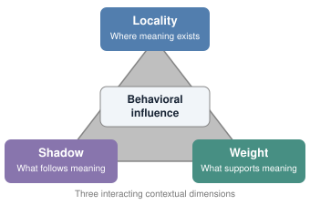

  

# Context Triad — Research Portal

The Context Triad is a research framework for examining how the placement, subsequent history, and relative support of represented meaning affect language-model behavior. Its central distinction is between meaning that remains present or recoverable in context and meaning that actually governs a later operation.

## Core Framework

| Paper | Role |
| --- | --- |
| [Context Triad](./Context_Triad.md#paper-context-triad) | Unified framework, shared definitions, interactions, and measurement strategy |
| [Semantic Locality](./Semantic_Locality.md#paper-semantic-locality) | Placement and distribution of representations relative to use; positional profiles and response contrasts |
| [Semantic Shadow](./Semantic_Shadow.md#paper-semantic-shadow) | Subsequent semantic context and order-sensitive influence; suppression, reinforcement, reinterpretation, and supersession |
| [Semantic Weight](./Semantic_Weight.md#paper-semantic-weight) | Coherent support relative to competing meanings; support proxies, ratios, and response measurements |

## Extended Framework and Research Atlas

| Document | Role |
| --- | --- |
| [Extended Context Triad](./Extended_Context_Triad.md#paper-extended-context-triad) | Develops six proposed compound and higher-order constructs from the primary dimensions: Continuity, Concentration, Momentum, Anchoring, Trajectory, and Consolidation |
| [Context Triad Research Atlas](./Research_Atlas/README.md#context-triad-research-atlas) | Maps established external research and engineering practices onto the primary and proposed derived constructs, distinguishing direct factor research, related evidence, and applied engineering |

## Interactive Model

The [Context Triad Model](./Context_Triad_Model/README.md#paper-context-triad-model) provides an interactive visual demonstration of how Locality, Shadow, and Weight may interact.

## Empirical Studies

| Study | Focus |
| --- | --- |
| [Studies index](./Studies/README.md#context-triad-studies) | catalogs investigations, their evidence status, and collection conventions |
| [Fox–Leopard Displacement](./Studies/Fox_Leopard_Displacement.md#paper-fox-leopard-answer-displacement) | Semantic weight, pangram inference, and answer displacement across fixed-slot layouts; 360 scored trials |
| [Planetary Chain Activation](./Studies/Planetary_Chain_Activation.md#paper-planetary-chain-activation) | Order-dependent associative recognition; three-condition reported pilot |
| [Glip Preference Anchoring](./Studies/Glip_Preference_Anchoring.md#paper-glip-preference-anchoring) | Label, description, position, and rival-order dependence in criterion-free selection; 360 trials |
