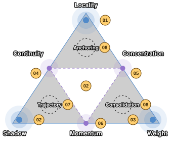
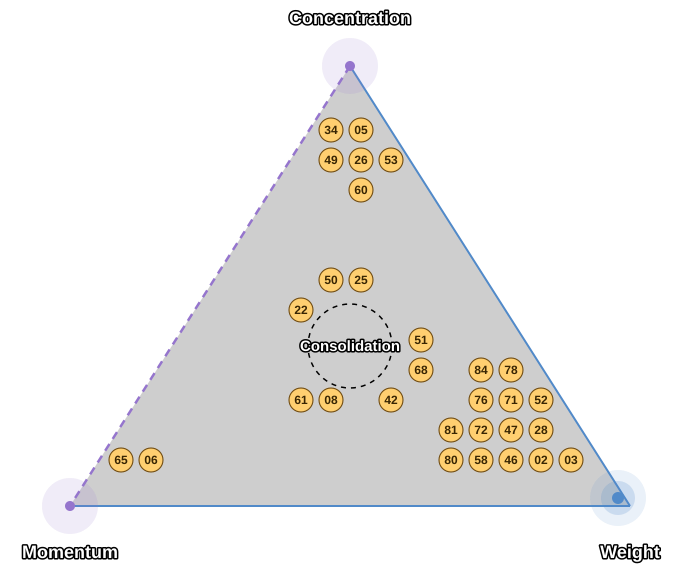

  

# Context Triad Research Atlas

The Research Atlas maps established research and applied engineering practices onto the [Context Triad](./Context_Triad.md#context-triad) and its proposed compound constructs. Its purpose is to relate existing findings, identify overlapping contextual relationships, and guide further investigation rather than claim that the underlying phenomena are newly discovered.

## Reading the Map

Amber numbered points identify external publications. Repeated numbers refer to the same publication in more than one location. The main Atlas retains the original overview; the four regions below expand its three outer corners and inverted central triangle. The original dimensional markers and triangular geometry are retained; the research points are a separate layer.

Positions represent conceptual associations, not measured coordinates, effect sizes, publication counts, or evidence strength. The compound and higher-order constructs are proposed descriptive abstractions, not established independent variables or validated mechanisms.

## Construct Relationships

| Level | Construct | Composition | Proposed focus |
| --- | --- | --- | --- |
| Primary | [Semantic Locality](./Semantic_Locality.md) | — | Placement and distribution relative to use |
| Primary | [Semantic Shadow](./Semantic_Shadow.md) | — | Subsequent context and order-sensitive influence |
| Primary | [Semantic Weight](./Semantic_Weight.md) | — | Relative coherent support |
| Compound | Semantic Continuity | Locality + Shadow | Persistence of influence across contextual development |
| Compound | Semantic Concentration | Locality + Weight | Distribution of coherent support relative to use |
| Compound | Semantic Momentum | Shadow + Weight | Direction and accumulation of influence through contextual history |
| Higher-order | Semantic Anchoring | Continuity + Concentration | Attachment of influence to relevant points of use |
| Higher-order | Semantic Trajectory | Continuity + Momentum | Evolution of influence across successive operations |
| Higher-order | Semantic Consolidation | Concentration + Momentum | Organization and accumulation of support around an interpretation |

The plus signs indicate conceptual composition, not arithmetic addition or statistical interaction estimates. Consistency with a historical object remains distinct from correctness under the authorized current state.

**Expanded regions:** [Locality](#locality-research-atlas) · [Shadow](#shadow-research-atlas) · [Weight](#weight-research-atlas) · [Behavioral](#behavioral-research-atlas) · [Research Index](#research-index).

## Locality Research Atlas

  

Placement and distribution relative to use; persistence, coherent support and attachment to relevant operations.

The SVG displays 30 distinct publication identifiers once in this region. A source may relate to more than one construct; the tables preserve those associations. Cross-disciplinary and methodological references are indexed but not plotted. Positions are illustrative; no geometric distance or density is a measurement.

### Semantic Locality (Locality region)

| Point | Publication | Regional relevance | Evidence relationship |
| --- | --- | --- | --- |
| [R01](#r01) | Liu, N. F., et al. (2024) | Information position and retrieval; candidate relevance to Locality. | Direct factor research |
| [R02](#r02) | Kurfali, M., & Östling, R. (2025) | Position, repetition and conflict; candidate relevance to Locality. | Direct factor research |
| [R09](#r09) | Bajaj, A., et al. (2026) | Temporal and positional retrieval biases; candidate relevance to Locality. | Direct factor research |
| [R17](#r17) | Gibson, E. (1998) | Human syntactic dependency distance and integration cost; candidate relevance to Locality. | Cross-disciplinary conceptual research |
| [R26](#r26) | Hsieh, C.-P., et al. (2024) | Effective long-context capability evaluation; candidate relevance to Locality. | Related empirical evidence |
| [R27](#r27) | Hsieh, C.-Y., et al. (2024) | Positional attention bias and calibration; candidate relevance to Locality. | Direct factor research |
| [R36](#r36) | Khot, T., et al. (2022) | Modular task-specific prompting; candidate relevance to Locality. | Related empirical evidence |
| [R38](#r38) | Lewis, R. L., & Vasishth, S. (2005) | Human retrieval and interference model; candidate relevance to Locality. | Cross-disciplinary conceptual research |
| [R45](#r45) | Liu, Y., Zeng, X., Shao, C., Meng, F., & Zhou, J. (2024) | Instruction placement in sequence generation; candidate relevance to Locality. | Direct factor research |
| [R46](#r46) | Lu, Y., et al. (2022) | Few-shot demonstration-order sensitivity; candidate relevance to Locality. | Direct factor research |
| [R49](#r49) | Modarressi, A., et al. (2025) | Long-context retrieval beyond literal matching; candidate relevance to Locality. | Direct factor research |
| [R58](#r58) | Shi, F., et al. (2023) | Interference from irrelevant context; candidate relevance to Locality. | Direct factor research |
| [R60](#r60) | Tian, R., et al. (2025) | Distance between relevant information pieces; candidate relevance to Locality. | Direct factor research |
| [R79](#r79) | Zhang, M., Meng, Z., & Collier, N. (2024) | Location guidance and position bias; candidate relevance to Locality. | Direct factor research |

### Semantic Continuity (Locality region)

| Point | Publication | Regional relevance | Evidence relationship |
| --- | --- | --- | --- |
| [R02](#r02) | Kurfali, M., & Östling, R. (2025) | Position, repetition and conflict; candidate relevance to Continuity. | Direct factor research |
| [R04](#r04) | Li, K., et al. (2024) | Instruction stability across turns; candidate relevance to Continuity. | Related empirical evidence |
| [R07](#r07) | Laban et al. (2025) | Multi-turn unreliability and premature assumptions; candidate relevance to Continuity. | Related empirical evidence |
| [R14](#r14) | Deshpande, K., et al. (2025) | Multi-turn conversation evaluation; candidate relevance to Continuity. | Related empirical evidence |
| [R16](#r16) | Epstein, E. L., et al. (2024) | Multimodal multi-turn instruction following; candidate relevance to Continuity. | Related empirical evidence |
| [R20](#r20) | Han, C., et al. (2025) | Interdependent instructions across turns; candidate relevance to Continuity. | Related empirical evidence |
| [R33](#r33) | Jia, Q., et al. (2026) | Evolving multi-turn instruction requirements; candidate relevance to Continuity. | Related empirical evidence |
| [R39](#r39) | Li, J., Li, J., Wang, Y., Chang, Y., & Wu, Y. (2025) | Inter-turn structural relations; candidate relevance to Continuity. | Related empirical evidence |
| [R51](#r51) | Packer, C., et al. (2023) | Structured context and memory management; candidate relevance to Continuity. | Applied engineering |
| [R66](#r66) | Wallace, E., et al. (2024) | Instruction authority and conflict resolution; candidate relevance to Continuity. | Related empirical evidence |
| [R74](#r74) | Wu, D., et al. (2025) | Long-term interactive memory and updates; candidate relevance to Continuity. | Related empirical evidence |
| [R82](#r82) | Zhou, D., et al. (2023) | Successive task decomposition; candidate relevance to Continuity. | Related empirical evidence |

### Semantic Concentration (Locality region)

| Point | Publication | Regional relevance | Evidence relationship |
| --- | --- | --- | --- |
| [R02](#r02) | Kurfali, M., & Östling, R. (2025) | Position, repetition and conflict; candidate relevance to Concentration. | Direct factor research |
| [R05](#r05) | Agrawal, D., Gao, S., & Gajek, M. (2024) | Instruction reminders and in-context retrieval; candidate relevance to Concentration. | Related empirical evidence |
| [R10](#r10) | Chandra, A., & Krovi, R. (1999) | Representational congruence in human information retrieval; candidate relevance to Concentration. | Cross-disciplinary conceptual research |
| [R26](#r26) | Hsieh, C.-P., et al. (2024) | Effective long-context capability evaluation; candidate relevance to Concentration. | Related empirical evidence |
| [R34](#r34) | Jiang, H., et al. (2023) | Prompt compression and retention; candidate relevance to Concentration. | Applied engineering |
| [R49](#r49) | Modarressi, A., et al. (2025) | Long-context retrieval beyond literal matching; candidate relevance to Concentration. | Direct factor research |
| [R53](#r53) | Pan, Z., et al. (2024) | Faithful prompt compression; candidate relevance to Concentration. | Applied engineering |
| [R60](#r60) | Tian, R., et al. (2025) | Distance between relevant information pieces; candidate relevance to Concentration. | Direct factor research |
| [R63](#r63) | Vessey, I. (1991) | Human cognitive fit; candidate relevance to Concentration. | Cross-disciplinary conceptual research |
| [R80](#r80) | Zhang, X., et al. (2025) | Differentiated many-shot reweighting; candidate relevance to Concentration. | Related empirical evidence |
| [R84](#r84) | Zou, K., Khalifa, M., & Wang, L. (2025) | Many-shot context utilization; candidate relevance to Concentration. | Related empirical evidence |

### Semantic Anchoring (Locality region)

| Point | Publication | Regional relevance | Evidence relationship |
| --- | --- | --- | --- |
| [R08](#r08) | Anthropic (2025) | Context selection, compaction and memory; candidate relevance to Anchoring. | Applied engineering |
| [R36](#r36) | Khot, T., et al. (2022) | Modular task-specific prompting; candidate relevance to Anchoring. | Related empirical evidence |
| [R39](#r39) | Li, J., Li, J., Wang, Y., Chang, Y., & Wu, Y. (2025) | Inter-turn structural relations; candidate relevance to Anchoring. | Related empirical evidence |
| [R51](#r51) | Packer, C., et al. (2023) | Structured context and memory management; candidate relevance to Anchoring. | Applied engineering |
| [R68](#r68) | Wang, L., et al. (2023) | Information flow through label representations; candidate relevance to Anchoring. | Theoretical or mechanistic foundation |
| [R74](#r74) | Wu, D., et al. (2025) | Long-term interactive memory and updates; candidate relevance to Anchoring. | Related empirical evidence |
| [R79](#r79) | Zhang, M., Meng, Z., & Collier, N. (2024) | Location guidance and position bias; candidate relevance to Anchoring. | Direct factor research |

## Shadow Research Atlas

  

Subsequent context and order-sensitive influence; persistence, accumulation and progression across operations.

The SVG displays 21 distinct publication identifiers once in this region. A source may relate to more than one construct; the tables preserve those associations. Cross-disciplinary and methodological references are indexed but not plotted. Positions are illustrative; no geometric distance or density is a measurement.

### Semantic Shadow (Shadow region)

| Point | Publication | Regional relevance | Evidence relationship |
| --- | --- | --- | --- |
| [R02](#r02) | Kurfali, M., & Östling, R. (2025) | Position, repetition and conflict; candidate relevance to Shadow. | Direct factor research |
| [R09](#r09) | Bajaj, A., et al. (2026) | Temporal and positional retrieval biases; candidate relevance to Shadow. | Direct factor research |
| [R14](#r14) | Deshpande, K., et al. (2025) | Multi-turn conversation evaluation; candidate relevance to Shadow. | Related empirical evidence |
| [R23](#r23) | Hogarth, R. M., & Einhorn, H. J. (1992) | Human sequential belief updating and order effects; candidate relevance to Shadow. | Cross-disciplinary conceptual research |
| [R45](#r45) | Liu, Y., Zeng, X., Shao, C., Meng, F., & Zhou, J. (2024) | Instruction placement in sequence generation; candidate relevance to Shadow. | Direct factor research |
| [R46](#r46) | Lu, Y., et al. (2022) | Few-shot demonstration-order sensitivity; candidate relevance to Shadow. | Direct factor research |
| [R50](#r50) | Olsson, C., et al. (2022) | Mechanistic study of induction heads; candidate relevance to Shadow. | Theoretical or mechanistic foundation |
| [R66](#r66) | Wallace, E., et al. (2024) | Instruction authority and conflict resolution; candidate relevance to Shadow. | Related empirical evidence |
| [R74](#r74) | Wu, D., et al. (2025) | Long-term interactive memory and updates; candidate relevance to Shadow. | Related empirical evidence |
| [R81](#r81) | Zhao, Z., et al. (2021) | Context-induced prediction bias and calibration; candidate relevance to Shadow. | Direct factor research |

### Semantic Continuity (Shadow region)

| Point | Publication | Regional relevance | Evidence relationship |
| --- | --- | --- | --- |
| [R02](#r02) | Kurfali, M., & Östling, R. (2025) | Position, repetition and conflict; candidate relevance to Continuity. | Direct factor research |
| [R04](#r04) | Li, K., et al. (2024) | Instruction stability across turns; candidate relevance to Continuity. | Related empirical evidence |
| [R07](#r07) | Laban et al. (2025) | Multi-turn unreliability and premature assumptions; candidate relevance to Continuity. | Related empirical evidence |
| [R14](#r14) | Deshpande, K., et al. (2025) | Multi-turn conversation evaluation; candidate relevance to Continuity. | Related empirical evidence |
| [R16](#r16) | Epstein, E. L., et al. (2024) | Multimodal multi-turn instruction following; candidate relevance to Continuity. | Related empirical evidence |
| [R20](#r20) | Han, C., et al. (2025) | Interdependent instructions across turns; candidate relevance to Continuity. | Related empirical evidence |
| [R33](#r33) | Jia, Q., et al. (2026) | Evolving multi-turn instruction requirements; candidate relevance to Continuity. | Related empirical evidence |
| [R39](#r39) | Li, J., Li, J., Wang, Y., Chang, Y., & Wu, Y. (2025) | Inter-turn structural relations; candidate relevance to Continuity. | Related empirical evidence |
| [R51](#r51) | Packer, C., et al. (2023) | Structured context and memory management; candidate relevance to Continuity. | Applied engineering |
| [R66](#r66) | Wallace, E., et al. (2024) | Instruction authority and conflict resolution; candidate relevance to Continuity. | Related empirical evidence |
| [R74](#r74) | Wu, D., et al. (2025) | Long-term interactive memory and updates; candidate relevance to Continuity. | Related empirical evidence |
| [R82](#r82) | Zhou, D., et al. (2023) | Successive task decomposition; candidate relevance to Continuity. | Related empirical evidence |

### Semantic Momentum (Shadow region)

| Point | Publication | Regional relevance | Evidence relationship |
| --- | --- | --- | --- |
| [R02](#r02) | Kurfali, M., & Östling, R. (2025) | Position, repetition and conflict; candidate relevance to Momentum. | Direct factor research |
| [R06](#r06) | Zhang et al. (2024) | Earlier errors and subsequent false claims; candidate relevance to Momentum. | Related empirical evidence |
| [R23](#r23) | Hogarth, R. M., & Einhorn, H. J. (1992) | Human sequential belief updating and order effects; candidate relevance to Momentum. | Cross-disciplinary conceptual research |
| [R65](#r65) | von Oswald, J., et al. (2022) | Computational accounts of in-context learning; candidate relevance to Momentum. | Theoretical or mechanistic foundation |
| [R76](#r76) | Xie, S. M., et al. (2022) | Probabilistic account of in-context learning; candidate relevance to Momentum. | Theoretical or mechanistic foundation |

### Semantic Trajectory (Shadow region)

| Point | Publication | Regional relevance | Evidence relationship |
| --- | --- | --- | --- |
| [R07](#r07) | Laban et al. (2025) | Multi-turn unreliability and premature assumptions; candidate relevance to Trajectory. | Related empirical evidence |
| [R14](#r14) | Deshpande, K., et al. (2025) | Multi-turn conversation evaluation; candidate relevance to Trajectory. | Related empirical evidence |
| [R16](#r16) | Epstein, E. L., et al. (2024) | Multimodal multi-turn instruction following; candidate relevance to Trajectory. | Related empirical evidence |
| [R20](#r20) | Han, C., et al. (2025) | Interdependent instructions across turns; candidate relevance to Trajectory. | Related empirical evidence |
| [R33](#r33) | Jia, Q., et al. (2026) | Evolving multi-turn instruction requirements; candidate relevance to Trajectory. | Related empirical evidence |
| [R39](#r39) | Li, J., Li, J., Wang, Y., Chang, Y., & Wu, Y. (2025) | Inter-turn structural relations; candidate relevance to Trajectory. | Related empirical evidence |
| [R70](#r70) | Wei, J., et al. (2022) | Intermediate reasoning sequences; candidate relevance to Trajectory. | Related empirical evidence |
| [R82](#r82) | Zhou, D., et al. (2023) | Successive task decomposition; candidate relevance to Trajectory. | Related empirical evidence |

## Weight Research Atlas

  

Relative coherent support; distribution, accumulation and convergence around an interpretation.

The SVG displays 30 distinct publication identifiers once in this region. A source may relate to more than one construct; the tables preserve those associations. Cross-disciplinary and methodological references are indexed but not plotted. Positions are illustrative; no geometric distance or density is a measurement.

### Semantic Weight (Weight region)

| Point | Publication | Regional relevance | Evidence relationship |
| --- | --- | --- | --- |
| [R02](#r02) | Kurfali, M., & Östling, R. (2025) | Position, repetition and conflict; candidate relevance to Weight. | Direct factor research |
| [R03](#r03) | Jin, M., et al. (2024) | Frequency and consistency of competing evidence; candidate relevance to Weight. | Direct factor research |
| [R28](#r28) | Hu, J., Liu, W., & Du, M. (2024) | Selection of in-context demonstrations; candidate relevance to Weight. | Related empirical evidence |
| [R38](#r38) | Lewis, R. L., & Vasishth, S. (2005) | Human retrieval and interference model; candidate relevance to Weight. | Cross-disciplinary conceptual research |
| [R46](#r46) | Lu, Y., et al. (2022) | Few-shot demonstration-order sensitivity; candidate relevance to Weight. | Direct factor research |
| [R47](#r47) | Min, S., et al. (2022) | Contributions of different demonstration properties; candidate relevance to Weight. | Related empirical evidence |
| [R52](#r52) | Pan, J., et al. (2023) | Task recognition versus task learning; candidate relevance to Weight. | Related empirical evidence |
| [R58](#r58) | Shi, F., et al. (2023) | Interference from irrelevant context; candidate relevance to Weight. | Direct factor research |
| [R71](#r71) | Wei, J., et al. (2023) | Model scale and context-driven task behavior; candidate relevance to Weight. | Related empirical evidence |
| [R72](#r72) | Wei, J., et al. (2023) | Arbitrary labels and contextual associations; candidate relevance to Weight. | Related empirical evidence |
| [R76](#r76) | Xie, S. M., et al. (2022) | Probabilistic account of in-context learning; candidate relevance to Weight. | Theoretical or mechanistic foundation |
| [R78](#r78) | Yu, Z., & Ananiadou, S. (2024) | Similarity-based contextual information selection; candidate relevance to Weight. | Theoretical or mechanistic foundation |
| [R80](#r80) | Zhang, X., et al. (2025) | Differentiated many-shot reweighting; candidate relevance to Weight. | Related empirical evidence |
| [R81](#r81) | Zhao, Z., et al. (2021) | Context-induced prediction bias and calibration; candidate relevance to Weight. | Direct factor research |
| [R84](#r84) | Zou, K., Khalifa, M., & Wang, L. (2025) | Many-shot context utilization; candidate relevance to Weight. | Related empirical evidence |

### Semantic Concentration (Weight region)

| Point | Publication | Regional relevance | Evidence relationship |
| --- | --- | --- | --- |
| [R02](#r02) | Kurfali, M., & Östling, R. (2025) | Position, repetition and conflict; candidate relevance to Concentration. | Direct factor research |
| [R05](#r05) | Agrawal, D., Gao, S., & Gajek, M. (2024) | Instruction reminders and in-context retrieval; candidate relevance to Concentration. | Related empirical evidence |
| [R10](#r10) | Chandra, A., & Krovi, R. (1999) | Representational congruence in human information retrieval; candidate relevance to Concentration. | Cross-disciplinary conceptual research |
| [R26](#r26) | Hsieh, C.-P., et al. (2024) | Effective long-context capability evaluation; candidate relevance to Concentration. | Related empirical evidence |
| [R34](#r34) | Jiang, H., et al. (2023) | Prompt compression and retention; candidate relevance to Concentration. | Applied engineering |
| [R49](#r49) | Modarressi, A., et al. (2025) | Long-context retrieval beyond literal matching; candidate relevance to Concentration. | Direct factor research |
| [R53](#r53) | Pan, Z., et al. (2024) | Faithful prompt compression; candidate relevance to Concentration. | Applied engineering |
| [R60](#r60) | Tian, R., et al. (2025) | Distance between relevant information pieces; candidate relevance to Concentration. | Direct factor research |
| [R63](#r63) | Vessey, I. (1991) | Human cognitive fit; candidate relevance to Concentration. | Cross-disciplinary conceptual research |
| [R80](#r80) | Zhang, X., et al. (2025) | Differentiated many-shot reweighting; candidate relevance to Concentration. | Related empirical evidence |
| [R84](#r84) | Zou, K., Khalifa, M., & Wang, L. (2025) | Many-shot context utilization; candidate relevance to Concentration. | Related empirical evidence |

### Semantic Momentum (Weight region)

| Point | Publication | Regional relevance | Evidence relationship |
| --- | --- | --- | --- |
| [R02](#r02) | Kurfali, M., & Östling, R. (2025) | Position, repetition and conflict; candidate relevance to Momentum. | Direct factor research |
| [R06](#r06) | Zhang et al. (2024) | Earlier errors and subsequent false claims; candidate relevance to Momentum. | Related empirical evidence |
| [R23](#r23) | Hogarth, R. M., & Einhorn, H. J. (1992) | Human sequential belief updating and order effects; candidate relevance to Momentum. | Cross-disciplinary conceptual research |
| [R65](#r65) | von Oswald, J., et al. (2022) | Computational accounts of in-context learning; candidate relevance to Momentum. | Theoretical or mechanistic foundation |
| [R76](#r76) | Xie, S. M., et al. (2022) | Probabilistic account of in-context learning; candidate relevance to Momentum. | Theoretical or mechanistic foundation |

### Semantic Consolidation (Weight region)

| Point | Publication | Regional relevance | Evidence relationship |
| --- | --- | --- | --- |
| [R08](#r08) | Anthropic (2025) | Context selection, compaction and memory; candidate relevance to Consolidation. | Applied engineering |
| [R12](#r12) | Chiang, J. N., et al. (2021) | Relational representations in human cognition; candidate relevance to Consolidation. | Cross-disciplinary conceptual research |
| [R22](#r22) | Hendel, R., et al. (2023) | Context-induced internal task representations; candidate relevance to Consolidation. | Theoretical or mechanistic foundation |
| [R24](#r24) | Holyoak, K. J., & Monti, M. M. (2021) | Human relational integration; candidate relevance to Consolidation. | Cross-disciplinary conceptual research |
| [R25](#r25) | Honovich, O., et al. (2022) | Task abstraction from demonstrations; candidate relevance to Consolidation. | Related empirical evidence |
| [R34](#r34) | Jiang, H., et al. (2023) | Prompt compression and retention; candidate relevance to Consolidation. | Applied engineering |
| [R42](#r42) | Liu, S., et al. (2023) | Context-derived latent steering; candidate relevance to Consolidation. | Theoretical or mechanistic foundation |
| [R47](#r47) | Min, S., et al. (2022) | Contributions of different demonstration properties; candidate relevance to Consolidation. | Related empirical evidence |
| [R50](#r50) | Olsson, C., et al. (2022) | Mechanistic study of induction heads; candidate relevance to Consolidation. | Theoretical or mechanistic foundation |
| [R51](#r51) | Packer, C., et al. (2023) | Structured context and memory management; candidate relevance to Consolidation. | Applied engineering |
| [R52](#r52) | Pan, J., et al. (2023) | Task recognition versus task learning; candidate relevance to Consolidation. | Related empirical evidence |
| [R53](#r53) | Pan, Z., et al. (2024) | Faithful prompt compression; candidate relevance to Consolidation. | Applied engineering |
| [R61](#r61) | Todd, E., et al. (2023) | Internal function representations; candidate relevance to Consolidation. | Theoretical or mechanistic foundation |
| [R65](#r65) | von Oswald, J., et al. (2022) | Computational accounts of in-context learning; candidate relevance to Consolidation. | Theoretical or mechanistic foundation |
| [R68](#r68) | Wang, L., et al. (2023) | Information flow through label representations; candidate relevance to Consolidation. | Theoretical or mechanistic foundation |
| [R71](#r71) | Wei, J., et al. (2023) | Model scale and context-driven task behavior; candidate relevance to Consolidation. | Related empirical evidence |
| [R72](#r72) | Wei, J., et al. (2023) | Arbitrary labels and contextual associations; candidate relevance to Consolidation. | Related empirical evidence |
| [R76](#r76) | Xie, S. M., et al. (2022) | Probabilistic account of in-context learning; candidate relevance to Consolidation. | Theoretical or mechanistic foundation |
| [R78](#r78) | Yu, Z., & Ananiadou, S. (2024) | Similarity-based contextual information selection; candidate relevance to Consolidation. | Theoretical or mechanistic foundation |

## Behavioral Research Atlas

  

Joint contextual influences and the behavioral dynamics and outcomes defined in the Context Triad paper. The center is not an additional semantic dimension.

The SVG displays 18 distinct publication identifiers once in this region. A source may relate to more than one construct; the tables preserve those associations. Cross-disciplinary and methodological references are indexed but not plotted. Positions are illustrative; no geometric distance or density is a measurement.

### Behavioral Outcomes

| Classification | Candidate research points | Relevance and qualification |
| --- | --- | --- |
| Preservation | [R04](#r04), [R05](#r05) | Candidate associations: instruction stability and reminders; preservation under a specified contrast must be checked. |
| Suppression | [R01](#r01), [R58](#r58) | Candidate associations: position sensitivity and irrelevant context; verify that the target meaning remains available. |
| Displacement | [R02](#r02), [R03](#r03) | Candidate associations: conflicting information and selection of competing evidence. |
| Transformation | [R06](#r06), [R07](#r07) | Candidate associations: changing or erroneous interpretations; not every error is transformation. |
| Resolution | [R66](#r66), [R74](#r74) | Candidate associations: instruction authority and memory updates; distinguish authorized change from historical consistency. |

### Behavioral Dynamics

| Classification | Candidate research points | Relevance and qualification |
| --- | --- | --- |
| Reinforcement | [R02](#r02), [R03](#r03) | Repeated or coherent evidence may strengthen a tendency. |
| Interference | [R02](#r02), [R58](#r58) | Conflict or irrelevant context can oppose target influence. |
| Compensation | [R27](#r27), [R79](#r79) | Position-bias interventions motivate compensation tests. |
| Dominance | [R02](#r02), [R03](#r03) | Selection of competing information motivates dominance tests. |
| Recovery | [R04](#r04), [R05](#r05) | Reminders and stability interventions motivate recovery tests. |
| Reversal | [R09](#r09), [R46](#r46) | Order/temporal effects motivate tests of directional reversal. |
| Saturation | [R80](#r80), [R84](#r84) | Many-shot and reweighting work motivates diminishing-return tests. |
| Threshold | [R62](#r62) | Constraint-satisfaction transitions motivate threshold tests; not a Triad-specific measure. |
| Instability | [R07](#r07), [R46](#r46), [R87](#r87) | Multi-turn, order and formatting sensitivity motivate stability tests; matched-condition variability requires separate measurement. |

## Research Index

The inventory comprises 87 unique external publications identified in the repository's Markdown papers and [canonical reference catalog](../Style_Guide/reference_catalog.json), including the original eight Atlas entries. Alternate editions are counted once. The original R01–R08 identifiers and their findings are retained. R09–R87 are provisional associations derived from repository bibliographies and titles; independent source-level verification is still needed. The regional tables also preserve the distinction between contextual factors, related phenomena, and suggested interpretations.

| Point | Publication | Map association | Findings and relevance | Evidence relationship | Repository provenance |
| --- | --- | --- | --- | --- | --- |
|  R01 | Liu et al. (2024), [Lost in the Middle: How Language Models Use Long Contexts](https://aclanthology.org/2024.tacl-1.9/) | Locality | Relocating relevant information changes retrieval and question-answering performance. | Direct factor research | Original Atlas, [Locality](./Semantic_Locality.md), [RCR](../Representational_Capacity_Reclamation.md) |
|  R02 | Kurfali and Östling (2025), [Conflicting Needles in a Haystack: How LLMs Behave When Faced with Contradictory Information](https://aclanthology.org/2025.emnlp-main.1742/) | Shadow; multifactor research spanning the primary and pairwise constructs | Manipulates position, repetition, layout, and conflicting evidence; reports recency and repetition biases in answer selection. | Direct multifactor research | Original Atlas, [Shadow](./Semantic_Shadow.md), [Weight](./Semantic_Weight.md) |
|  R03 | Jin et al. (2024), [Tug-of-War Between Knowledge: Exploring and Resolving Knowledge Conflicts in Retrieval-Augmented Language Models](https://arxiv.org/abs/2402.14409) | Weight | Models tend to prefer more frequently presented evidence and evidence consistent with their internal knowledge. | Direct factor research | Original Atlas |
|  R04 | Li et al. (2024), [Measuring and Controlling Instruction (In)Stability in Language Model Dialogs](https://arxiv.org/abs/2402.10962) | Continuity | Examines instruction drift during extended dialogue and an intervention to mitigate it. | Related empirical evidence | Original Atlas, [Shadow](./Semantic_Shadow.md) |
|  R05 | Agrawal et al. (2024), [Can't Remember Details in Long Documents? You Need Some R&R](https://aclanthology.org/2024.findings-emnlp.742/) | Concentration | Periodic instruction reminders and in-context retrieval improve long-document question answering; the combined intervention does not isolate the effect of support distribution alone. | Related empirical evidence | Original Atlas, [Locality](./Semantic_Locality.md) |
|  R06 | Zhang et al. (2024), [How Language Model Hallucinations Can Snowball](https://proceedings.mlr.press/v235/zhang24ay.html) | Momentum | Earlier erroneous answers can induce later false claims that models can recognize as false when evaluated separately. | Related empirical evidence | Original Atlas |
|  R07 | Laban et al. (2025), [LLMs Get Lost in Multi-Turn Conversation](https://arxiv.org/abs/2505.06120) | Trajectory; Continuity | Multi-turn tasks show increased unreliability and persistence of premature assumptions. | Related empirical evidence | Original Atlas |
|  R08 | Anthropic (2025), [Effective Context Engineering for AI Agents](https://www.anthropic.com/research/effective-context-engineering-for-ai-agents) | Anchoring; Consolidation | Describes practical approaches to context selection, compaction, structured memory, and agentic retrieval. | Applied engineering | Original Atlas |
|  R09 | Bajaj, A., et al. (2026), [Beyond Semantics: How Temporal Biases Shapes Retrieval in Transformer and State-Space Models](https://aclanthology.org/2026.eacl-long.355/) | Locality; Shadow | Temporal and positional retrieval biases (proposed relevance). | Direct factor research | [Shadow](./Semantic_Shadow.md) |
|  R10 | Chandra, A., & Krovi, R. (1999), [Representational congruence and information retrieval: Towards an extended model of cognitive fit](https://doi.org/10.1016/S0167-9236(99)00014-7) | Concentration | Representational congruence in human information retrieval (proposed relevance). | Cross-disciplinary conceptual research | [MNSR](../Model_Native_Structural_Representation.md) |
|  R11 | Chatterjee, A., et al. (2024), [POSIX: A Prompt Sensitivity Index For Large Language Models](https://aclanthology.org/2024.findings-emnlp.852/) | Adjacent: representation | Prompt sensitivity measurement (proposed relevance). | Related empirical evidence | [MNSR](../Model_Native_Structural_Representation.md) |
|  R12 | Chiang, J. N., et al. (2021), [Distributed Code for Semantic Relations Predicts Neural Similarity during Analogical Reasoning](https://doi.org/10.1162/jocn_a_01620) | Consolidation | Relational representations in human cognition (proposed relevance). | Cross-disciplinary conceptual research | [MNSR](../Model_Native_Structural_Representation.md) |
|  R13 | De Sabbata, C. N., et al. (2024), [Rational Metareasoning for Large Language Models](https://arxiv.org/abs/2410.05563) | Adjacent: capacity | Reasoning-resource allocation (proposed relevance). | Related empirical evidence | [RIS](../ArcGrav_Reasoning_Interaction_Substitution.md) |
|  R14 | Deshpande, K., et al. (2025), [MultiChallenge: A Realistic Multi-Turn Conversation Evaluation Benchmark Challenging to Frontier LLMs](https://aclanthology.org/2025.findings-acl.958/) | Shadow; Continuity; Trajectory | Multi-turn conversation evaluation (proposed relevance). | Related empirical evidence | [Shadow](./Semantic_Shadow.md) |
|  R15 | Elhage, N., et al. (2022), [Toy Models of Superposition](https://transformer-circuits.pub/2022/toy_model/index.html) | Adjacent: representation | Representation of overlapping features (proposed relevance). | Theoretical or mechanistic foundation | [MNSR](../Model_Native_Structural_Representation.md) |
|  R16 | Epstein, E. L., et al. (2024), [MMMT-IF: A Challenging Multimodal Multi-Turn Instruction Following Benchmark](https://arxiv.org/abs/2409.18216) | Continuity; Trajectory | Multimodal multi-turn instruction following (proposed relevance). | Related empirical evidence | [Locality](./Semantic_Locality.md) |
|  R17 | Gibson, E. (1998), [Linguistic complexity: locality of syntactic dependencies](https://doi.org/10.1016/S0010-0277(98)00034-1) | Locality | Human syntactic dependency distance and integration cost (proposed relevance). | Cross-disciplinary conceptual research | [Locality](./Semantic_Locality.md), [MNSR](../Model_Native_Structural_Representation.md) |
|  R18 | Gonen, H., et al. (2023), [Demystifying Prompts in Language Models via Perplexity Estimation](https://aclanthology.org/2023.findings-emnlp.679/) | Adjacent: representation | Prompt perplexity and effectiveness (proposed relevance). | Related empirical evidence | [MNSR](../Model_Native_Structural_Representation.md) |
|  R19 | Halford, G. S., Wilson, W. H., & Phillips, S. (1998), [Processing capacity defined by relational complexity: Implications for comparative, developmental, and cognitive psychology](https://doi.org/10.1017/S0140525X98001769) | Adjacent: capacity | Relational complexity and processing limits (proposed relevance). | Cross-disciplinary conceptual research | [RCR](../Representational_Capacity_Reclamation.md) |
|  R20 | Han, C., et al. (2025), [Can Language Models Follow Multiple Turns of Entangled Instructions?](https://aclanthology.org/2025.findings-emnlp.1387/) | Continuity; Trajectory | Interdependent instructions across turns (proposed relevance). | Related empirical evidence | [Shadow](./Semantic_Shadow.md) |
|  R21 | He, J., et al. (2024), [Does Prompt Formatting Have Any Impact on LLM Performance?](https://arxiv.org/abs/2411.10541) | Adjacent: representation | Prompt formatting effects (proposed relevance). | Related empirical evidence | [Syntax](../ArcGrav_Syntax_Efficiency.md), [RCR](../Representational_Capacity_Reclamation.md) |
|  R22 | Hendel, R., et al. (2023), [In-Context Learning Creates Task Vectors](https://arxiv.org/abs/2310.15916) | Consolidation | Context-induced internal task representations (proposed relevance). | Theoretical or mechanistic foundation | [MNSR](../Model_Native_Structural_Representation.md) |
|  R23 | Hogarth, R. M., & Einhorn, H. J. (1992), [Order effects in belief updating: The belief-adjustment model](https://doi.org/10.1016/0010-0285(92)90002-J) | Shadow; Momentum | Human sequential belief updating and order effects (proposed relevance). | Cross-disciplinary conceptual research | [Shadow](./Semantic_Shadow.md) |
|  R24 | Holyoak, K. J., & Monti, M. M. (2021), [Relational Integration in the Human Brain: A Review and Synthesis](https://doi.org/10.1162/jocn_a_01619) | Consolidation | Human relational integration (proposed relevance). | Cross-disciplinary conceptual research | [MNSR](../Model_Native_Structural_Representation.md), [RCR](../Representational_Capacity_Reclamation.md) |
|  R25 | Honovich, O., et al. (2022), [Instruction Induction: From Few Examples to Natural Language Task Descriptions](https://arxiv.org/abs/2205.10782) | Consolidation | Task abstraction from demonstrations (proposed relevance). | Related empirical evidence | [Interpretive](../ArcGrav_Interpretive_Efficiency.md) |
|  R26 | Hsieh, C.-P., et al. (2024), [RULER: What's the Real Context Size of Your Long-Context Language Models?](https://arxiv.org/abs/2404.06654) | Locality; Concentration | Effective long-context capability evaluation (proposed relevance). | Related empirical evidence | [Locality](./Semantic_Locality.md) |
|  R27 | Hsieh, C.-Y., et al. (2024), [Found in the Middle: Calibrating Positional Attention Bias Improves Long Context Utilization](https://arxiv.org/abs/2406.16008) | Locality | Positional attention bias and calibration (proposed relevance). | Direct factor research | [Locality](./Semantic_Locality.md) |
|  R28 | Hu, J., Liu, W., & Du, M. (2024), [Strategic Demonstration Selection for Improved Fairness in LLM In-Context Learning](https://aclanthology.org/2024.emnlp-main.425/) | Weight | Selection of in-context demonstrations (proposed relevance). | Related empirical evidence | [Weight](./Semantic_Weight.md) |
|  R29 | Hua, A., et al. (2025), [Flaw or Artifact? Rethinking Prompt Sensitivity in Evaluating LLMs](https://aclanthology.org/2025.emnlp-main.1006/) | Adjacent: methodology | Evaluation artifacts in prompt sensitivity (proposed relevance). | Methodological research | [Interpretive](../ArcGrav_Interpretive_Efficiency.md) |
|  R30 | Huh, M., et al. (2024), [Position: The Platonic Representation Hypothesis](https://proceedings.mlr.press/v235/huh24a.html) | Adjacent: representation | Hypothesized shared representational structure (proposed relevance). | Theoretical or mechanistic foundation | [MNSR](../Model_Native_Structural_Representation.md) |
|  R31 | Jaroslawicz, D., et al. (2025), [How Many Instructions Can LLMs Follow at Once?](https://arxiv.org/abs/2507.11538) | Adjacent: capacity | Simultaneous instruction-following limits (proposed relevance). | Related empirical evidence | [RCR](../Representational_Capacity_Reclamation.md) |
|  R32 | Jeoung, S., et al. (2026), [PromptPrism: A Linguistically-Inspired Taxonomy for Prompts](https://aclanthology.org/2026.findings-eacl.61/) | Adjacent: representation | Taxonomy of prompt structure (proposed relevance). | Methodological research | [Interpretive](../ArcGrav_Interpretive_Efficiency.md) |
|  R33 | Jia, Q., et al. (2026), [One Battle After Another: Probing LLMs’ Limits on Multi-Turn Instruction Following with a Benchmark Evolving Framework](https://aclanthology.org/2026.acl-long.433/) | Continuity; Trajectory | Evolving multi-turn instruction requirements (proposed relevance). | Related empirical evidence | [Shadow](./Semantic_Shadow.md) |
|  R34 | Jiang, H., et al. (2023), [LLMLingua: Compressing Prompts for Accelerated Inference of Large Language Models](https://aclanthology.org/2023.emnlp-main.825/) | Concentration; Consolidation | Prompt compression and retention (proposed relevance). | Applied engineering | [Shadow](./Semantic_Shadow.md) |
|  R35 | Jiang, Y., et al. (2024), [On the Origins of Linear Representations in Large Language Models](https://proceedings.mlr.press/v235/jiang24d.html) | Adjacent: representation | Origins of linear representations (proposed relevance). | Theoretical or mechanistic foundation | [MNSR](../Model_Native_Structural_Representation.md) |
|  R36 | Khot, T., et al. (2022), [Decomposed Prompting: A Modular Approach for Solving Complex Tasks](https://arxiv.org/abs/2210.02406) | Locality; Anchoring | Modular task-specific prompting (proposed relevance). | Related empirical evidence | [RCR](../Representational_Capacity_Reclamation.md) |
|  R37 | Kirsh, D. (2010), [Thinking with external representations](https://doi.org/10.1007/s00146-010-0272-8) | Adjacent: representation | External representations and inferential costs (proposed relevance). | Cross-disciplinary conceptual research | [MNSR](../Model_Native_Structural_Representation.md), [RCR](../Representational_Capacity_Reclamation.md) |
|  R38 | Lewis, R. L., & Vasishth, S. (2005), [An activation-based model of sentence processing as skilled memory retrieval](https://doi.org/10.1207/s15516709cog0000_25) | Locality; Weight | Human retrieval and interference model (proposed relevance). | Cross-disciplinary conceptual research | [Locality](./Semantic_Locality.md) |
|  R39 | Li, J., Li, J., Wang, Y., Chang, Y., & Wu, Y. (2025), [StructFlowBench: A Structured Flow Benchmark for Multi-turn Instruction Following](https://aclanthology.org/2025.findings-acl.486/) | Continuity; Anchoring; Trajectory | Inter-turn structural relations (proposed relevance). | Related empirical evidence | [Shadow](./Semantic_Shadow.md) |
|  R40 | Lieder, F., & Griffiths, T. L. (2017), [Strategy selection as rational metareasoning](https://doi.org/10.1037/rev0000075) | Adjacent: capacity | Resource-sensitive strategy selection (proposed relevance). | Cross-disciplinary conceptual research | [RIS](../ArcGrav_Reasoning_Interaction_Substitution.md) |
|  R41 | Lieder, F., & Griffiths, T. L. (2019), [Resource-rational analysis: Understanding human cognition as the optimal use of limited computational resources](https://doi.org/10.1017/S0140525X1900061X) | Adjacent: capacity | Human resource-bounded cognition (proposed relevance). | Cross-disciplinary conceptual research | [RCR](../Representational_Capacity_Reclamation.md) |
|  R42 | Liu, S., et al. (2023), [In-context Vectors: Making In Context Learning More Effective and Controllable Through Latent Space Steering](https://arxiv.org/abs/2311.06668) | Consolidation | Context-derived latent steering (proposed relevance). | Theoretical or mechanistic foundation | [MNSR](../Model_Native_Structural_Representation.md) |
|  R43 | Liu, Y., & Chu, C. (2026), [Understanding the Prompt Sensitivity](https://aclanthology.org/2026.acl-long.2053/) | Adjacent: representation | Conditions affecting prompt sensitivity (proposed relevance). | Related empirical evidence | [RCR](../Representational_Capacity_Reclamation.md) |
|  R44 | Liu, Y., et al. (2025), [Beyond Prompt Content: Enhancing LLM Performance via Content-Format Integrated Prompt Optimization](https://arxiv.org/abs/2502.04295) | Adjacent: representation | Joint content-format optimization (proposed relevance). | Related empirical evidence | [Syntax](../ArcGrav_Syntax_Efficiency.md), [Interpretive](../ArcGrav_Interpretive_Efficiency.md), [MNSR](../Model_Native_Structural_Representation.md) |
|  R45 | Liu, Y., Zeng, X., Shao, C., Meng, F., & Zhou, J. (2024), [Instruction Position Matters in Sequence Generation with Large Language Models](https://aclanthology.org/2024.findings-acl.693/) | Locality; Shadow | Instruction placement in sequence generation (proposed relevance). | Direct factor research | [Locality](./Semantic_Locality.md) |
|  R46 | Lu, Y., et al. (2022), [Fantastically Ordered Prompts and Where to Find Them: Overcoming Few-Shot Prompt Order Sensitivity](https://arxiv.org/abs/2104.08786) | Locality; Shadow; Weight | Few-shot demonstration-order sensitivity (proposed relevance). | Direct factor research | [MNSR](../Model_Native_Structural_Representation.md), [Shadow](./Semantic_Shadow.md), [Weight](./Semantic_Weight.md) |
|  R47 | Min, S., et al. (2022), [Rethinking the Role of Demonstrations: What Makes In-Context Learning Work?](https://aclanthology.org/2022.emnlp-main.759/) | Weight; Consolidation | Contributions of different demonstration properties (proposed relevance). | Related empirical evidence | [MNSR](../Model_Native_Structural_Representation.md) |
|  R48 | Mishra, M., et al. (2023), [Prompting with Pseudo-Code Instructions](https://aclanthology.org/2023.emnlp-main.939/) | Adjacent: representation | Pseudo-code instruction representation (proposed relevance). | Related empirical evidence | [Syntax](../ArcGrav_Syntax_Efficiency.md), [Interpretive](../ArcGrav_Interpretive_Efficiency.md) |
|  R49 | Modarressi, A., et al. (2025), [NoLiMa: Long-Context Evaluation Beyond Literal Matching](https://proceedings.mlr.press/v267/modarressi25a.html) | Locality; Concentration | Long-context retrieval beyond literal matching (proposed relevance). | Direct factor research | [Locality](./Semantic_Locality.md) |
|  R50 | Olsson, C., et al. (2022), [In-context Learning and Induction Heads](https://arxiv.org/abs/2209.11895) | Shadow; Consolidation | Mechanistic study of induction heads (proposed relevance). | Theoretical or mechanistic foundation | [MNSR](../Model_Native_Structural_Representation.md) |
|  R51 | Packer, C., et al. (2023), [MemGPT: Towards LLMs as Operating Systems](https://arxiv.org/abs/2310.08560) | Continuity; Anchoring; Consolidation | Structured context and memory management (proposed relevance). | Applied engineering | [Shadow](./Semantic_Shadow.md) |
|  R52 | Pan, J., et al. (2023), [What In-Context Learning Learns In-Context: Disentangling Task Recognition and Task Learning](https://aclanthology.org/2023.findings-acl.527/) | Weight; Consolidation | Task recognition versus task learning (proposed relevance). | Related empirical evidence | [Interpretive](../ArcGrav_Interpretive_Efficiency.md), [MNSR](../Model_Native_Structural_Representation.md) |
|  R53 | Pan, Z., et al. (2024), [LLMLingua-2: Data Distillation for Efficient and Faithful Task-Agnostic Prompt Compression](https://aclanthology.org/2024.findings-acl.57/) | Concentration; Consolidation | Faithful prompt compression (proposed relevance). | Applied engineering | [Shadow](./Semantic_Shadow.md) |
|  R54 | Park, K., et al. (2024), [The Linear Representation Hypothesis and the Geometry of Large Language Models](https://proceedings.mlr.press/v235/park24c.html) | Adjacent: representation | Geometry of learned representations (proposed relevance). | Theoretical or mechanistic foundation | [MNSR](../Model_Native_Structural_Representation.md) |
|  R55 | Puerto, H., et al. (2024), [Code Prompting Elicits Conditional Reasoning Abilities in Text+Code LLMs](https://aclanthology.org/2024.emnlp-main.629/) | Adjacent: representation | Code representation and conditional reasoning (proposed relevance). | Related empirical evidence | [Syntax](../ArcGrav_Syntax_Efficiency.md) |
|  R56 | Ramsauer, H., et al. (2020), [Hopfield Networks Is All You Need](https://openreview.net/forum?id=tL89RnzIiCd) | Adjacent: mechanism | Associative memory and attention (proposed relevance). | Theoretical or mechanistic foundation | [MNSR](../Model_Native_Structural_Representation.md) |
|  R57 | Risko, E. F., & Gilbert, S. J. (2016), [Cognitive Offloading](https://doi.org/10.1016/j.tics.2016.07.002) | Adjacent: capacity | Cognitive offloading (proposed relevance). | Cross-disciplinary conceptual research | [MNSR](../Model_Native_Structural_Representation.md) |
|  R58 | Shi, F., et al. (2023), [Large Language Models Can Be Easily Distracted by Irrelevant Context](https://proceedings.mlr.press/v202/shi23a.html) | Locality; Weight | Interference from irrelevant context (proposed relevance). | Direct factor research | [Locality](./Semantic_Locality.md) |
|  R59 | Tam, Z. R., et al. (2024), [Let Me Speak Freely? A Study On The Impact Of Format Restrictions On Large Language Model Performance](https://aclanthology.org/2024.emnlp-industry.91/) | Adjacent: representation | Output-format restrictions (proposed relevance). | Related empirical evidence | [Syntax](../ArcGrav_Syntax_Efficiency.md) |
|  R60 | Tian, R., et al. (2025), [Distance between Relevant Information Pieces Causes Bias in Long-Context LLMs](https://aclanthology.org/2025.findings-acl.28/) | Locality; Concentration | Distance between relevant information pieces (proposed relevance). | Direct factor research | [Locality](./Semantic_Locality.md) |
|  R61 | Todd, E., et al. (2023), [Function Vectors in Large Language Models](https://arxiv.org/abs/2310.15213) | Consolidation | Internal function representations (proposed relevance). | Theoretical or mechanistic foundation | [MNSR](../Model_Native_Structural_Representation.md) |
|  R62 | Vasileva, M. I. (2026), [Large Language Models Can Follow Instructions, But Not Many at Once: Phase Transitions in Compositional Constraint Satisfaction](https://arxiv.org/abs/2608.12426) | Adjacent: capacity | Compositional constraint-satisfaction limits (proposed relevance). | Related empirical evidence | [RCR](../Representational_Capacity_Reclamation.md) |
|  R63 | Vessey, I. (1991), [Cognitive Fit: A Theory-Based Analysis of the Graphs Versus Tables Literature](https://doi.org/10.1111/j.1540-5915.1991.tb00344.x) | Concentration | Human cognitive fit (proposed relevance). | Cross-disciplinary conceptual research | [MNSR](../Model_Native_Structural_Representation.md) |
|  R64 | Voita, E., & Titov, I. (2020), [Information-Theoretic Probing with Minimum Description Length](https://aclanthology.org/2020.emnlp-main.14/) | Adjacent: methodology | Minimum-description-length probing (proposed relevance). | Methodological research | [Interpretive](../ArcGrav_Interpretive_Efficiency.md) |
|  R65 | von Oswald, J., et al. (2022), [Transformers Learn In-Context by Gradient Descent](https://arxiv.org/abs/2212.07677) | Momentum; Consolidation | Computational accounts of in-context learning (proposed relevance). | Theoretical or mechanistic foundation | [MNSR](../Model_Native_Structural_Representation.md) |
|  R66 | Wallace, E., et al. (2024), [The Instruction Hierarchy: Training LLMs to Prioritize Privileged Instructions](https://arxiv.org/abs/2404.13208) | Shadow; Continuity | Instruction authority and conflict resolution (proposed relevance). | Related empirical evidence | [Interpretive](../ArcGrav_Interpretive_Efficiency.md), [Shadow](./Semantic_Shadow.md) |
|  R67 | Wang, B., et al. (2023), [Grammar Prompting for Domain-Specific Language Generation with Large Language Models](https://proceedings.neurips.cc/paper_files/paper/2023/hash/cd40d0d65bfebb894ccc9ea822b47fa8-Abstract-Conference.html) | Adjacent: representation | External grammar constraints (proposed relevance). | Related empirical evidence | [Interpretive](../ArcGrav_Interpretive_Efficiency.md) |
|  R68 | Wang, L., et al. (2023), [Label Words are Anchors: An Information Flow Perspective for Understanding In-Context Learning](https://aclanthology.org/2023.emnlp-main.609/) | Anchoring; Consolidation | Information flow through label representations (proposed relevance). | Theoretical or mechanistic foundation | [MNSR](../Model_Native_Structural_Representation.md) |
|  R69 | Webson, A., & Pavlick, E. (2022), [Do Prompt-Based Models Really Understand the Meaning of Their Prompts?](https://aclanthology.org/2022.naacl-main.167/) | Adjacent: methodology | Task success versus intended prompt interpretation (proposed relevance). | Related empirical evidence | [Interpretive](../ArcGrav_Interpretive_Efficiency.md) |
|  R70 | Wei, J., et al. (2022), [Chain-of-Thought Prompting Elicits Reasoning in Large Language Models](https://proceedings.neurips.cc/paper/2022/hash/9d5609613524ecf4f15af0f7b31abca4-Abstract-Conference.html) | Trajectory | Intermediate reasoning sequences (proposed relevance). | Related empirical evidence | [RCR](../Representational_Capacity_Reclamation.md) |
|  R71 | Wei, J., et al. (2023), [Larger language models do in-context learning differently](https://arxiv.org/abs/2303.03846) | Weight; Consolidation | Model scale and context-driven task behavior (proposed relevance). | Related empirical evidence | [Interpretive](../ArcGrav_Interpretive_Efficiency.md) |
|  R72 | Wei, J., et al. (2023), [Symbol tuning improves in-context learning in language models](https://aclanthology.org/2023.emnlp-main.61/) | Weight; Consolidation | Arbitrary labels and contextual associations (proposed relevance). | Related empirical evidence | [Interpretive](../ArcGrav_Interpretive_Efficiency.md) |
|  R73 | Wen, B., et al. (2024), [Benchmarking Complex Instruction-Following with Multiple Constraints Composition](https://arxiv.org/abs/2407.03978) | Adjacent: capacity | Compositional instruction-following limits (proposed relevance). | Related empirical evidence | [RCR](../Representational_Capacity_Reclamation.md) |
|  R74 | Wu, D., et al. (2025), [LongMemEval: Benchmarking Chat Assistants on Long-Term Interactive Memory](https://arxiv.org/abs/2410.10813) | Shadow; Continuity; Anchoring | Long-term interactive memory and updates (proposed relevance). | Related empirical evidence | [Shadow](./Semantic_Shadow.md) |
|  R75 | Xie, Q., et al. (2026), [Beyond Prompt Engineering: A Systematic Analysis of Prompt Lexical Sensitivity and Its Impacts on Quality](https://aclanthology.org/2026.findings-acl.2084/) | Adjacent: representation | Lexical sensitivity (proposed relevance). | Related empirical evidence | [MNSR](../Model_Native_Structural_Representation.md) |
|  R76 | Xie, S. M., et al. (2022), [An Explanation of In-context Learning as Implicit Bayesian Inference](https://arxiv.org/abs/2111.02080) | Weight; Momentum; Consolidation | Probabilistic account of in-context learning (proposed relevance). | Theoretical or mechanistic foundation | [MNSR](../Model_Native_Structural_Representation.md) |
|  R77 | Yang, C., et al. (2026), [What Prompts Don’t Say: Understanding and Managing Underspecification in LLM Prompts](https://aclanthology.org/2026.findings-acl.441/) | Adjacent: representation | Underspecification and inferred requirements (proposed relevance). | Related empirical evidence | [RCR](../Representational_Capacity_Reclamation.md) |
|  R78 | Yu, Z., & Ananiadou, S. (2024), [How do Large Language Models Learn In-Context? Query and Key Matrices of In-Context Heads are Two Towers for Metric Learning](https://aclanthology.org/2024.emnlp-main.192/) | Weight; Consolidation | Similarity-based contextual information selection (proposed relevance). | Theoretical or mechanistic foundation | [Weight](./Semantic_Weight.md) |
|  R79 | Zhang, M., Meng, Z., & Collier, N. (2024), [Can We Instruct LLMs to Compensate for Position Bias?](https://aclanthology.org/2024.findings-emnlp.732/) | Locality; Anchoring | Location guidance and position bias (proposed relevance). | Direct factor research | [Locality](./Semantic_Locality.md) |
|  R80 | Zhang, X., et al. (2025), [More is not always better? Enhancing Many-Shot In-Context Learning with Differentiated and Reweighting Objectives](https://aclanthology.org/2025.acl-long.1475/) | Weight; Concentration | Differentiated many-shot reweighting (proposed relevance). | Related empirical evidence | [Weight](./Semantic_Weight.md) |
|  R81 | Zhao, Z., et al. (2021), [Calibrate Before Use: Improving Few-shot Performance of Language Models](https://proceedings.mlr.press/v139/zhao21c.html) | Shadow; Weight | Context-induced prediction bias and calibration (proposed relevance). | Direct factor research | [Shadow](./Semantic_Shadow.md), [Weight](./Semantic_Weight.md) |
|  R82 | Zhou, D., et al. (2023), [Least-to-Most Prompting Enables Complex Reasoning in Large Language Models](https://arxiv.org/abs/2205.10625) | Continuity; Trajectory | Successive task decomposition (proposed relevance). | Related empirical evidence | [RCR](../Representational_Capacity_Reclamation.md) |
|  R83 | Zhuo, J., et al. (2024), [ProSA: Assessing and Understanding the Prompt Sensitivity of LLMs](https://aclanthology.org/2024.findings-emnlp.108/) | Adjacent: methodology | Prompt-sensitivity assessment (proposed relevance). | Methodological research | [MNSR](../Model_Native_Structural_Representation.md) |
|  R84 | Zou, K., Khalifa, M., & Wang, L. (2025), [On Many-Shot In-Context Learning for Long-Context Evaluation](https://aclanthology.org/2025.acl-long.1245/) | Weight; Concentration | Many-shot context utilization (proposed relevance). | Related empirical evidence | [Weight](./Semantic_Weight.md) |
|  R85 | Johari, R., Pekelis, L., & Walsh, D. J. (2019), [Always Valid Inference: Bringing Sequential Analysis to A/B Testing](https://arxiv.org/abs/1512.04922v3) | Adjacent: methodology | Sequential inference and stopping rules (proposed relevance). | Methodological research | [ARB](../Prompt_Performance/Studies/ArcGrav_ARB_Trials/README.md) |
|  R86 | Pryzant, R., Iter, D., Li, J., Lee, Y., Zhu, C., & Zeng, M. (2023), [Automatic Prompt Optimization with “Gradient Descent” and Beam Search](https://aclanthology.org/2023.emnlp-main.494/) | Adjacent: representation | Iterative prompt optimization (proposed relevance). | Applied engineering | [AgMark](../Prompt_Performance/Studies/AgMark_Runs/AgMark_Prompt_Performance.md), [ARB](../Prompt_Performance/Studies/ArcGrav_ARB_Trials/README.md) |
|  R87 | Sclar, M., Choi, Y., Tsvetkov, Y., & Suhr, A. (2024), [Quantifying Language Models' Sensitivity to Spurious Features in Prompt Design or: How I learned to start worrying about prompt formatting](https://arxiv.org/abs/2310.11324v2) | Adjacent: representation | Sensitivity to incidental prompt-format variation (proposed relevance). | Related empirical evidence | [AgMark](../Prompt_Performance/Studies/AgMark_Runs/AgMark_Prompt_Performance.md), [ARB](../Prompt_Performance/Studies/ArcGrav_ARB_Trials/README.md) |

**Evidence relationships.** Direct factor research examines a relevant contextual factor experimentally (including multifactor designs). Related empirical evidence concerns relevant phenomena or interventions without necessarily isolating a construct. Theoretical or mechanistic foundations concern explanatory accounts, not validation of Triad mechanisms. Applied engineering describes techniques and implementations. Cross-disciplinary conceptual research supplies analogies or antecedents, not LLM validation. Methodological research informs measurement or inference. These categories describe the relationship to this framework, not a ranking of study quality.

## Internal Research Index

Internal investigations are distinct from independent external evidence. The three Context Triad studies report 1,110 trials in total; they address different tasks and should not be pooled as an effect estimate. The ARB reports describe related trials and are not eight independent replications. Internal identifiers are not amber publication markers in the initial regional overlays.

| ID | Internal study | Candidate association | Scope and relevance |
| --- | --- | --- | --- |
|  I01 | [Fox–Leopard Displacement](./Studies/Fox_Leopard_Displacement.md) | Weight; Locality | 360 trials; competing description expansion and response selection; cue recognition and selection are distinct. |
|  I02 | [Glip Preference Anchoring](./Studies/Glip_Preference_Anchoring.md) | Locality; Shadow; Anchoring | 360 trials; label, description and position under criterion-free selection. |
|  I03 | [Planetary Order vs. Greek Genealogy](./Studies/Planetary_Order_vs_Greek_Genealogy.md) | Locality; Shadow; competing interpretations | 390 scored trials; changing name order changes the main reading. |
|  I04 | [AgMark Prompt Performance](../Prompt_Performance/Studies/AgMark_Runs/AgMark_Prompt_Performance.md) | Adjacent: representation and resource use | 250 scored observations; compare correctness, exact output, token use and timing separately. |
|  I05 | [Collection Membership, Multiplicity and Order](../Prompt_Performance/Studies/ArcGrav_ARB_Trials/Collection_Membership_Multiplicity_and_Order.md) | Consolidation | Membership, multiplicity and order are separate output obligations. |
|  I06 | [Compression, Reuse and Instruction Locality](../Prompt_Performance/Studies/ArcGrav_ARB_Trials/Compression_Reuse_and_Instruction_Locality.md) | Locality; Anchoring | No observed pass-rate improvement from relocation in the recorded contrasts; not an isolated wording effect. |
|  I07 | [Construction Checks and Verification](../Prompt_Performance/Studies/ArcGrav_ARB_Trials/Construction_Checks_and_Verification.md) | Adjacent: methodology | Separate prescribed validation, evidence of execution and acceptance. |
|  I08 | [Evidence Assembly and Exact Rendering](../Prompt_Performance/Studies/ArcGrav_ARB_Trials/Evidence_Assembly_and_Exact_Rendering.md) | Concentration; Consolidation | Selection and exact assembly/rendering are distinct. |
|  I09 | [Inheritance, Defaults and Output Construction](../Prompt_Performance/Studies/ArcGrav_ARB_Trials/Inheritance_Defaults_and_Output_Construction.md) | Anchoring; Continuity | Trace inherited obligations, materialization and override scope. |
|  I10 | [Input and Execution Integrity](../Prompt_Performance/Studies/ArcGrav_ARB_Trials/Input_and_Execution_Integrity.md) | Shadow; instruction authority | Separate authority, admission, fidelity and diagnostic consequences. |
|  I11 | [Predicate Scope and Decision Separation](../Prompt_Performance/Studies/ArcGrav_ARB_Trials/Predicate_Scope_and_Decision_Separation.md) | Anchoring; Concentration | Separate comparison domains and decision consequences. |
|  I12 | [Reference Binding and Independent Decisions](../Prompt_Performance/Studies/ArcGrav_ARB_Trials/Reference_Binding_and_Independent_Decisions.md) | Locality; Anchoring | Separate producer-consumer binding, field decisions and aggregation. |
|  I13 | [Longitudinal Operational Leverage](../Operational_Leverage/Studies/ArcGrav_Longitudinal_Operational_Leverage.md) | Adjacent: operational efficiency | Observational telemetry; specification compression with preserved downstream activity. |
|  I14 | [Single Workstream Delegation Leverage](../Operational_Leverage/Studies/ArcGrav_Single_Workstream_Delegation_Leverage.md) | Adjacent: operational efficiency | Observational workstream and external benchmark comparison; tool activity is the measured outcome. |

## Supporting Research

References without an adequately specific geometric association remain in the Research Index: [R11](#r11), [R13](#r13), [R15](#r15), [R18](#r18), [R19](#r19), [R21](#r21), [R29](#r29), [R30](#r30), [R31](#r31), [R32](#r32), [R35](#r35), [R37](#r37), [R40](#r40), [R41](#r41), [R43](#r43), [R44](#r44), [R48](#r48), [R54](#r54), [R55](#r55), [R56](#r56), [R57](#r57), [R59](#r59), [R62](#r62), [R64](#r64), [R67](#r67), [R69](#r69), [R73](#r73), [R75](#r75), [R77](#r77), [R83](#r83), [R85](#r85), [R86](#r86), [R87](#r87). Cross-disciplinary and methodological publications can inform tests without serving as direct evidence of the Triad.

The [external operational baseline](../Agentic_Software_Engineering_Operational_Baseline.md) uses the [SWE-rebench July 2026 trajectories dataset](https://huggingface.co/datasets/ibragim-bad/swe_rebench_07_2026_trajectories) and [SWE-rebench methodology](https://swe-rebench.com/). Platform documentation and community observations cited by the operational studies remain contextual resources rather than scholarly validation.

## Scope and Evidence Status

The mappings are interpretations of the cited work within the Context Triad, not classifications asserted by the original authors. This inventory covers cited publications identified in the repository at the time of the audit, not the entire external literature. Regional and behavioral mappings are provisional and require examination of the original methods and results. The main overview is intentionally selective. The regional points do not encode evidence strength or effect size. No region's density should be interpreted as the amount of available research.

The atlas distinguishes existing evidence from proposed constructs and motivates controlled tests of whether the latter add explanatory, predictive, or operational value beyond the primary perspectives. Evidence of overlap does not establish a causal mechanism, the independence of any derived construct, or validation of the nine-construct framework.

## Assets

| File | Role |
| --- | --- |
| [Triad_Research_Atlas.svg](./Assets/Triad_Research_Atlas.svg) | Original expanded Triad with numbered research points |
| [Triad_Research_Overlay.svg](./Assets/Triad_Research_Overlay.svg) | Transparent standalone overview research-point layer using the same viewBox |
| [Locality_Research_Atlas.svg](./Assets/Locality_Research_Atlas.svg) | Expanded locality research region with independent research-point group |
| [Shadow_Research_Atlas.svg](./Assets/Shadow_Research_Atlas.svg) | Expanded shadow research region with independent research-point group |
| [Weight_Research_Atlas.svg](./Assets/Weight_Research_Atlas.svg) | Expanded weight research region with independent research-point group |
| [Behavioral_Research_Atlas.svg](./Assets/Behavioral_Research_Atlas.svg) | Expanded behavioral research region with independent research-point group |

The overview SVG and each regional SVG contain an independent group `research-point-overlay`. Each outer region has a blue primary node, two purple compound nodes, a dashed higher-order circle and a dashed lavender edge shared with the inverted behavioral region. The behavioral region has three purple compound nodes and three dashed lavender edges. The SVG numbers correspond to the linked research index above; the index provides accessible publication links when GitHub renders the SVG as an image.

## Related Research

- [Context Triad](./Context_Triad.md#context-triad)
- [Context Triad Studies](./Studies/README.md#context-triad-studies)
- [Context Triad Model](./Context_Triad_Model/README.md#context-triad-model)
