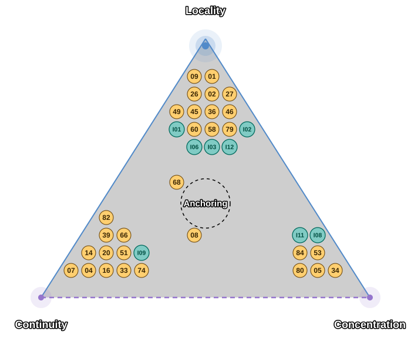
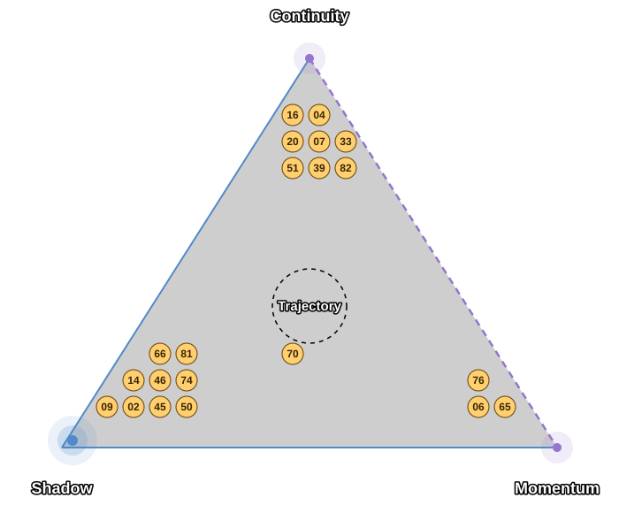
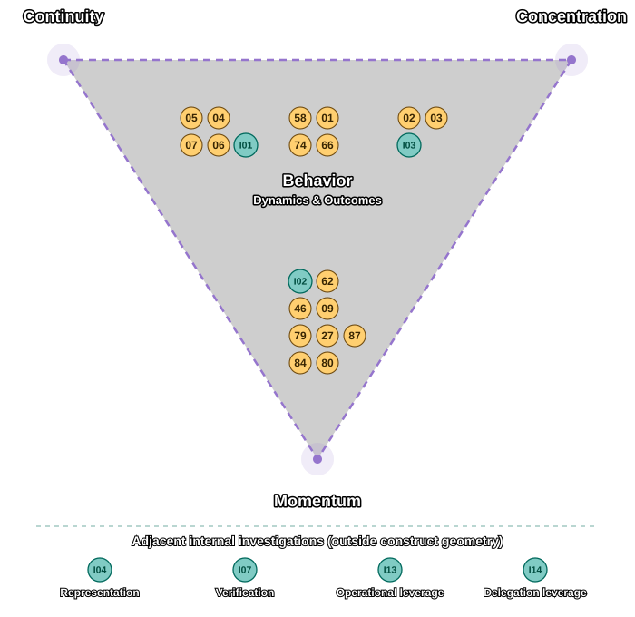

  

# Context Triad Research Atlas

The Research Atlas maps external research, internal investigations and applied engineering practices to the [Context Triad](./Context_Triad.md#context-triad). Each reference identifies the research point, source, relevance, Triad relationship and map location.

**Navigate:** [Locality](#locality-research-atlas) · [Shadow](#shadow-research-atlas) · [Weight](#weight-research-atlas) · [Behavioral](#behavioral-research-atlas) · [Research Index](#research-index) · [Constructs](#construct-relationships) · [Supporting research](#supporting-research)

## Reading the Map

**Amber — R-series:** external publications (the SVG shows the numeric suffix, e.g. `01` = R01). **Teal — I-series:** internal investigations (e.g. `I01`). Repeated identifiers refer to the same source. Color identifies provenance.

The overview is selective; the four regional maps expand the three outer corners and inverted center. In each regional table, the point identifier links to its full Research Index entry. The **Map point** links back to the existing regional SVG; a dash means the reference is associated in the tables but not plotted in that region. Index map-location links lead to the region and its reference row.

## Construct Relationships

| Level | Construct | Composition | Focus |
| --- | --- | --- | --- |
| Primary | [Semantic Locality](./Semantic_Locality.md) | — | Placement and distribution relative to use |
| Primary | [Semantic Shadow](./Semantic_Shadow.md) | — | Subsequent context and order-sensitive influence |
| Primary | [Semantic Weight](./Semantic_Weight.md) | — | Relative coherent support |
| Compound | Semantic Continuity | Locality + Shadow | Persistence of influence across contextual development |
| Compound | Semantic Concentration | Locality + Weight | Distribution of coherent support relative to use |
| Compound | Semantic Momentum | Shadow + Weight | Direction and accumulation of influence through contextual history |
| Higher-order | Semantic Anchoring | Continuity + Concentration | Attachment of influence to relevant points of use |
| Higher-order | Semantic Trajectory | Continuity + Momentum | Evolution of influence across successive operations |
| Higher-order | Semantic Consolidation | Concentration + Momentum | Organization and accumulation of support around an interpretation |

The plus signs indicate conceptual composition.

**Explore:** [Locality](#locality-research-atlas) · [Shadow](#shadow-research-atlas) · [Weight](#weight-research-atlas) · [Behavioral](#behavioral-research-atlas) · [Research Index](#research-index)

## Locality Research Atlas

**Navigate:** [↑ Overview](#context-triad-research-atlas) · [Locality](#locality-research-atlas) · [Shadow](#shadow-research-atlas) · [Weight](#weight-research-atlas) · [Behavioral](#behavioral-research-atlas) · [Research Index](#research-index)

**In this region:** [Locality](#semantic-locality-locality-region) · [Continuity](#semantic-continuity-locality-region) · [Concentration](#semantic-concentration-locality-region) · [Anchoring](#semantic-anchoring-locality-region)

  

Placement and distribution relative to use; persistence, coherent support and attachment to relevant operations.

**Map:** 30 external publications and 8 internal investigations. Each plotted identifier appears once in this region; the tables retain every construct association, including references not plotted here.

### Semantic Locality (Locality region)

| Point | Source | Relevance | Triad relationship | Map point |
| --- | --- | --- | --- | --- |
| [R01](#r01) | Liu, N. F., et al. (2024) | Information position and retrieval. | Locality | [01](#locality-research-atlas) |
| [R02](#r02) | Kurfali, M., & Östling, R. (2025) | Position, repetition and conflict. | Locality | [02](#locality-research-atlas) |
| [R09](#r09) | Bajaj, A., et al. (2026) | Temporal and positional retrieval biases. | Locality | [09](#locality-research-atlas) |
| [R17](#r17) | Gibson, E. (1998) | Human syntactic dependency distance and integration cost. | Locality | — (not plotted in this region) |
| [R26](#r26) | Hsieh, C.-P., et al. (2024) | Effective long-context capability evaluation. | Locality | [26](#locality-research-atlas) |
| [R27](#r27) | Hsieh, C.-Y., et al. (2024) | Positional attention bias and calibration. | Locality | [27](#locality-research-atlas) |
| [R36](#r36) | Khot, T., et al. (2022) | Modular task-specific prompting. | Locality | [36](#locality-research-atlas) |
| [R38](#r38) | Lewis, R. L., & Vasishth, S. (2005) | Human retrieval and interference model. | Locality | — (not plotted in this region) |
| [R45](#r45) | Liu, Y., Zeng, X., Shao, C., Meng, F., & Zhou, J. (2024) | Instruction placement in sequence generation. | Locality | [45](#locality-research-atlas) |
| [R46](#r46) | Lu, Y., et al. (2022) | Few-shot demonstration-order sensitivity. | Locality | [46](#locality-research-atlas) |
| [R49](#r49) | Modarressi, A., et al. (2025) | Long-context retrieval beyond literal matching. | Locality | [49](#locality-research-atlas) |
| [R58](#r58) | Shi, F., et al. (2023) | Interference from irrelevant context. | Locality | [58](#locality-research-atlas) |
| [R60](#r60) | Tian, R., et al. (2025) | Distance between relevant information pieces. | Locality | [60](#locality-research-atlas) |
| [R79](#r79) | Zhang, M., Meng, Z., & Collier, N. (2024) | Location guidance and position bias. | Locality | [79](#locality-research-atlas) |
| [I01](#i01) | Fox–Leopard Displacement | Description placement and competing-description expansion across prompt layouts. (360 trials) | Locality | [I01](#locality-research-atlas) |
| [I02](#i02) | Glip Preference Anchoring | Heading and description permutations alter criterion-free selection, including contrasts with fixed description order. (360 trials) | Locality | [I02](#locality-research-atlas) |
| [I03](#i03) | Planetary Order vs. Greek Genealogy | Permuting the same names changes the prevailing reading. (390 scored trials) | Locality | [I03](#locality-research-atlas) |
| [I06](#i06) | Compression, Reuse and Instruction Locality | Relocating an unchanged definition produced no observed pass-rate improvement in the recorded contrasts. | Locality | [I06](#locality-research-atlas) |
| [I12](#i12) | Reference Binding and Independent Decisions | Explicit producer–consumer binding and reference placement. | Locality | [I12](#locality-research-atlas) |

### Semantic Continuity (Locality region)

| Point | Source | Relevance | Triad relationship | Map point |
| --- | --- | --- | --- | --- |
| [R02](#r02) | Kurfali, M., & Östling, R. (2025) | Position, repetition and conflict. | Continuity | [02](#locality-research-atlas) |
| [R04](#r04) | Li, K., et al. (2024) | Instruction stability across turns. | Continuity | [04](#locality-research-atlas) |
| [R07](#r07) | Laban et al. (2025) | Multi-turn unreliability and premature assumptions. | Continuity | [07](#locality-research-atlas) |
| [R14](#r14) | Deshpande, K., et al. (2025) | Multi-turn conversation evaluation. | Continuity | [14](#locality-research-atlas) |
| [R16](#r16) | Epstein, E. L., et al. (2024) | Multimodal multi-turn instruction following. | Continuity | [16](#locality-research-atlas) |
| [R20](#r20) | Han, C., et al. (2025) | Interdependent instructions across turns. | Continuity | [20](#locality-research-atlas) |
| [R33](#r33) | Jia, Q., et al. (2026) | Evolving multi-turn instruction requirements. | Continuity | [33](#locality-research-atlas) |
| [R39](#r39) | Li, J., Li, J., Wang, Y., Chang, Y., & Wu, Y. (2025) | Inter-turn structural relations. | Continuity | [39](#locality-research-atlas) |
| [R51](#r51) | Packer, C., et al. (2023) | Structured context and memory management. | Continuity | [51](#locality-research-atlas) |
| [R66](#r66) | Wallace, E., et al. (2024) | Instruction authority and conflict resolution. | Continuity | [66](#locality-research-atlas) |
| [R74](#r74) | Wu, D., et al. (2025) | Long-term interactive memory and updates. | Continuity | [74](#locality-research-atlas) |
| [R82](#r82) | Zhou, D., et al. (2023) | Successive task decomposition. | Continuity | [82](#locality-research-atlas) |
| [I09](#i09) | Inheritance, Defaults and Output Construction | Missing inherited keys despite retained defaults; persistence of output obligations. | Continuity | [I09](#locality-research-atlas) |

### Semantic Concentration (Locality region)

| Point | Source | Relevance | Triad relationship | Map point |
| --- | --- | --- | --- | --- |
| [R02](#r02) | Kurfali, M., & Östling, R. (2025) | Position, repetition and conflict. | Concentration | [02](#locality-research-atlas) |
| [R05](#r05) | Agrawal, D., Gao, S., & Gajek, M. (2024) | Instruction reminders and in-context retrieval. | Concentration | [05](#locality-research-atlas) |
| [R10](#r10) | Chandra, A., & Krovi, R. (1999) | Representational congruence in human information retrieval. | Concentration | — (not plotted in this region) |
| [R26](#r26) | Hsieh, C.-P., et al. (2024) | Effective long-context capability evaluation. | Concentration | [26](#locality-research-atlas) |
| [R34](#r34) | Jiang, H., et al. (2023) | Prompt compression and retention. | Concentration | [34](#locality-research-atlas) |
| [R49](#r49) | Modarressi, A., et al. (2025) | Long-context retrieval beyond literal matching. | Concentration | [49](#locality-research-atlas) |
| [R53](#r53) | Pan, Z., et al. (2024) | Faithful prompt compression. | Concentration | [53](#locality-research-atlas) |
| [R60](#r60) | Tian, R., et al. (2025) | Distance between relevant information pieces. | Concentration | [60](#locality-research-atlas) |
| [R63](#r63) | Vessey, I. (1991) | Human cognitive fit. | Concentration | — (not plotted in this region) |
| [R80](#r80) | Zhang, X., et al. (2025) | Differentiated many-shot reweighting. | Concentration | [80](#locality-research-atlas) |
| [R84](#r84) | Zou, K., Khalifa, M., & Wang, L. (2025) | Many-shot context utilization. | Concentration | [84](#locality-research-atlas) |
| [I08](#i08) | Evidence Assembly and Exact Rendering | Assembly failures despite correct selection; distribution of needed evidence. | Concentration | [I08](#locality-research-atlas) |
| [I11](#i11) | Predicate Scope and Decision Separation | Predicate operands, consumer decisions and distribution of supporting information. | Concentration | [I11](#locality-research-atlas) |

### Semantic Anchoring (Locality region)

| Point | Source | Relevance | Triad relationship | Map point |
| --- | --- | --- | --- | --- |
| [R08](#r08) | Anthropic (2025) | Context selection, compaction and memory. | Anchoring | [08](#locality-research-atlas) |
| [R36](#r36) | Khot, T., et al. (2022) | Modular task-specific prompting. | Anchoring | [36](#locality-research-atlas) |
| [R39](#r39) | Li, J., Li, J., Wang, Y., Chang, Y., & Wu, Y. (2025) | Inter-turn structural relations. | Anchoring | [39](#locality-research-atlas) |
| [R51](#r51) | Packer, C., et al. (2023) | Structured context and memory management. | Anchoring | [51](#locality-research-atlas) |
| [R68](#r68) | Wang, L., et al. (2023) | Information flow through label representations. | Anchoring | [68](#locality-research-atlas) |
| [R74](#r74) | Wu, D., et al. (2025) | Long-term interactive memory and updates. | Anchoring | [74](#locality-research-atlas) |
| [R79](#r79) | Zhang, M., Meng, Z., & Collier, N. (2024) | Location guidance and position bias. | Anchoring | [79](#locality-research-atlas) |
| [I02](#i02) | Glip Preference Anchoring | Conditional label–description–position preference. (360 trials) | Anchoring | [I02](#locality-research-atlas) |
| [I06](#i06) | Compression, Reuse and Instruction Locality | Shared instructions and explicit consumers; relocation produced no observed gain. | Anchoring | [I06](#locality-research-atlas) |
| [I09](#i09) | Inheritance, Defaults and Output Construction | Tracing inherited obligations through the output producer to use. | Anchoring | [I09](#locality-research-atlas) |
| [I11](#i11) | Predicate Scope and Decision Separation | Binding predicates to comparison domains and consequences. | Anchoring | [I11](#locality-research-atlas) |
| [I12](#i12) | Reference Binding and Independent Decisions | Reference binding, independent decisions and instruction–consumer relationships. | Anchoring | [I12](#locality-research-atlas) |

## Shadow Research Atlas

**Navigate:** [↑ Overview](#context-triad-research-atlas) · [Locality](#locality-research-atlas) · [Shadow](#shadow-research-atlas) · [Weight](#weight-research-atlas) · [Behavioral](#behavioral-research-atlas) · [Research Index](#research-index)

**In this region:** [Shadow](#semantic-shadow-shadow-region) · [Continuity](#semantic-continuity-shadow-region) · [Momentum](#semantic-momentum-shadow-region) · [Trajectory](#semantic-trajectory-shadow-region)

  

Subsequent context and order-sensitive influence; persistence, accumulation and progression across operations.

**Map:** 21 external publications and 4 internal investigations. Each plotted identifier appears once in this region; the tables retain every construct association, including references not plotted here.

### Semantic Shadow (Shadow region)

| Point | Source | Relevance | Triad relationship | Map point |
| --- | --- | --- | --- | --- |
| [R02](#r02) | Kurfali, M., & Östling, R. (2025) | Position, repetition and conflict. | Shadow | [02](#shadow-research-atlas) |
| [R09](#r09) | Bajaj, A., et al. (2026) | Temporal and positional retrieval biases. | Shadow | [09](#shadow-research-atlas) |
| [R14](#r14) | Deshpande, K., et al. (2025) | Multi-turn conversation evaluation. | Shadow | [14](#shadow-research-atlas) |
| [R23](#r23) | Hogarth, R. M., & Einhorn, H. J. (1992) | Human sequential belief updating and order effects. | Shadow | — (not plotted in this region) |
| [R45](#r45) | Liu, Y., Zeng, X., Shao, C., Meng, F., & Zhou, J. (2024) | Instruction placement in sequence generation. | Shadow | [45](#shadow-research-atlas) |
| [R46](#r46) | Lu, Y., et al. (2022) | Few-shot demonstration-order sensitivity. | Shadow | [46](#shadow-research-atlas) |
| [R50](#r50) | Olsson, C., et al. (2022) | Mechanistic study of induction heads. | Shadow | [50](#shadow-research-atlas) |
| [R66](#r66) | Wallace, E., et al. (2024) | Instruction authority and conflict resolution. | Shadow | [66](#shadow-research-atlas) |
| [R74](#r74) | Wu, D., et al. (2025) | Long-term interactive memory and updates. | Shadow | [74](#shadow-research-atlas) |
| [R81](#r81) | Zhao, Z., et al. (2021) | Context-induced prediction bias and calibration. | Shadow | [81](#shadow-research-atlas) |
| [I02](#i02) | Glip Preference Anchoring | Within-prompt heading and description order contrasts affect selection. (360 trials) | Shadow | [I02](#shadow-research-atlas) |
| [I03](#i03) | Planetary Order vs. Greek Genealogy | Order permutations of unchanged names alter interpretation. (390 scored trials) | Shadow | [I03](#shadow-research-atlas) |
| [I10](#i10) | Input and Execution Integrity | Instruction authority, input admission, conflict and authorized consequences. | Shadow | [I10](#shadow-research-atlas) |

### Semantic Continuity (Shadow region)

| Point | Source | Relevance | Triad relationship | Map point |
| --- | --- | --- | --- | --- |
| [R02](#r02) | Kurfali, M., & Östling, R. (2025) | Position, repetition and conflict. | Continuity | [02](#shadow-research-atlas) |
| [R04](#r04) | Li, K., et al. (2024) | Instruction stability across turns. | Continuity | [04](#shadow-research-atlas) |
| [R07](#r07) | Laban et al. (2025) | Multi-turn unreliability and premature assumptions. | Continuity | [07](#shadow-research-atlas) |
| [R14](#r14) | Deshpande, K., et al. (2025) | Multi-turn conversation evaluation. | Continuity | [14](#shadow-research-atlas) |
| [R16](#r16) | Epstein, E. L., et al. (2024) | Multimodal multi-turn instruction following. | Continuity | [16](#shadow-research-atlas) |
| [R20](#r20) | Han, C., et al. (2025) | Interdependent instructions across turns. | Continuity | [20](#shadow-research-atlas) |
| [R33](#r33) | Jia, Q., et al. (2026) | Evolving multi-turn instruction requirements. | Continuity | [33](#shadow-research-atlas) |
| [R39](#r39) | Li, J., Li, J., Wang, Y., Chang, Y., & Wu, Y. (2025) | Inter-turn structural relations. | Continuity | [39](#shadow-research-atlas) |
| [R51](#r51) | Packer, C., et al. (2023) | Structured context and memory management. | Continuity | [51](#shadow-research-atlas) |
| [R66](#r66) | Wallace, E., et al. (2024) | Instruction authority and conflict resolution. | Continuity | [66](#shadow-research-atlas) |
| [R74](#r74) | Wu, D., et al. (2025) | Long-term interactive memory and updates. | Continuity | [74](#shadow-research-atlas) |
| [R82](#r82) | Zhou, D., et al. (2023) | Successive task decomposition. | Continuity | [82](#shadow-research-atlas) |
| [I09](#i09) | Inheritance, Defaults and Output Construction | Inherited obligations can be absent from output while other defaults survive; persistence across construction steps. | Continuity | [I09](#shadow-research-atlas) |

### Semantic Momentum (Shadow region)

| Point | Source | Relevance | Triad relationship | Map point |
| --- | --- | --- | --- | --- |
| [R02](#r02) | Kurfali, M., & Östling, R. (2025) | Position, repetition and conflict. | Momentum | [02](#shadow-research-atlas) |
| [R06](#r06) | Zhang et al. (2024) | Earlier errors and subsequent false claims. | Momentum | [06](#shadow-research-atlas) |
| [R23](#r23) | Hogarth, R. M., & Einhorn, H. J. (1992) | Human sequential belief updating and order effects. | Momentum | — (not plotted in this region) |
| [R65](#r65) | von Oswald, J., et al. (2022) | Computational accounts of in-context learning. | Momentum | [65](#shadow-research-atlas) |
| [R76](#r76) | Xie, S. M., et al. (2022) | Probabilistic account of in-context learning. | Momentum | [76](#shadow-research-atlas) |

### Semantic Trajectory (Shadow region)

| Point | Source | Relevance | Triad relationship | Map point |
| --- | --- | --- | --- | --- |
| [R07](#r07) | Laban et al. (2025) | Multi-turn unreliability and premature assumptions. | Trajectory | [07](#shadow-research-atlas) |
| [R14](#r14) | Deshpande, K., et al. (2025) | Multi-turn conversation evaluation. | Trajectory | [14](#shadow-research-atlas) |
| [R16](#r16) | Epstein, E. L., et al. (2024) | Multimodal multi-turn instruction following. | Trajectory | [16](#shadow-research-atlas) |
| [R20](#r20) | Han, C., et al. (2025) | Interdependent instructions across turns. | Trajectory | [20](#shadow-research-atlas) |
| [R33](#r33) | Jia, Q., et al. (2026) | Evolving multi-turn instruction requirements. | Trajectory | [33](#shadow-research-atlas) |
| [R39](#r39) | Li, J., Li, J., Wang, Y., Chang, Y., & Wu, Y. (2025) | Inter-turn structural relations. | Trajectory | [39](#shadow-research-atlas) |
| [R70](#r70) | Wei, J., et al. (2022) | Intermediate reasoning sequences. | Trajectory | [70](#shadow-research-atlas) |
| [R82](#r82) | Zhou, D., et al. (2023) | Successive task decomposition. | Trajectory | [82](#shadow-research-atlas) |

## Weight Research Atlas

**Navigate:** [↑ Overview](#context-triad-research-atlas) · [Locality](#locality-research-atlas) · [Shadow](#shadow-research-atlas) · [Weight](#weight-research-atlas) · [Behavioral](#behavioral-research-atlas) · [Research Index](#research-index)

**In this region:** [Weight](#semantic-weight-weight-region) · [Concentration](#semantic-concentration-weight-region) · [Momentum](#semantic-momentum-weight-region) · [Consolidation](#semantic-consolidation-weight-region)

  

Relative coherent support; distribution, accumulation and convergence around an interpretation.

**Map:** 30 external publications and 5 internal investigations. Each plotted identifier appears once in this region; the tables retain every construct association, including references not plotted here.

### Semantic Weight (Weight region)

| Point | Source | Relevance | Triad relationship | Map point |
| --- | --- | --- | --- | --- |
| [R02](#r02) | Kurfali, M., & Östling, R. (2025) | Position, repetition and conflict. | Weight | [02](#weight-research-atlas) |
| [R03](#r03) | Jin et al. (2024) | Frequency and consistency of competing evidence. | Weight | [03](#weight-research-atlas) |
| [R28](#r28) | Hu, J., Liu, W., & Du, M. (2024) | Selection of in-context demonstrations. | Weight | [28](#weight-research-atlas) |
| [R38](#r38) | Lewis, R. L., & Vasishth, S. (2005) | Human retrieval and interference model. | Weight | — (not plotted in this region) |
| [R46](#r46) | Lu, Y., et al. (2022) | Few-shot demonstration-order sensitivity. | Weight | [46](#weight-research-atlas) |
| [R47](#r47) | Min, S., et al. (2022) | Contributions of different demonstration properties. | Weight | [47](#weight-research-atlas) |
| [R52](#r52) | Pan, J., et al. (2023) | Task recognition versus task learning. | Weight | [52](#weight-research-atlas) |
| [R58](#r58) | Shi, F., et al. (2023) | Interference from irrelevant context. | Weight | [58](#weight-research-atlas) |
| [R71](#r71) | Wei, J., et al. (2023) | Model scale and context-driven task behavior. | Weight | [71](#weight-research-atlas) |
| [R72](#r72) | Wei, J., et al. (2023) | Arbitrary labels and contextual associations. | Weight | [72](#weight-research-atlas) |
| [R76](#r76) | Xie, S. M., et al. (2022) | Probabilistic account of in-context learning. | Weight | [76](#weight-research-atlas) |
| [R78](#r78) | Yu, Z., & Ananiadou, S. (2024) | Similarity-based contextual information selection. | Weight | [78](#weight-research-atlas) |
| [R80](#r80) | Zhang, X., et al. (2025) | Differentiated many-shot reweighting. | Weight | [80](#weight-research-atlas) |
| [R81](#r81) | Zhao, Z., et al. (2021) | Context-induced prediction bias and calibration. | Weight | [81](#weight-research-atlas) |
| [R84](#r84) | Zou, K., Khalifa, M., & Wang, L. (2025) | Many-shot context utilization. | Weight | [84](#weight-research-atlas) |
| [I01](#i01) | Fox–Leopard Displacement | Expanding a competing description shifts single-animal selection while pangram identification stays similar. (360 trials) | Weight | [I01](#weight-research-atlas) |
| [I03](#i03) | Planetary Order vs. Greek Genealogy | The same names support competing readings; order changes selection. (390 scored trials) | Weight | [I03](#weight-research-atlas) |

### Semantic Concentration (Weight region)

| Point | Source | Relevance | Triad relationship | Map point |
| --- | --- | --- | --- | --- |
| [R02](#r02) | Kurfali, M., & Östling, R. (2025) | Position, repetition and conflict. | Concentration | [02](#weight-research-atlas) |
| [R05](#r05) | Agrawal, D., Gao, S., & Gajek, M. (2024) | Instruction reminders and in-context retrieval. | Concentration | [05](#weight-research-atlas) |
| [R10](#r10) | Chandra, A., & Krovi, R. (1999) | Representational congruence in human information retrieval. | Concentration | — (not plotted in this region) |
| [R26](#r26) | Hsieh, C.-P., et al. (2024) | Effective long-context capability evaluation. | Concentration | [26](#weight-research-atlas) |
| [R34](#r34) | Jiang, H., et al. (2023) | Prompt compression and retention. | Concentration | [34](#weight-research-atlas) |
| [R49](#r49) | Modarressi, A., et al. (2025) | Long-context retrieval beyond literal matching. | Concentration | [49](#weight-research-atlas) |
| [R53](#r53) | Pan, Z., et al. (2024) | Faithful prompt compression. | Concentration | [53](#weight-research-atlas) |
| [R60](#r60) | Tian, R., et al. (2025) | Distance between relevant information pieces. | Concentration | [60](#weight-research-atlas) |
| [R63](#r63) | Vessey, I. (1991) | Human cognitive fit. | Concentration | — (not plotted in this region) |
| [R80](#r80) | Zhang, X., et al. (2025) | Differentiated many-shot reweighting. | Concentration | [80](#weight-research-atlas) |
| [R84](#r84) | Zou, K., Khalifa, M., & Wang, L. (2025) | Many-shot context utilization. | Concentration | [84](#weight-research-atlas) |
| [I08](#i08) | Evidence Assembly and Exact Rendering | Correct evidence selection can fail during assembly; distribution of supporting information. | Concentration | [I08](#weight-research-atlas) |
| [I11](#i11) | Predicate Scope and Decision Separation | Eligibility, preference and reporting depend on distinct evidence domains. | Concentration | [I11](#weight-research-atlas) |

### Semantic Momentum (Weight region)

| Point | Source | Relevance | Triad relationship | Map point |
| --- | --- | --- | --- | --- |
| [R02](#r02) | Kurfali, M., & Östling, R. (2025) | Position, repetition and conflict. | Momentum | [02](#weight-research-atlas) |
| [R06](#r06) | Zhang et al. (2024) | Earlier errors and subsequent false claims. | Momentum | [06](#weight-research-atlas) |
| [R23](#r23) | Hogarth, R. M., & Einhorn, H. J. (1992) | Human sequential belief updating and order effects. | Momentum | — (not plotted in this region) |
| [R65](#r65) | von Oswald, J., et al. (2022) | Computational accounts of in-context learning. | Momentum | [65](#weight-research-atlas) |
| [R76](#r76) | Xie, S. M., et al. (2022) | Probabilistic account of in-context learning. | Momentum | [76](#weight-research-atlas) |

### Semantic Consolidation (Weight region)

| Point | Source | Relevance | Triad relationship | Map point |
| --- | --- | --- | --- | --- |
| [R08](#r08) | Anthropic (2025) | Context selection, compaction and memory. | Consolidation | [08](#weight-research-atlas) |
| [R12](#r12) | Chiang, J. N., et al. (2021) | Relational representations in human cognition. | Consolidation | — (not plotted in this region) |
| [R22](#r22) | Hendel, R., et al. (2023) | Context-induced internal task representations. | Consolidation | [22](#weight-research-atlas) |
| [R24](#r24) | Holyoak, K. J., & Monti, M. M. (2021) | Human relational integration. | Consolidation | — (not plotted in this region) |
| [R25](#r25) | Honovich, O., et al. (2022) | Task abstraction from demonstrations. | Consolidation | [25](#weight-research-atlas) |
| [R34](#r34) | Jiang, H., et al. (2023) | Prompt compression and retention. | Consolidation | [34](#weight-research-atlas) |
| [R42](#r42) | Liu, S., et al. (2023) | Context-derived latent steering. | Consolidation | [42](#weight-research-atlas) |
| [R47](#r47) | Min, S., et al. (2022) | Contributions of different demonstration properties. | Consolidation | [47](#weight-research-atlas) |
| [R50](#r50) | Olsson, C., et al. (2022) | Mechanistic study of induction heads. | Consolidation | [50](#weight-research-atlas) |
| [R51](#r51) | Packer, C., et al. (2023) | Structured context and memory management. | Consolidation | [51](#weight-research-atlas) |
| [R52](#r52) | Pan, J., et al. (2023) | Task recognition versus task learning. | Consolidation | [52](#weight-research-atlas) |
| [R53](#r53) | Pan, Z., et al. (2024) | Faithful prompt compression. | Consolidation | [53](#weight-research-atlas) |
| [R61](#r61) | Todd, E., et al. (2023) | Internal function representations. | Consolidation | [61](#weight-research-atlas) |
| [R65](#r65) | von Oswald, J., et al. (2022) | Computational accounts of in-context learning. | Consolidation | [65](#weight-research-atlas) |
| [R68](#r68) | Wang, L., et al. (2023) | Information flow through label representations. | Consolidation | [68](#weight-research-atlas) |
| [R71](#r71) | Wei, J., et al. (2023) | Model scale and context-driven task behavior. | Consolidation | [71](#weight-research-atlas) |
| [R72](#r72) | Wei, J., et al. (2023) | Arbitrary labels and contextual associations. | Consolidation | [72](#weight-research-atlas) |
| [R76](#r76) | Xie, S. M., et al. (2022) | Probabilistic account of in-context learning. | Consolidation | [76](#weight-research-atlas) |
| [R78](#r78) | Yu, Z., & Ananiadou, S. (2024) | Similarity-based contextual information selection. | Consolidation | [78](#weight-research-atlas) |
| [I05](#i05) | Collection Membership, Multiplicity and Order | Membership, multiplicity and order failures during assembly of a coherent result. | Consolidation | [I05](#weight-research-atlas) |
| [I08](#i08) | Evidence Assembly and Exact Rendering | Evidence coverage, provenance and rendering during result assembly. | Consolidation | [I08](#weight-research-atlas) |

## Behavioral Research Atlas

**Navigate:** [↑ Overview](#context-triad-research-atlas) · [Locality](#locality-research-atlas) · [Shadow](#shadow-research-atlas) · [Weight](#weight-research-atlas) · [Behavioral](#behavioral-research-atlas) · [Research Index](#research-index)

**In this region:** [Outcomes](#behavioral-outcomes) · [Dynamics](#behavioral-dynamics) · [Adjacent investigations](#adjacent-internal-investigations)

  

Joint contextual influences and the behavioral dynamics and outcomes defined in the Context Triad paper.

**Map:** 18 external publications and 3 internal investigations inside the triangle; 4 additional internal investigations in the adjacent-research strip.

### Behavioral Outcomes

| Triad relationship | External points | Relevance | Internal points and relevance | Map points |
| --- | --- | --- | --- | --- |
| Preservation | [R04](#r04), [R05](#r05) | Instruction stability and reminders. | — | [04](#behavioral-research-atlas), [05](#behavioral-research-atlas) |
| Suppression | [R01](#r01), [R58](#r58) | Position sensitivity and interference from irrelevant context. | — | [01](#behavioral-research-atlas), [58](#behavioral-research-atlas) |
| Displacement | [R02](#r02), [R03](#r03) | Conflicting information and selection of competing evidence. | [I01](#i01): Competing-description expansion changes single-animal selection despite similar pangram identification. [I03](#i03): Name order changes the prevailing collective reading while competing interpretations remain available. | [02](#behavioral-research-atlas), [03](#behavioral-research-atlas), [I01](#behavioral-research-atlas), [I03](#behavioral-research-atlas) |
| Transformation | [R06](#r06), [R07](#r07) | Changing or erroneous interpretations. | — | [06](#behavioral-research-atlas), [07](#behavioral-research-atlas) |
| Resolution | [R66](#r66), [R74](#r74) | Instruction authority, memory updates and authorized change. | — | [66](#behavioral-research-atlas), [74](#behavioral-research-atlas) |

### Behavioral Dynamics

| Triad relationship | External points | Relevance | Internal points and relevance | Map points |
| --- | --- | --- | --- | --- |
| Reinforcement | [R02](#r02), [R03](#r03) | Repetition and coherent evidence in answer selection. | — | [02](#behavioral-research-atlas), [03](#behavioral-research-atlas) |
| Interference | [R02](#r02), [R58](#r58) | Conflicting information and interference from irrelevant context. | — | [02](#behavioral-research-atlas), [58](#behavioral-research-atlas) |
| Compensation | [R27](#r27), [R79](#r79) | Position-bias interventions. | — | [27](#behavioral-research-atlas), [79](#behavioral-research-atlas) |
| Dominance | [R02](#r02), [R03](#r03) | Selection of competing information. | [I02](#i02): Selection frequencies differ across label and description arrangements without a declared preference criterion. [I03](#i03): The most common reading changes with order. | [02](#behavioral-research-atlas), [03](#behavioral-research-atlas), [I02](#behavioral-research-atlas), [I03](#behavioral-research-atlas) |
| Recovery | [R04](#r04), [R05](#r05) | Reminders and stability interventions. | — | [04](#behavioral-research-atlas), [05](#behavioral-research-atlas) |
| Reversal | [R09](#r09), [R46](#r46) | Order and temporal effects. | [I03](#i03): Forward and reverse reference layouts differ in prevailing readings. | [09](#behavioral-research-atlas), [46](#behavioral-research-atlas), [I03](#behavioral-research-atlas) |
| Saturation | [R80](#r80), [R84](#r84) | Many-shot learning, reweighting and diminishing returns. | — | [80](#behavioral-research-atlas), [84](#behavioral-research-atlas) |
| Threshold | [R62](#r62) | Constraint-satisfaction transitions. | — | [62](#behavioral-research-atlas) |
| Instability | [R07](#r07), [R46](#r46), [R87](#r87) | Multi-turn, order and formatting sensitivity. | [I02](#i02): Only 5 of 36 layouts have unanimous replies across ten repeats. | [07](#behavioral-research-atlas), [46](#behavioral-research-atlas), [87](#behavioral-research-atlas), [I02](#behavioral-research-atlas) |

### Adjacent Internal Investigations

These four investigations concern representation, verification and operational leverage and appear in the adjacent strip below the inverted triangle.

| Point | Source | Relevance | Triad relationship | Map point |
| --- | --- | --- | --- | --- |
| [I04](#i04) | AgMark Prompt Performance | Representation comparison: accuracy, exact-result agreement, token consumption and timing. | Adjacent investigation | [I04 (adjacent strip)](#behavioral-research-atlas) |
| [I07](#i07) | Construction Checks and Verification | Methodological study of prescribed checks, execution evidence and acceptance. | Adjacent investigation | [I07 (adjacent strip)](#behavioral-research-atlas) |
| [I13](#i13) | Longitudinal Operational Leverage | Observational specification compression and downstream tool activity. | Adjacent investigation | [I13 (adjacent strip)](#behavioral-research-atlas) |
| [I14](#i14) | Single Workstream Delegation Leverage | Observational workstream comparison and external benchmark of tool activity. | Adjacent investigation | [I14 (adjacent strip)](#behavioral-research-atlas) |

## Research Index

**Navigate:** [↑ Overview](#context-triad-research-atlas) · [Locality](#locality-research-atlas) · [Shadow](#shadow-research-atlas) · [Weight](#weight-research-atlas) · [Behavioral](#behavioral-research-atlas) · [Research Index](#research-index)

Each source appears once. **Triad relationship** records its associations; **Map locations** links to plotted regions and regional table entries. Table-only links identify additional associations.

The index contains 101 entries: 87 external publications from the repository's Markdown papers and [canonical reference catalog](../Style_Guide/reference_catalog.json), and 14 internal investigations. Alternate editions are counted once.

| Point | Source | Relevance | Triad relationship | Map locations |
| --- | --- | --- | --- | --- |
|  R01 | Liu et al. (2024), [Lost in the Middle: How Language Models Use Long Contexts](https://aclanthology.org/2024.tacl-1.9/) External — Original Atlas, [Locality](./Semantic_Locality.md), [RCR](../Representational_Capacity_Reclamation.md) | Relocating relevant information changes retrieval and question-answering performance. | Locality | [Overview](#context-triad-research-atlas) · [Locality](#locality-research-atlas) ([row](#locality-r01)) · [Behavioral](#behavioral-research-atlas) ([row](#behavioral-r01)) |
|  R02 | Kurfali and Östling (2025), [Conflicting Needles in a Haystack: How LLMs Behave When Faced with Contradictory Information](https://aclanthology.org/2025.emnlp-main.1742/) External — Original Atlas, [Shadow](./Semantic_Shadow.md), [Weight](./Semantic_Weight.md) | Manipulates position, repetition, layout, and conflicting evidence; reports recency and repetition biases in answer selection. | Shadow; multifactor research spanning the primary and pairwise constructs | [Overview](#context-triad-research-atlas) · [Locality](#locality-research-atlas) ([row](#locality-r02)) · [Shadow](#shadow-research-atlas) ([row](#shadow-r02)) · [Weight](#weight-research-atlas) ([row](#weight-r02)) · [Behavioral](#behavioral-research-atlas) ([row](#behavioral-r02)) |
|  R03 | Jin et al. (2024), [Tug-of-War Between Knowledge: Exploring and Resolving Knowledge Conflicts in Retrieval-Augmented Language Models](https://arxiv.org/abs/2402.14409) External — Original Atlas | Models tend to prefer more frequently presented evidence and evidence consistent with their internal knowledge. | Weight | [Overview](#context-triad-research-atlas) · [Weight](#weight-research-atlas) ([row](#weight-r03)) · [Behavioral](#behavioral-research-atlas) ([row](#behavioral-r03)) |
|  R04 | Li et al. (2024), [Measuring and Controlling Instruction (In)Stability in Language Model Dialogs](https://arxiv.org/abs/2402.10962) External — Original Atlas, [Shadow](./Semantic_Shadow.md) | Examines instruction drift during extended dialogue and an intervention to mitigate it. | Continuity | [Overview](#context-triad-research-atlas) · [Locality](#locality-research-atlas) ([row](#locality-r04)) · [Shadow](#shadow-research-atlas) ([row](#shadow-r04)) · [Behavioral](#behavioral-research-atlas) ([row](#behavioral-r04)) |
|  R05 | Agrawal et al. (2024), [Can't Remember Details in Long Documents? You Need Some R&R](https://aclanthology.org/2024.findings-emnlp.742/) External — Original Atlas, [Locality](./Semantic_Locality.md) | Combined periodic instruction reminders and in-context retrieval improve long-document question answering. | Concentration | [Overview](#context-triad-research-atlas) · [Locality](#locality-research-atlas) ([row](#locality-r05)) · [Weight](#weight-research-atlas) ([row](#weight-r05)) · [Behavioral](#behavioral-research-atlas) ([row](#behavioral-r05)) |
|  R06 | Zhang et al. (2024), [How Language Model Hallucinations Can Snowball](https://proceedings.mlr.press/v235/zhang24ay.html) External — Original Atlas | Earlier erroneous answers can induce later false claims that models can recognize as false when evaluated separately. | Momentum | [Overview](#context-triad-research-atlas) · [Shadow](#shadow-research-atlas) ([row](#shadow-r06)) · [Weight](#weight-research-atlas) ([row](#weight-r06)) · [Behavioral](#behavioral-research-atlas) ([row](#behavioral-r06)) |
|  R07 | Laban et al. (2025), [LLMs Get Lost in Multi-Turn Conversation](https://arxiv.org/abs/2505.06120) External — Original Atlas | Multi-turn tasks show increased unreliability and persistence of premature assumptions. | Trajectory; Continuity | [Overview](#context-triad-research-atlas) · [Locality](#locality-research-atlas) ([row](#locality-r07)) · [Shadow](#shadow-research-atlas) ([row](#shadow-r07)) · [Behavioral](#behavioral-research-atlas) ([row](#behavioral-r07)) |
|  R08 | Anthropic (2025), [Effective Context Engineering for AI Agents](https://www.anthropic.com/research/effective-context-engineering-for-ai-agents) External — Original Atlas | Describes practical approaches to context selection, compaction, structured memory, and agentic retrieval. | Anchoring; Consolidation | [Overview](#context-triad-research-atlas) · [Locality](#locality-research-atlas) ([row](#locality-r08)) · [Weight](#weight-research-atlas) ([row](#weight-r08)) |
|  R09 | Bajaj, A., et al. (2026), [Beyond Semantics: How Temporal Biases Shapes Retrieval in Transformer and State-Space Models](https://aclanthology.org/2026.eacl-long.355/) External — [Shadow](./Semantic_Shadow.md) | Temporal and positional retrieval biases. | Locality; Shadow | [Locality](#locality-research-atlas) ([row](#locality-r09)) · [Shadow](#shadow-research-atlas) ([row](#shadow-r09)) · [Behavioral](#behavioral-research-atlas) ([row](#behavioral-r09)) |
|  R10 | Chandra, A., & Krovi, R. (1999), [Representational congruence and information retrieval: Towards an extended model of cognitive fit](https://doi.org/10.1016/S0167-9236(99)00014-7) External — [MNSR](../Model_Native_Structural_Representation.md) | Representational congruence in human information retrieval. | Concentration | — (not plotted) Table only: [Locality table](#locality-r10) · [Weight table](#weight-r10) |
|  R11 | Chatterjee, A., et al. (2024), [POSIX: A Prompt Sensitivity Index For Large Language Models](https://aclanthology.org/2024.findings-emnlp.852/) External — [MNSR](../Model_Native_Structural_Representation.md) | Prompt sensitivity measurement. | Adjacent: representation | — (not plotted) |
|  R12 | Chiang, J. N., et al. (2021), [Distributed Code for Semantic Relations Predicts Neural Similarity during Analogical Reasoning](https://doi.org/10.1162/jocn_a_01620) External — [MNSR](../Model_Native_Structural_Representation.md) | Relational representations in human cognition. | Consolidation | — (not plotted) Table only: [Weight table](#weight-r12) |
|  R13 | De Sabbata, C. N., et al. (2024), [Rational Metareasoning for Large Language Models](https://arxiv.org/abs/2410.05563) External — [RIS](../ArcGrav_Reasoning_Interaction_Substitution.md) | Reasoning-resource allocation. | Adjacent: capacity | — (not plotted) |
|  R14 | Deshpande, K., et al. (2025), [MultiChallenge: A Realistic Multi-Turn Conversation Evaluation Benchmark Challenging to Frontier LLMs](https://aclanthology.org/2025.findings-acl.958/) External — [Shadow](./Semantic_Shadow.md) | Multi-turn conversation evaluation. | Shadow; Continuity; Trajectory | [Locality](#locality-research-atlas) ([row](#locality-r14)) · [Shadow](#shadow-research-atlas) ([row](#shadow-r14)) |
|  R15 | Elhage, N., et al. (2022), [Toy Models of Superposition](https://transformer-circuits.pub/2022/toy_model/index.html) External — [MNSR](../Model_Native_Structural_Representation.md) | Representation of overlapping features. | Adjacent: representation | — (not plotted) |
|  R16 | Epstein, E. L., et al. (2024), [MMMT-IF: A Challenging Multimodal Multi-Turn Instruction Following Benchmark](https://arxiv.org/abs/2409.18216) External — [Locality](./Semantic_Locality.md) | Multimodal multi-turn instruction following. | Continuity; Trajectory | [Locality](#locality-research-atlas) ([row](#locality-r16)) · [Shadow](#shadow-research-atlas) ([row](#shadow-r16)) |
|  R17 | Gibson, E. (1998), [Linguistic complexity: locality of syntactic dependencies](https://doi.org/10.1016/S0010-0277(98)00034-1) External — [Locality](./Semantic_Locality.md), [MNSR](../Model_Native_Structural_Representation.md) | Human syntactic dependency distance and integration cost. | Locality | — (not plotted) Table only: [Locality table](#locality-r17) |
|  R18 | Gonen, H., et al. (2023), [Demystifying Prompts in Language Models via Perplexity Estimation](https://aclanthology.org/2023.findings-emnlp.679/) External — [MNSR](../Model_Native_Structural_Representation.md) | Prompt perplexity and effectiveness. | Adjacent: representation | — (not plotted) |
|  R19 | Halford, G. S., Wilson, W. H., & Phillips, S. (1998), [Processing capacity defined by relational complexity: Implications for comparative, developmental, and cognitive psychology](https://doi.org/10.1017/S0140525X98001769) External — [RCR](../Representational_Capacity_Reclamation.md) | Relational complexity and processing limits. | Adjacent: capacity | — (not plotted) |
|  R20 | Han, C., et al. (2025), [Can Language Models Follow Multiple Turns of Entangled Instructions?](https://aclanthology.org/2025.findings-emnlp.1387/) External — [Shadow](./Semantic_Shadow.md) | Interdependent instructions across turns. | Continuity; Trajectory | [Locality](#locality-research-atlas) ([row](#locality-r20)) · [Shadow](#shadow-research-atlas) ([row](#shadow-r20)) |
|  R21 | He, J., et al. (2024), [Does Prompt Formatting Have Any Impact on LLM Performance?](https://arxiv.org/abs/2411.10541) External — [Syntax](../ArcGrav_Syntax_Efficiency.md), [RCR](../Representational_Capacity_Reclamation.md) | Prompt formatting effects. | Adjacent: representation | — (not plotted) |
|  R22 | Hendel, R., et al. (2023), [In-Context Learning Creates Task Vectors](https://arxiv.org/abs/2310.15916) External — [MNSR](../Model_Native_Structural_Representation.md) | Context-induced internal task representations. | Consolidation | [Weight](#weight-research-atlas) ([row](#weight-r22)) |
|  R23 | Hogarth, R. M., & Einhorn, H. J. (1992), [Order effects in belief updating: The belief-adjustment model](https://doi.org/10.1016/0010-0285(92)90002-J) External — [Shadow](./Semantic_Shadow.md) | Human sequential belief updating and order effects. | Shadow; Momentum | — (not plotted) Table only: [Shadow table](#shadow-r23) · [Weight table](#weight-r23) |
|  R24 | Holyoak, K. J., & Monti, M. M. (2021), [Relational Integration in the Human Brain: A Review and Synthesis](https://doi.org/10.1162/jocn_a_01619) External — [MNSR](../Model_Native_Structural_Representation.md), [RCR](../Representational_Capacity_Reclamation.md) | Human relational integration. | Consolidation | — (not plotted) Table only: [Weight table](#weight-r24) |
|  R25 | Honovich, O., et al. (2022), [Instruction Induction: From Few Examples to Natural Language Task Descriptions](https://arxiv.org/abs/2205.10782) External — [Interpretive](../ArcGrav_Interpretive_Efficiency.md) | Task abstraction from demonstrations. | Consolidation | [Weight](#weight-research-atlas) ([row](#weight-r25)) |
|  R26 | Hsieh, C.-P., et al. (2024), [RULER: What's the Real Context Size of Your Long-Context Language Models?](https://arxiv.org/abs/2404.06654) External — [Locality](./Semantic_Locality.md) | Effective long-context capability evaluation. | Locality; Concentration | [Locality](#locality-research-atlas) ([row](#locality-r26)) · [Weight](#weight-research-atlas) ([row](#weight-r26)) |
|  R27 | Hsieh, C.-Y., et al. (2024), [Found in the Middle: Calibrating Positional Attention Bias Improves Long Context Utilization](https://arxiv.org/abs/2406.16008) External — [Locality](./Semantic_Locality.md) | Positional attention bias and calibration. | Locality | [Locality](#locality-research-atlas) ([row](#locality-r27)) · [Behavioral](#behavioral-research-atlas) ([row](#behavioral-r27)) |
|  R28 | Hu, J., Liu, W., & Du, M. (2024), [Strategic Demonstration Selection for Improved Fairness in LLM In-Context Learning](https://aclanthology.org/2024.emnlp-main.425/) External — [Weight](./Semantic_Weight.md) | Selection of in-context demonstrations. | Weight | [Weight](#weight-research-atlas) ([row](#weight-r28)) |
|  R29 | Hua, A., et al. (2025), [Flaw or Artifact? Rethinking Prompt Sensitivity in Evaluating LLMs](https://aclanthology.org/2025.emnlp-main.1006/) External — [Interpretive](../ArcGrav_Interpretive_Efficiency.md) | Evaluation artifacts in prompt sensitivity. | Adjacent: methodology | — (not plotted) |
|  R30 | Huh, M., et al. (2024), [Position: The Platonic Representation Hypothesis](https://proceedings.mlr.press/v235/huh24a.html) External — [MNSR](../Model_Native_Structural_Representation.md) | Hypothesized shared representational structure. | Adjacent: representation | — (not plotted) |
|  R31 | Jaroslawicz, D., et al. (2025), [How Many Instructions Can LLMs Follow at Once?](https://arxiv.org/abs/2507.11538) External — [RCR](../Representational_Capacity_Reclamation.md) | Simultaneous instruction-following limits. | Adjacent: capacity | — (not plotted) |
|  R32 | Jeoung, S., et al. (2026), [PromptPrism: A Linguistically-Inspired Taxonomy for Prompts](https://aclanthology.org/2026.findings-eacl.61/) External — [Interpretive](../ArcGrav_Interpretive_Efficiency.md) | Taxonomy of prompt structure. | Adjacent: representation | — (not plotted) |
|  R33 | Jia, Q., et al. (2026), [One Battle After Another: Probing LLMs’ Limits on Multi-Turn Instruction Following with a Benchmark Evolving Framework](https://aclanthology.org/2026.acl-long.433/) External — [Shadow](./Semantic_Shadow.md) | Evolving multi-turn instruction requirements. | Continuity; Trajectory | [Locality](#locality-research-atlas) ([row](#locality-r33)) · [Shadow](#shadow-research-atlas) ([row](#shadow-r33)) |
|  R34 | Jiang, H., et al. (2023), [LLMLingua: Compressing Prompts for Accelerated Inference of Large Language Models](https://aclanthology.org/2023.emnlp-main.825/) External — [Shadow](./Semantic_Shadow.md) | Prompt compression and retention. | Concentration; Consolidation | [Locality](#locality-research-atlas) ([row](#locality-r34)) · [Weight](#weight-research-atlas) ([row](#weight-r34)) |
|  R35 | Jiang, Y., et al. (2024), [On the Origins of Linear Representations in Large Language Models](https://proceedings.mlr.press/v235/jiang24d.html) External — [MNSR](../Model_Native_Structural_Representation.md) | Origins of linear representations. | Adjacent: representation | — (not plotted) |
|  R36 | Khot, T., et al. (2022), [Decomposed Prompting: A Modular Approach for Solving Complex Tasks](https://arxiv.org/abs/2210.02406) External — [RCR](../Representational_Capacity_Reclamation.md) | Modular task-specific prompting. | Locality; Anchoring | [Locality](#locality-research-atlas) ([row](#locality-r36)) |
|  R37 | Kirsh, D. (2010), [Thinking with external representations](https://doi.org/10.1007/s00146-010-0272-8) External — [MNSR](../Model_Native_Structural_Representation.md), [RCR](../Representational_Capacity_Reclamation.md) | External representations and inferential costs. | Adjacent: representation | — (not plotted) |
|  R38 | Lewis, R. L., & Vasishth, S. (2005), [An activation-based model of sentence processing as skilled memory retrieval](https://doi.org/10.1207/s15516709cog0000_25) External — [Locality](./Semantic_Locality.md) | Human retrieval and interference model. | Locality; Weight | — (not plotted) Table only: [Locality table](#locality-r38) · [Weight table](#weight-r38) |
|  R39 | Li, J., Li, J., Wang, Y., Chang, Y., & Wu, Y. (2025), [StructFlowBench: A Structured Flow Benchmark for Multi-turn Instruction Following](https://aclanthology.org/2025.findings-acl.486/) External — [Shadow](./Semantic_Shadow.md) | Inter-turn structural relations. | Continuity; Anchoring; Trajectory | [Locality](#locality-research-atlas) ([row](#locality-r39)) · [Shadow](#shadow-research-atlas) ([row](#shadow-r39)) |
|  R40 | Lieder, F., & Griffiths, T. L. (2017), [Strategy selection as rational metareasoning](https://doi.org/10.1037/rev0000075) External — [RIS](../ArcGrav_Reasoning_Interaction_Substitution.md) | Resource-sensitive strategy selection. | Adjacent: capacity | — (not plotted) |
|  R41 | Lieder, F., & Griffiths, T. L. (2019), [Resource-rational analysis: Understanding human cognition as the optimal use of limited computational resources](https://doi.org/10.1017/S0140525X1900061X) External — [RCR](../Representational_Capacity_Reclamation.md) | Human resource-bounded cognition. | Adjacent: capacity | — (not plotted) |
|  R42 | Liu, S., et al. (2023), [In-context Vectors: Making In Context Learning More Effective and Controllable Through Latent Space Steering](https://arxiv.org/abs/2311.06668) External — [MNSR](../Model_Native_Structural_Representation.md) | Context-derived latent steering. | Consolidation | [Weight](#weight-research-atlas) ([row](#weight-r42)) |
|  R43 | Liu, Y., & Chu, C. (2026), [Understanding the Prompt Sensitivity](https://aclanthology.org/2026.acl-long.2053/) External — [RCR](../Representational_Capacity_Reclamation.md) | Conditions affecting prompt sensitivity. | Adjacent: representation | — (not plotted) |
|  R44 | Liu, Y., et al. (2025), [Beyond Prompt Content: Enhancing LLM Performance via Content-Format Integrated Prompt Optimization](https://arxiv.org/abs/2502.04295) External — [Syntax](../ArcGrav_Syntax_Efficiency.md), [Interpretive](../ArcGrav_Interpretive_Efficiency.md), [MNSR](../Model_Native_Structural_Representation.md) | Joint content-format optimization. | Adjacent: representation | — (not plotted) |
|  R45 | Liu, Y., Zeng, X., Shao, C., Meng, F., & Zhou, J. (2024), [Instruction Position Matters in Sequence Generation with Large Language Models](https://aclanthology.org/2024.findings-acl.693/) External — [Locality](./Semantic_Locality.md) | Instruction placement in sequence generation. | Locality; Shadow | [Locality](#locality-research-atlas) ([row](#locality-r45)) · [Shadow](#shadow-research-atlas) ([row](#shadow-r45)) |
|  R46 | Lu, Y., et al. (2022), [Fantastically Ordered Prompts and Where to Find Them: Overcoming Few-Shot Prompt Order Sensitivity](https://arxiv.org/abs/2104.08786) External — [MNSR](../Model_Native_Structural_Representation.md), [Shadow](./Semantic_Shadow.md), [Weight](./Semantic_Weight.md) | Few-shot demonstration-order sensitivity. | Locality; Shadow; Weight | [Locality](#locality-research-atlas) ([row](#locality-r46)) · [Shadow](#shadow-research-atlas) ([row](#shadow-r46)) · [Weight](#weight-research-atlas) ([row](#weight-r46)) · [Behavioral](#behavioral-research-atlas) ([row](#behavioral-r46)) |
|  R47 | Min, S., et al. (2022), [Rethinking the Role of Demonstrations: What Makes In-Context Learning Work?](https://aclanthology.org/2022.emnlp-main.759/) External — [MNSR](../Model_Native_Structural_Representation.md) | Contributions of different demonstration properties. | Weight; Consolidation | [Weight](#weight-research-atlas) ([row](#weight-r47)) |
|  R48 | Mishra, M., et al. (2023), [Prompting with Pseudo-Code Instructions](https://aclanthology.org/2023.emnlp-main.939/) External — [Syntax](../ArcGrav_Syntax_Efficiency.md), [Interpretive](../ArcGrav_Interpretive_Efficiency.md) | Pseudo-code instruction representation. | Adjacent: representation | — (not plotted) |
|  R49 | Modarressi, A., et al. (2025), [NoLiMa: Long-Context Evaluation Beyond Literal Matching](https://proceedings.mlr.press/v267/modarressi25a.html) External — [Locality](./Semantic_Locality.md) | Long-context retrieval beyond literal matching. | Locality; Concentration | [Locality](#locality-research-atlas) ([row](#locality-r49)) · [Weight](#weight-research-atlas) ([row](#weight-r49)) |
|  R50 | Olsson, C., et al. (2022), [In-context Learning and Induction Heads](https://arxiv.org/abs/2209.11895) External — [MNSR](../Model_Native_Structural_Representation.md) | Mechanistic study of induction heads. | Shadow; Consolidation | [Shadow](#shadow-research-atlas) ([row](#shadow-r50)) · [Weight](#weight-research-atlas) ([row](#weight-r50)) |
|  R51 | Packer, C., et al. (2023), [MemGPT: Towards LLMs as Operating Systems](https://arxiv.org/abs/2310.08560) External — [Shadow](./Semantic_Shadow.md) | Structured context and memory management. | Continuity; Anchoring; Consolidation | [Locality](#locality-research-atlas) ([row](#locality-r51)) · [Shadow](#shadow-research-atlas) ([row](#shadow-r51)) · [Weight](#weight-research-atlas) ([row](#weight-r51)) |
|  R52 | Pan, J., et al. (2023), [What In-Context Learning Learns In-Context: Disentangling Task Recognition and Task Learning](https://aclanthology.org/2023.findings-acl.527/) External — [Interpretive](../ArcGrav_Interpretive_Efficiency.md), [MNSR](../Model_Native_Structural_Representation.md) | Task recognition versus task learning. | Weight; Consolidation | [Weight](#weight-research-atlas) ([row](#weight-r52)) |
|  R53 | Pan, Z., et al. (2024), [LLMLingua-2: Data Distillation for Efficient and Faithful Task-Agnostic Prompt Compression](https://aclanthology.org/2024.findings-acl.57/) External — [Shadow](./Semantic_Shadow.md) | Faithful prompt compression. | Concentration; Consolidation | [Locality](#locality-research-atlas) ([row](#locality-r53)) · [Weight](#weight-research-atlas) ([row](#weight-r53)) |
|  R54 | Park, K., et al. (2024), [The Linear Representation Hypothesis and the Geometry of Large Language Models](https://proceedings.mlr.press/v235/park24c.html) External — [MNSR](../Model_Native_Structural_Representation.md) | Geometry of learned representations. | Adjacent: representation | — (not plotted) |
|  R55 | Puerto, H., et al. (2024), [Code Prompting Elicits Conditional Reasoning Abilities in Text+Code LLMs](https://aclanthology.org/2024.emnlp-main.629/) External — [Syntax](../ArcGrav_Syntax_Efficiency.md) | Code representation and conditional reasoning. | Adjacent: representation | — (not plotted) |
|  R56 | Ramsauer, H., et al. (2020), [Hopfield Networks Is All You Need](https://openreview.net/forum?id=tL89RnzIiCd) External — [MNSR](../Model_Native_Structural_Representation.md) | Associative memory and attention. | Adjacent: mechanism | — (not plotted) |
|  R57 | Risko, E. F., & Gilbert, S. J. (2016), [Cognitive Offloading](https://doi.org/10.1016/j.tics.2016.07.002) External — [MNSR](../Model_Native_Structural_Representation.md) | Cognitive offloading. | Adjacent: capacity | — (not plotted) |
|  R58 | Shi, F., et al. (2023), [Large Language Models Can Be Easily Distracted by Irrelevant Context](https://proceedings.mlr.press/v202/shi23a.html) External — [Locality](./Semantic_Locality.md) | Interference from irrelevant context. | Locality; Weight | [Locality](#locality-research-atlas) ([row](#locality-r58)) · [Weight](#weight-research-atlas) ([row](#weight-r58)) · [Behavioral](#behavioral-research-atlas) ([row](#behavioral-r58)) |
|  R59 | Tam, Z. R., et al. (2024), [Let Me Speak Freely? A Study On The Impact Of Format Restrictions On Large Language Model Performance](https://aclanthology.org/2024.emnlp-industry.91/) External — [Syntax](../ArcGrav_Syntax_Efficiency.md) | Output-format restrictions. | Adjacent: representation | — (not plotted) |
|  R60 | Tian, R., et al. (2025), [Distance between Relevant Information Pieces Causes Bias in Long-Context LLMs](https://aclanthology.org/2025.findings-acl.28/) External — [Locality](./Semantic_Locality.md) | Distance between relevant information pieces. | Locality; Concentration | [Locality](#locality-research-atlas) ([row](#locality-r60)) · [Weight](#weight-research-atlas) ([row](#weight-r60)) |
|  R61 | Todd, E., et al. (2023), [Function Vectors in Large Language Models](https://arxiv.org/abs/2310.15213) External — [MNSR](../Model_Native_Structural_Representation.md) | Internal function representations. | Consolidation | [Weight](#weight-research-atlas) ([row](#weight-r61)) |
|  R62 | Vasileva, M. I. (2026), [Large Language Models Can Follow Instructions, But Not Many at Once: Phase Transitions in Compositional Constraint Satisfaction](https://arxiv.org/abs/2608.12426) External — [RCR](../Representational_Capacity_Reclamation.md) | Compositional constraint-satisfaction limits. | Adjacent: capacity | [Behavioral](#behavioral-research-atlas) ([row](#behavioral-r62)) |
|  R63 | Vessey, I. (1991), [Cognitive Fit: A Theory-Based Analysis of the Graphs Versus Tables Literature](https://doi.org/10.1111/j.1540-5915.1991.tb00344.x) External — [MNSR](../Model_Native_Structural_Representation.md) | Human cognitive fit. | Concentration | — (not plotted) Table only: [Locality table](#locality-r63) · [Weight table](#weight-r63) |
|  R64 | Voita, E., & Titov, I. (2020), [Information-Theoretic Probing with Minimum Description Length](https://aclanthology.org/2020.emnlp-main.14/) External — [Interpretive](../ArcGrav_Interpretive_Efficiency.md) | Minimum-description-length probing. | Adjacent: methodology | — (not plotted) |
|  R65 | von Oswald, J., et al. (2022), [Transformers Learn In-Context by Gradient Descent](https://arxiv.org/abs/2212.07677) External — [MNSR](../Model_Native_Structural_Representation.md) | Computational accounts of in-context learning. | Momentum; Consolidation | [Shadow](#shadow-research-atlas) ([row](#shadow-r65)) · [Weight](#weight-research-atlas) ([row](#weight-r65)) |
|  R66 | Wallace, E., et al. (2024), [The Instruction Hierarchy: Training LLMs to Prioritize Privileged Instructions](https://arxiv.org/abs/2404.13208) External — [Interpretive](../ArcGrav_Interpretive_Efficiency.md), [Shadow](./Semantic_Shadow.md) | Instruction authority and conflict resolution. | Shadow; Continuity | [Locality](#locality-research-atlas) ([row](#locality-r66)) · [Shadow](#shadow-research-atlas) ([row](#shadow-r66)) · [Behavioral](#behavioral-research-atlas) ([row](#behavioral-r66)) |
|  R67 | Wang, B., et al. (2023), [Grammar Prompting for Domain-Specific Language Generation with Large Language Models](https://proceedings.neurips.cc/paper_files/paper/2023/hash/cd40d0d65bfebb894ccc9ea822b47fa8-Abstract-Conference.html) External — [Interpretive](../ArcGrav_Interpretive_Efficiency.md) | External grammar constraints. | Adjacent: representation | — (not plotted) |
|  R68 | Wang, L., et al. (2023), [Label Words are Anchors: An Information Flow Perspective for Understanding In-Context Learning](https://aclanthology.org/2023.emnlp-main.609/) External — [MNSR](../Model_Native_Structural_Representation.md) | Information flow through label representations. | Anchoring; Consolidation | [Locality](#locality-research-atlas) ([row](#locality-r68)) · [Weight](#weight-research-atlas) ([row](#weight-r68)) |
|  R69 | Webson, A., & Pavlick, E. (2022), [Do Prompt-Based Models Really Understand the Meaning of Their Prompts?](https://aclanthology.org/2022.naacl-main.167/) External — [Interpretive](../ArcGrav_Interpretive_Efficiency.md) | Task success versus intended prompt interpretation. | Adjacent: methodology | — (not plotted) |
|  R70 | Wei, J., et al. (2022), [Chain-of-Thought Prompting Elicits Reasoning in Large Language Models](https://proceedings.neurips.cc/paper/2022/hash/9d5609613524ecf4f15af0f7b31abca4-Abstract-Conference.html) External — [RCR](../Representational_Capacity_Reclamation.md) | Intermediate reasoning sequences. | Trajectory | [Shadow](#shadow-research-atlas) ([row](#shadow-r70)) |
|  R71 | Wei, J., et al. (2023), [Larger language models do in-context learning differently](https://arxiv.org/abs/2303.03846) External — [Interpretive](../ArcGrav_Interpretive_Efficiency.md) | Model scale and context-driven task behavior. | Weight; Consolidation | [Weight](#weight-research-atlas) ([row](#weight-r71)) |
|  R72 | Wei, J., et al. (2023), [Symbol tuning improves in-context learning in language models](https://aclanthology.org/2023.emnlp-main.61/) External — [Interpretive](../ArcGrav_Interpretive_Efficiency.md) | Arbitrary labels and contextual associations. | Weight; Consolidation | [Weight](#weight-research-atlas) ([row](#weight-r72)) |
|  R73 | Wen, B., et al. (2024), [Benchmarking Complex Instruction-Following with Multiple Constraints Composition](https://arxiv.org/abs/2407.03978) External — [RCR](../Representational_Capacity_Reclamation.md) | Compositional instruction-following limits. | Adjacent: capacity | — (not plotted) |
|  R74 | Wu, D., et al. (2025), [LongMemEval: Benchmarking Chat Assistants on Long-Term Interactive Memory](https://arxiv.org/abs/2410.10813) External — [Shadow](./Semantic_Shadow.md) | Long-term interactive memory and updates. | Shadow; Continuity; Anchoring | [Locality](#locality-research-atlas) ([row](#locality-r74)) · [Shadow](#shadow-research-atlas) ([row](#shadow-r74)) · [Behavioral](#behavioral-research-atlas) ([row](#behavioral-r74)) |
|  R75 | Xie, Q., et al. (2026), [Beyond Prompt Engineering: A Systematic Analysis of Prompt Lexical Sensitivity and Its Impacts on Quality](https://aclanthology.org/2026.findings-acl.2084/) External — [MNSR](../Model_Native_Structural_Representation.md) | Lexical sensitivity. | Adjacent: representation | — (not plotted) |
|  R76 | Xie, S. M., et al. (2022), [An Explanation of In-context Learning as Implicit Bayesian Inference](https://arxiv.org/abs/2111.02080) External — [MNSR](../Model_Native_Structural_Representation.md) | Probabilistic account of in-context learning. | Weight; Momentum; Consolidation | [Shadow](#shadow-research-atlas) ([row](#shadow-r76)) · [Weight](#weight-research-atlas) ([row](#weight-r76)) |
|  R77 | Yang, C., et al. (2026), [What Prompts Don’t Say: Understanding and Managing Underspecification in LLM Prompts](https://aclanthology.org/2026.findings-acl.441/) External — [RCR](../Representational_Capacity_Reclamation.md) | Underspecification and inferred requirements. | Adjacent: representation | — (not plotted) |
|  R78 | Yu, Z., & Ananiadou, S. (2024), [How do Large Language Models Learn In-Context? Query and Key Matrices of In-Context Heads are Two Towers for Metric Learning](https://aclanthology.org/2024.emnlp-main.192/) External — [Weight](./Semantic_Weight.md) | Similarity-based contextual information selection. | Weight; Consolidation | [Weight](#weight-research-atlas) ([row](#weight-r78)) |
|  R79 | Zhang, M., Meng, Z., & Collier, N. (2024), [Can We Instruct LLMs to Compensate for Position Bias?](https://aclanthology.org/2024.findings-emnlp.732/) External — [Locality](./Semantic_Locality.md) | Location guidance and position bias. | Locality; Anchoring | [Locality](#locality-research-atlas) ([row](#locality-r79)) · [Behavioral](#behavioral-research-atlas) ([row](#behavioral-r79)) |
|  R80 | Zhang, X., et al. (2025), [More is not always better? Enhancing Many-Shot In-Context Learning with Differentiated and Reweighting Objectives](https://aclanthology.org/2025.acl-long.1475/) External — [Weight](./Semantic_Weight.md) | Differentiated many-shot reweighting. | Weight; Concentration | [Locality](#locality-research-atlas) ([row](#locality-r80)) · [Weight](#weight-research-atlas) ([row](#weight-r80)) · [Behavioral](#behavioral-research-atlas) ([row](#behavioral-r80)) |
|  R81 | Zhao, Z., et al. (2021), [Calibrate Before Use: Improving Few-shot Performance of Language Models](https://proceedings.mlr.press/v139/zhao21c.html) External — [Shadow](./Semantic_Shadow.md), [Weight](./Semantic_Weight.md) | Context-induced prediction bias and calibration. | Shadow; Weight | [Shadow](#shadow-research-atlas) ([row](#shadow-r81)) · [Weight](#weight-research-atlas) ([row](#weight-r81)) |
|  R82 | Zhou, D., et al. (2023), [Least-to-Most Prompting Enables Complex Reasoning in Large Language Models](https://arxiv.org/abs/2205.10625) External — [RCR](../Representational_Capacity_Reclamation.md) | Successive task decomposition. | Continuity; Trajectory | [Locality](#locality-research-atlas) ([row](#locality-r82)) · [Shadow](#shadow-research-atlas) ([row](#shadow-r82)) |
|  R83 | Zhuo, J., et al. (2024), [ProSA: Assessing and Understanding the Prompt Sensitivity of LLMs](https://aclanthology.org/2024.findings-emnlp.108/) External — [MNSR](../Model_Native_Structural_Representation.md) | Prompt-sensitivity assessment. | Adjacent: methodology | — (not plotted) |
|  R84 | Zou, K., Khalifa, M., & Wang, L. (2025), [On Many-Shot In-Context Learning for Long-Context Evaluation](https://aclanthology.org/2025.acl-long.1245/) External — [Weight](./Semantic_Weight.md) | Many-shot context utilization. | Weight; Concentration | [Locality](#locality-research-atlas) ([row](#locality-r84)) · [Weight](#weight-research-atlas) ([row](#weight-r84)) · [Behavioral](#behavioral-research-atlas) ([row](#behavioral-r84)) |
|  R85 | Johari, R., Pekelis, L., & Walsh, D. J. (2019), [Always Valid Inference: Bringing Sequential Analysis to A/B Testing](https://arxiv.org/abs/1512.04922v3) External — [ARB](../Prompt_Performance/Studies/ArcGrav_ARB_Trials/README.md) | Sequential inference and stopping rules. | Adjacent: methodology | — (not plotted) |
|  R86 | Pryzant, R., Iter, D., Li, J., Lee, Y., Zhu, C., & Zeng, M. (2023), [Automatic Prompt Optimization with “Gradient Descent” and Beam Search](https://aclanthology.org/2023.emnlp-main.494/) External — [AgMark](../Prompt_Performance/Studies/AgMark_Runs/AgMark_Prompt_Performance.md), [ARB](../Prompt_Performance/Studies/ArcGrav_ARB_Trials/README.md) | Iterative prompt optimization. | Adjacent: representation | — (not plotted) |
|  R87 | Sclar, M., Choi, Y., Tsvetkov, Y., & Suhr, A. (2024), [Quantifying Language Models' Sensitivity to Spurious Features in Prompt Design or: How I learned to start worrying about prompt formatting](https://arxiv.org/abs/2310.11324v2) External — [AgMark](../Prompt_Performance/Studies/AgMark_Runs/AgMark_Prompt_Performance.md), [ARB](../Prompt_Performance/Studies/ArcGrav_ARB_Trials/README.md) | Sensitivity to incidental prompt-format variation. | Adjacent: representation | [Behavioral](#behavioral-research-atlas) ([row](#behavioral-r87)) |
|  I01 | [Fox–Leopard Displacement](./Studies/Fox_Leopard_Displacement.md) Internal — Context Triad Studies | 360 trials; competing description expansion and response selection; cue recognition and selection are distinct. | Weight; Locality; behavioral displacement | [Overview](#context-triad-research-atlas) · [Locality](#locality-research-atlas) ([row](#locality-i01)) · [Weight](#weight-research-atlas) ([row](#weight-i01)) · [Behavioral](#behavioral-research-atlas) ([row](#behavioral-i01)) |
|  I02 | [Glip Preference Anchoring](./Studies/Glip_Preference_Anchoring.md) Internal — Context Triad Studies | 360 trials; label, description and position under criterion-free selection. | Locality; Shadow; Anchoring; dominance and instability | [Overview](#context-triad-research-atlas) · [Locality](#locality-research-atlas) ([row](#locality-i02)) · [Shadow](#shadow-research-atlas) ([row](#shadow-i02)) · [Behavioral](#behavioral-research-atlas) ([row](#behavioral-i02)) |
|  I03 | [Planetary Order vs. Greek Genealogy](./Studies/Planetary_Order_vs_Greek_Genealogy.md) Internal — Context Triad Studies | 390 scored trials; changing name order changes the main reading. | Locality; Shadow; Weight (competing interpretations); dominance, displacement and reversal | [Overview](#context-triad-research-atlas) · [Locality](#locality-research-atlas) ([row](#locality-i03)) · [Shadow](#shadow-research-atlas) ([row](#shadow-i03)) · [Weight](#weight-research-atlas) ([row](#weight-i03)) · [Behavioral](#behavioral-research-atlas) ([row](#behavioral-i03)) |
|  I04 | [AgMark Prompt Performance](../Prompt_Performance/Studies/AgMark_Runs/AgMark_Prompt_Performance.md) Internal — AgMark Prompt Performance | 250 scored observations; compare correctness, exact output, token use and timing separately. | Adjacent: representation and resource use | [Behavioral](#behavioral-research-atlas) (adjacent strip) ([row](#behavioral-i04)) |
|  I05 | [Collection Membership, Multiplicity and Order](../Prompt_Performance/Studies/ArcGrav_ARB_Trials/Collection_Membership_Multiplicity_and_Order.md) Internal — ARB Trials | Membership, multiplicity and order are separate output obligations. | Consolidation | [Weight](#weight-research-atlas) ([row](#weight-i05)) |
|  I06 | [Compression, Reuse and Instruction Locality](../Prompt_Performance/Studies/ArcGrav_ARB_Trials/Compression_Reuse_and_Instruction_Locality.md) Internal — ARB Trials | No observed pass-rate improvement from relocation in the recorded contrasts. | Locality; Anchoring | [Locality](#locality-research-atlas) ([row](#locality-i06)) |
|  I07 | [Construction Checks and Verification](../Prompt_Performance/Studies/ArcGrav_ARB_Trials/Construction_Checks_and_Verification.md) Internal — ARB Trials | Separate prescribed validation, evidence of execution and acceptance. | Adjacent: methodology | [Behavioral](#behavioral-research-atlas) (adjacent strip) ([row](#behavioral-i07)) |
|  I08 | [Evidence Assembly and Exact Rendering](../Prompt_Performance/Studies/ArcGrav_ARB_Trials/Evidence_Assembly_and_Exact_Rendering.md) Internal — ARB Trials | Selection and exact assembly/rendering are distinct. | Concentration; Consolidation | [Locality](#locality-research-atlas) ([row](#locality-i08)) · [Weight](#weight-research-atlas) ([row](#weight-i08)) |
|  I09 | [Inheritance, Defaults and Output Construction](../Prompt_Performance/Studies/ArcGrav_ARB_Trials/Inheritance_Defaults_and_Output_Construction.md) Internal — ARB Trials | Trace inherited obligations, materialization and override scope. | Anchoring; Continuity | [Locality](#locality-research-atlas) ([row](#locality-i09)) · [Shadow](#shadow-research-atlas) ([row](#shadow-i09)) |
|  I10 | [Input and Execution Integrity](../Prompt_Performance/Studies/ArcGrav_ARB_Trials/Input_and_Execution_Integrity.md) Internal — ARB Trials | Separate authority, admission, fidelity and diagnostic consequences. | Shadow; instruction authority | [Shadow](#shadow-research-atlas) ([row](#shadow-i10)) |
|  I11 | [Predicate Scope and Decision Separation](../Prompt_Performance/Studies/ArcGrav_ARB_Trials/Predicate_Scope_and_Decision_Separation.md) Internal — ARB Trials | Separate comparison domains and decision consequences. | Anchoring; Concentration | [Locality](#locality-research-atlas) ([row](#locality-i11)) · [Weight](#weight-research-atlas) ([row](#weight-i11)) |
|  I12 | [Reference Binding and Independent Decisions](../Prompt_Performance/Studies/ArcGrav_ARB_Trials/Reference_Binding_and_Independent_Decisions.md) Internal — ARB Trials | Separate producer-consumer binding, field decisions and aggregation. | Locality; Anchoring | [Locality](#locality-research-atlas) ([row](#locality-i12)) |
|  I13 | [Longitudinal Operational Leverage](../Operational_Leverage/Studies/ArcGrav_Longitudinal_Operational_Leverage.md) Internal — Operational Leverage | Observational telemetry; specification compression with preserved downstream activity. | Adjacent: operational efficiency | [Behavioral](#behavioral-research-atlas) (adjacent strip) ([row](#behavioral-i13)) |
|  I14 | [Single Workstream Delegation Leverage](../Operational_Leverage/Studies/ArcGrav_Single_Workstream_Delegation_Leverage.md) Internal — Operational Leverage | Observational workstream and external benchmark comparison; tool activity is the measured outcome. | Adjacent: operational efficiency | [Behavioral](#behavioral-research-atlas) (adjacent strip) ([row](#behavioral-i14)) |

The three Context Triad studies report 1,110 trials across different tasks. The ARB reports describe related trials.

## Supporting Research

**Navigate:** [↑ Overview](#context-triad-research-atlas) · [Research Index](#research-index)

Additional methodological, representational and capacity-related references are available in the Research Index (some also appear in the Behavioral Atlas): [R11](#r11), [R13](#r13), [R15](#r15), [R18](#r18), [R19](#r19), [R21](#r21), [R29](#r29), [R30](#r30), [R31](#r31), [R32](#r32), [R35](#r35), [R37](#r37), [R40](#r40), [R41](#r41), [R43](#r43), [R44](#r44), [R48](#r48), [R54](#r54), [R55](#r55), [R56](#r56), [R57](#r57), [R59](#r59), [R62](#r62), [R64](#r64), [R67](#r67), [R69](#r69), [R73](#r73), [R75](#r75), [R77](#r77), [R83](#r83), [R85](#r85), [R86](#r86), [R87](#r87).

The [external operational baseline](../Agentic_Software_Engineering_Operational_Baseline.md) uses the [SWE-rebench July 2026 trajectories dataset](https://huggingface.co/datasets/ibragim-bad/swe_rebench_07_2026_trajectories) and [SWE-rebench methodology](https://swe-rebench.com/).

## Assets

**Navigate:** [↑ Overview](#context-triad-research-atlas) · [Research Index](#research-index)

| File | Role |
| --- | --- |
| [Triad_Research_Atlas.svg](./Assets/Triad_Research_Atlas.svg) | Original expanded Triad with numbered research points |
| [Triad_Research_Overlay.svg](./Assets/Triad_Research_Overlay.svg) | Transparent standalone overview research-point layer using the same viewBox |
| [Locality_Research_Atlas.svg](./Assets/Locality_Research_Atlas.svg) | Expanded locality research region with independent research-point group |
| [Shadow_Research_Atlas.svg](./Assets/Shadow_Research_Atlas.svg) | Expanded shadow research region with independent research-point group |
| [Weight_Research_Atlas.svg](./Assets/Weight_Research_Atlas.svg) | Expanded weight research region with independent research-point group |
| [Behavioral_Research_Atlas.svg](./Assets/Behavioral_Research_Atlas.svg) | Expanded behavioral research region with independent research-point group |

The overview SVG and each regional SVG contain an independent group `research-point-overlay`. Each outer region has a blue primary node, two purple compound nodes, a dashed higher-order circle and a dashed lavender edge shared with the inverted behavioral region. The behavioral region has three purple compound nodes and three dashed lavender edges. The SVG identifiers correspond to the unified Research Index above; the tables provide accessible source links when GitHub renders the SVG as an image. The Behavioral SVG includes a labeled adjacent-research strip outside its inverted triangle.

## Related Research

**Navigate:** [↑ Overview](#context-triad-research-atlas) · [Research Index](#research-index)

- [Context Triad](./Context_Triad.md#context-triad)
- [Context Triad Studies](./Studies/README.md#context-triad-studies)
- [Context Triad Model](./Context_Triad_Model/README.md#context-triad-model)
