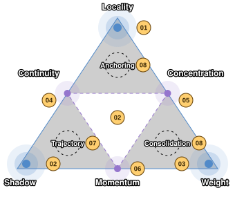

  

# Context Triad Research Atlas

The Research Atlas maps established research and applied engineering practices onto the [Context Triad](../Context_Triad.md#context-triad) and its proposed compound constructs. Its purpose is to relate existing findings, identify overlapping contextual relationships, and guide further investigation rather than claim that the underlying phenomena are newly discovered.

## Reading the Map

Amber numbered points identify external publications. Repeated numbers refer to the same publication in more than one location. The original dimensional markers and triangular geometry are retained; the research points are a separate layer.

Positions represent conceptual associations, not measured coordinates, effect sizes, publication counts, or evidence strength. The compound and higher-order constructs are proposed descriptive abstractions, not established independent variables or validated mechanisms.

## Construct Relationships

| Level | Construct | Composition | Proposed focus |
| --- | --- | --- | --- |
| Primary | [Semantic Locality](../Semantic_Locality.md) | — | Placement and distribution relative to use |
| Primary | [Semantic Shadow](../Semantic_Shadow.md) | — | Subsequent context and order-sensitive influence |
| Primary | [Semantic Weight](../Semantic_Weight.md) | — | Relative coherent support |
| Compound | Semantic Continuity | Locality + Shadow | Persistence of influence across contextual development |
| Compound | Semantic Concentration | Locality + Weight | Distribution of coherent support relative to use |
| Compound | Semantic Momentum | Shadow + Weight | Direction and accumulation of influence through contextual history |
| Higher-order | Semantic Anchoring | Continuity + Concentration | Attachment of influence to relevant points of use |
| Higher-order | Semantic Trajectory | Continuity + Momentum | Evolution of influence across successive operations |
| Higher-order | Semantic Consolidation | Concentration + Momentum | Organization and accumulation of support around an interpretation |

The plus signs indicate conceptual composition, not arithmetic addition or statistical interaction estimates. Consistency with a historical object remains distinct from correctness under the authorized current state.

## Research Index

| Point | Publication | Map association | Findings and relevance | Evidence relationship |
| --- | --- | --- | --- | --- |
|  R01 | Liu et al. (2024), [Lost in the Middle: How Language Models Use Long Contexts](https://aclanthology.org/2024.tacl-1.9/) | Locality | Relocating relevant information changes retrieval and question-answering performance. | Direct factor research |
|  R02 | Kurfali and Östling (2025), [Conflicting Needles in a Haystack: How LLMs Behave When Faced with Contradictory Information](https://aclanthology.org/2025.emnlp-main.1742/) | Shadow; multifactor research spanning the primary and pairwise constructs | Manipulates position, repetition, layout, and conflicting evidence; reports recency and repetition biases in answer selection. | Direct multifactor research |
|  R03 | Jin et al. (2024), [Tug-of-War Between Knowledge: Exploring and Resolving Knowledge Conflicts in Retrieval-Augmented Language Models](https://arxiv.org/abs/2402.14409) | Weight | Models tend to prefer more frequently presented evidence and evidence consistent with their internal knowledge. | Direct factor research |
|  R04 | Li et al. (2024), [Measuring and Controlling Instruction (In)Stability in Language Model Dialogs](https://arxiv.org/abs/2402.10962) | Continuity | Examines instruction drift during extended dialogue and an intervention to mitigate it. | Related empirical evidence |
|  R05 | Agrawal et al. (2024), [Can't Remember Details in Long Documents? You Need Some R&R](https://aclanthology.org/2024.findings-emnlp.742/) | Concentration | Periodic instruction reminders and in-context retrieval improve long-document question answering; the combined intervention does not isolate the effect of support distribution alone. | Related empirical evidence |
|  R06 | Zhang et al. (2024), [How Language Model Hallucinations Can Snowball](https://proceedings.mlr.press/v235/zhang24ay.html) | Momentum | Earlier erroneous answers can induce later false claims that models can recognize as false when evaluated separately. | Related empirical evidence |
|  R07 | Laban et al. (2025), [LLMs Get Lost in Multi-Turn Conversation](https://arxiv.org/abs/2505.06120) | Trajectory; Continuity | Multi-turn tasks show increased unreliability and persistence of premature assumptions. | Related empirical evidence |
|  R08 | Anthropic (2025), [Effective Context Engineering for AI Agents](https://www.anthropic.com/research/effective-context-engineering-for-ai-agents) | Anchoring; Consolidation | Describes practical approaches to context selection, compaction, structured memory, and agentic retrieval. | Applied engineering |

**Evidence relationships.** Direct factor research experimentally examines at least one relevant contextual variable. Related empirical evidence examines a phenomenon or compound intervention relevant to a construct without necessarily isolating that construct. Applied engineering describes implementations or practices, not independent validation of the proposed higher-order constructs.

## Scope and Evidence Status

The mappings are interpretations of the cited work within the Context Triad, not classifications asserted by the original authors. This initial selection is illustrative rather than exhaustive. No region's density should be interpreted as the amount of available research.

The atlas distinguishes existing evidence from proposed constructs and motivates controlled tests of whether the latter add explanatory, predictive, or operational value beyond the primary perspectives. Evidence of overlap does not establish a causal mechanism, the independence of any derived construct, or validation of the nine-construct framework.

## Assets

| File | Role |
| --- | --- |
| [Triad_Research_Atlas.svg](./Assets/Triad_Research_Atlas.svg) | Original expanded Triad with numbered research points |
| [Triad_Research_Overlay.svg](./Assets/Triad_Research_Overlay.svg) | Transparent standalone research-point layer using the same viewBox |

The combined SVG contains the independent group `research-point-overlay`. The SVG numbers correspond to the linked research index above; the index provides accessible publication links when GitHub renders the SVG as an image.

## Related Research

- [Context Triad](../Context_Triad.md#context-triad)
- [Context Triad Studies](../Studies/README.md#context-triad-studies)
- [Context Triad Model](../Context_Triad_Model/README.md#context-triad-model)
