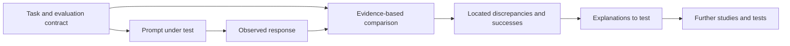

# Prompt Performance

## Abstract

**Prompt performance** concerns whether a model's observed response fulfills a specified task, including its decisions, required content, output structure, and delivery constraints. A prompt may state a correct rule without that rule governing every required output. This research studies **how task requirements are represented, applied at their points of use, and evaluated against observable results**.

The research develops performance definitions, evaluation distinctions, and testable explanations from the investigations cataloged in [Studies](./Studies/README.md). Individual studies supply evidence; this parent directory owns the research synthesized from that evidence. Neither a single benchmark nor a successful prompt version defines performance in general.

## Research Object

A prompt specifies or constrains a transformation, but performance is established by **the response relative to the task and its evaluator**, not by the prompt's apparent clarity or form alone. Performance analysis examines which features of a task specification affect decisions, required outputs, and the interpretation of tests.

Research therefore distinguishes the **specified obligation**, the **observed behavior**, and the **measurement used to judge it**. A correct field choice, a complete emitted object, a valid serialization, and an accepted response are related outcomes, but none automatically establishes the others.

## Performance Dimensions

Different tasks expose different dimensions of performance. The dimensions below are possible research lenses, not requirements for what constitutes a study.

| Dimension | Research question | Observable evidence |
| --- | --- | --- |
| Decision fidelity | Were inputs, eligibility rules, comparisons, and selections applied to the correct subjects? | Selected values, classifications, provenance, and decision-level discrepancies |
| Output coverage | Were all required objects, properties, members, and occurrences produced? | Field presence, finding completeness, collection membership, counts, and ordering |
| Representation and delivery | Was the computed result expressed in the required form? | Schema and template conformity, operand formatting, complete-response acceptance |
| Verification | What properties were checked, and does the output support any reported success? | Check coverage, source-to-output consistency, external acceptance |
| Substantive utility and resource cost | Was the response useful, and at what execution or interaction cost? | Task-specific utility measures, time, tokens, retries, or human effort—when explicitly collected |

These measurements have different units and denominators. For example, strict exact-response acceptance and field-level accuracy answer different questions; neither is an interchangeable measure of overall usefulness.

## Specification and Evaluation Boundaries

The recurring research problem is **obligation versus application**: a rule can be present in the specification while its intended consequence is absent, misclassified, or incorrectly rendered in the result.

This diagram describes the research workflow, not a model's hidden reasoning. It also distinguishes a changed prompt from an explanation of *why* a result changed. A version-to-version improvement is an observed contrast; attributing it to one edit requires a design capable of isolating that edit.

## Research Distinctions from Studies

Available study evidence motivates several separations worth testing beyond their original task:

- **Evidence domain versus decision rule.** Eligibility, preference, reporting, and tie conditions can inspect different populations. The correct scope depends on the task.
- **Decision versus output obligation.** A supported result must also reach the required output field, including cases where neighboring values are unresolved.
- **Membership versus content completeness.** A required finding can exist while one of its components or a downstream collection contribution is missing.
- **Shared instruction versus consumer binding.** Reuse, compression, and instruction placement can alter the relationships a consumer must recover; their form alone does not determine performance.
- **Requested checking versus demonstrated acceptance.** A validation instruction, reported success flag, prescribed test, and independent acceptance result can cover different properties.

These are **research distinctions and hypotheses for further testing**, not claims that a particular wording, prompt length, or notation reliably improves unrelated tasks. The originating evidence and its limits remain in the individual study reports.

## From Studies to Research

The [Studies collection](./Studies/README.md) is open-ended: studies can address varied questions and use whichever methods, materials, or forms suit the work. They need not share a fixed structure, protocol, scoring system, or evidence format. Multiple analyses of shared material may be presented together where appropriate.

**Derived research** compares what such evidence can establish: which relationships recur, which findings remain task-specific, what alternative explanations survive, and which controlled or cross-task tests are needed. A study's observed result can support a local explanation without demonstrating a general causal effect. Independent investigations can support, qualify, or challenge earlier interpretations.

The [Studies index](./Studies/README.md) is the catalog of investigations. This parent directory is the home for synthesis, conceptual accounts, measurement distinctions, and research propositions developed from them.

## Evidence and Limits

Evidence should retain its status when incorporated into research:

- **Specification analysis** establishes what a formulation requires, omits, or leaves ambiguous.
- **Recorded behavior** establishes what a model returned under documented conditions and how that response was judged.
- **Verified static results** establish outcomes of particular syntax or reference checks, not necessarily behavioral correctness.
- **Causal and transfer claims** require suitable controlled comparisons, replications, or independently evaluated settings.

Adaptive sequences, bundled prompt edits, single-fixture tests, and selectively reviewed failures can reveal meaningful construction problems without isolating an edit's causal effect. Performance conclusions remain bounded by the stated tasks, metrics, and conditions.

## Research Directions

Research can extend these distinctions through separately specified tasks, controlled prompt variations, cross-model replication, and evaluations that distinguish decision accuracy from response completeness and practical usefulness. Other directions include testing rule reuse and locality under matched content, measuring efficiency alongside correctness, and assessing whether verification catches errors outside a prescribed check set.

New studies of these or other questions can be cataloged under [Studies](./Studies/README.md). Research-level conclusions drawn from them should state the extent of their evidential support.

## Study Evidence

The [study catalog](./Studies/README.md) currently includes the [ArcGrav Authority Resolution Benchmark prompt-refinement trials](./Studies/ArcGrav_ARB_Trials/README.md). That archive contains the observed responses, trial audit, evidence ledger, and seven thematic analyses that inform the research distinctions summarized here. Its task-specific findings and strict-response measurements must be read within the study's stated scope.

## Related Research

- [Instructional Representation](../Instructional_Representation.md) examines how instruction meaning and program-like structure differ.
- [ArcGrav Interpretive Efficiency](../ArcGrav_Interpretive_Efficiency.md) examines the cost of recovering meaning from a representation.
- [Context Triad](../Context_Triad/README.md) examines locality, later context, and relative support at points of use.
