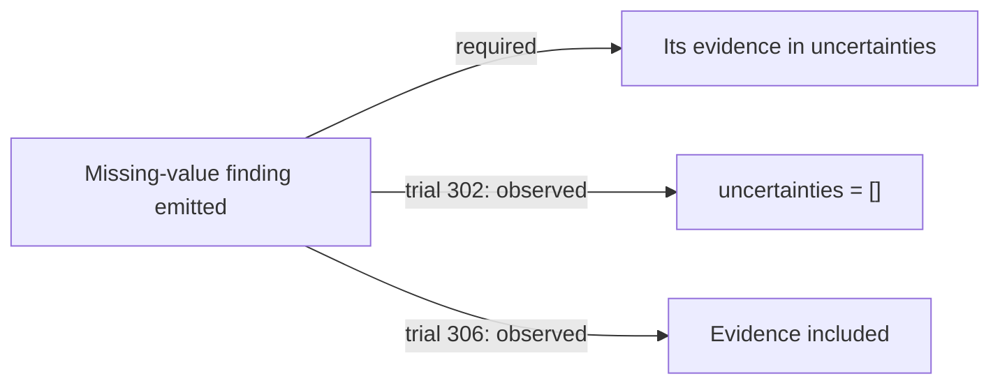
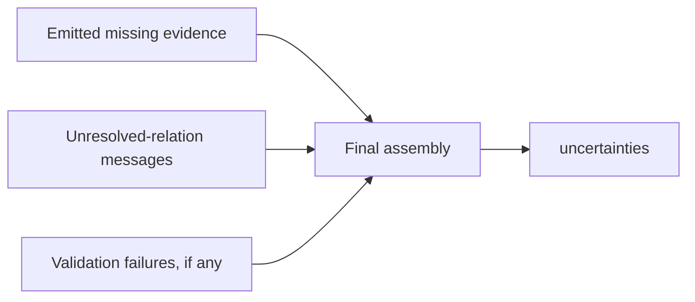
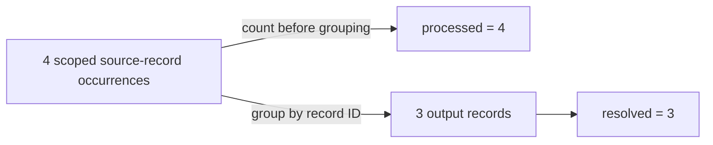
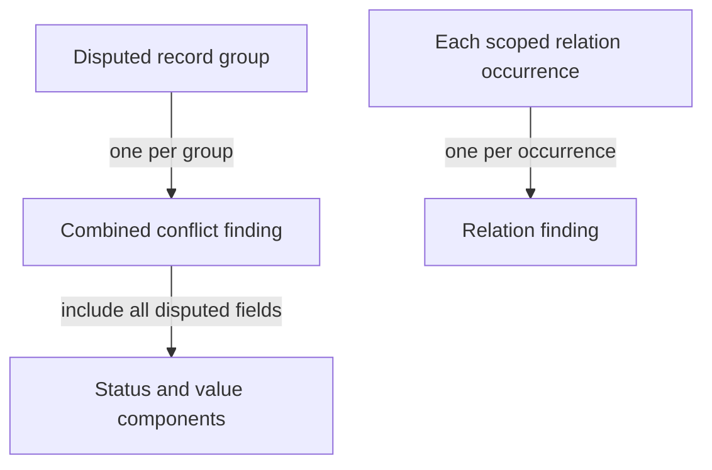
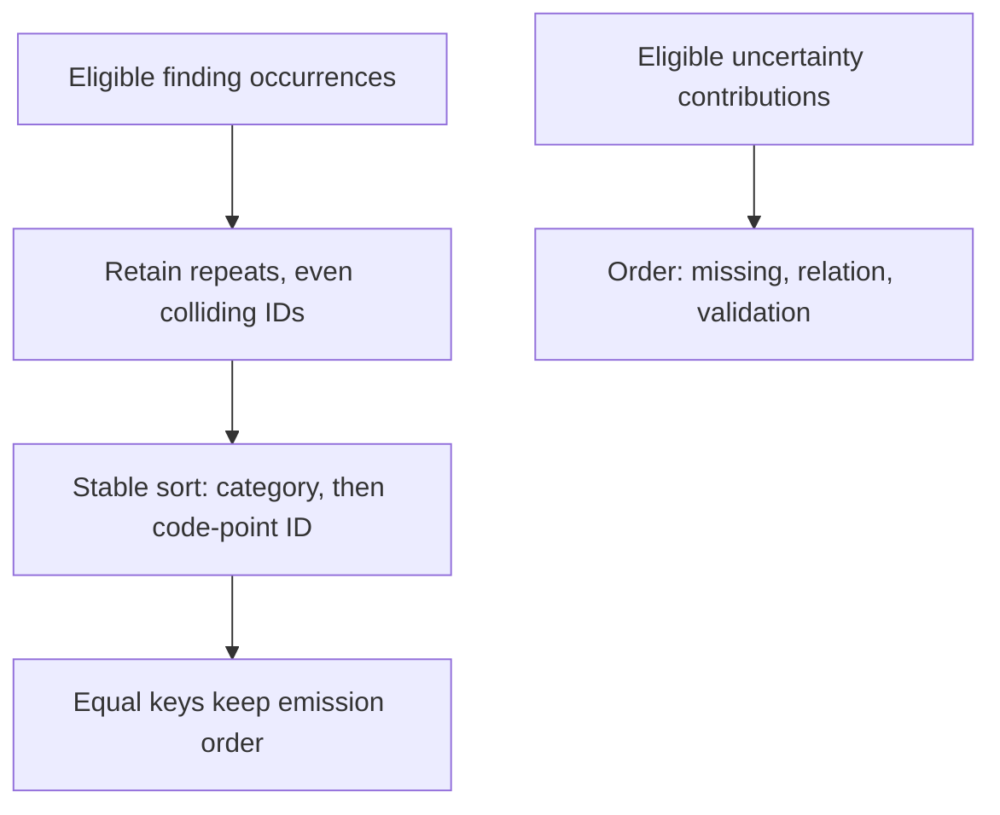

<a id="paper-collection-semantics"></a>
# Collection Membership, Multiplicity and Order

**Study context:** This thematic analysis belongs to the single [ArcGrav Authority Resolution Benchmark prompt-refinement trials study](./README.md), using one fixed fixture. Its trial contrasts describe observed outcomes, not isolated causal effects of individual edits.

## Abstract

Collection correctness requires **membership**, **multiplicity** and **order** rules. Recorded outputs omitted evidence already present in a finding, counted grouped records instead of source occurrences, and split or omitted required findings. Specify producer-to-member mappings, emission units, count populations and assembly order separately. The trial contrasts show associations, not isolated effects of wording.

## Core distinction

**Membership** selects the producers that contribute members. **Multiplicity** sets how many members each producer emits. **Order** arranges the retained members. Counts additionally require a population and a measurement stage. A type such as `array of strings` defines shape, not membership. Collection rules concern whole members; [evidence assembly](./Evidence_Assembly_and_Exact_Rendering.md) concerns their internal components.

## Scope

The fixed fixture has four scoped source-record occurrences across three record IDs. It requires three output records, one uncertainty string and five findings: a combined conflict, a missing-value finding, an instruction-content finding and two scoped relation findings. Prompt revisions were iterative, not isolated interventions. Colliding finding IDs, equal-key ties and ordering among multiple uncertainties were not independently tested.

## Observations

### 1. Type does not establish membership

**Finding.** A missing-value finding can be present while its required evidence is absent from `uncertainties`. An element type permits both outputs; a contribution rule distinguishes them.



**Evidence.** Trials 302 and 306 emitted the same evidence for `missing:item_2:value`. Only trial 306 included it in `uncertainties`. `V053.A01` named missing evidence, unresolved-relation messages and validation failures as contributors. Empty arrays occurred in 19/305 earlier outputs and 0/102 later outputs; some earlier cases also lacked the producing finding. The V53 type, membership and order annotations share one edited line, so the contrast does not isolate a wording effect.

**Construction.** State a producer-to-member rule: “For each unresolved finding, include its evidence string.” An empty collection is correct when no producer qualifies. Reevaluate membership after a repair. [Evidence 1](#evidence-1).

### 2. Final collections combine stage contributions

**Finding.** A validation stage with no failures can coexist with earlier uncertainties. The final collection needs a rule for combining or reconciling its contributors.



**Evidence.** Trial 251 emitted `missing:item_2:value` and reported `execution.validated=true`, yet returned `uncertainties=[]`. Earlier clauses `V003.A19` and `V003.A22` required retention and forbade replacement by validation failures alone. The result proves omission of a required contribution, not an internal overwrite mechanism.

**Construction.** Define whether each stage **appends**, **replaces** or **recomputes** members. A clean review adds no review failures; it need not erase existing data issues. If resolved issues should disappear, recompute from current qualifying producers rather than retain stale entries. [Evidence 2](#evidence-2).

### 3. Counts attach to a population and stage

**Finding.** Four source-record occurrences become three grouped records. The fixture defines `processed` over occurrences before grouping, including repeats.



**Evidence.** Trials 185–186 reported `execution.processed=3`; trial 187 reported 4. `V039.A01` clarified “scoped source-record occurrences before grouping including repeats.” This discrepancy occurred in 12/186 earlier outputs and 0/221 later outputs. Earlier prompts already described occurrence counts, so the trajectory is descriptive. In this fixture, `resolved` counts emitted records, including unresolved ones; `findings` counts emitted finding occurrences.

**Construction.** Define each count's **population**, **stage** and **repeat policy**. “Accepted purchase events before grouping by customer” counts transactions; “unique customers” counts grouped identities. Neither count substitutes for the other. [Evidence 3](#evidence-3).

### 4. Emission units differ from their components

**Finding.** A disputed group emits one combined conflict finding with every required field component. Each scoped relation occurrence emits its own finding. Object cardinality and component completeness require separate checks.



**Evidence.** Trial 160 split a group conflict into status and value findings, yielding six findings instead of five. Trial 164 had five findings but omitted the combined conflict's status component; trial 167 passed exactly. Trial 374 omitted a required relation and had four findings; trial 378 included both relations and had five. `V033.A02` specified the combined finding, and `V059.A01` added a relation-occurrence recheck. The revisions contained other changes; the counts are consequences of member differences, not independent effects.

**Construction.** Assign **one output per group**, **per event** or **per relation occurrence** as the task requires. Then define components inside each member. Verify source-to-member coverage and member-internal coverage separately; an aggregate total can hide offsetting omissions and extras. [Evidence 4](#evidence-4).

### 5. Order operates on retained occurrences

**Finding.** Sorting arranges the members already emitted. It cannot add an omitted relation, merge split conflicts or decide whether repeated IDs represent distinct required occurrences.



**Evidence.** `V011.A05` retains duplicate IDs; `V011.A21` stabilizes equal-key order; `V011.A22` specifies Unicode code-point comparison rather than locale or natural collation. `V031.A20` combines repetition and stability requirements. Sorting cannot repair trial 160's extra conflict or trial 374's omitted relation. Colliding IDs, equal keys, alternate collation and multi-entry uncertainty ordering remain untested requirements.

**Construction.** Select members and their occurrence policy before sorting. For example, emit one invoice line per submission, even when vendors repeat, then sort stably by vendor. Preserve source-required repetitions without preserving accidental duplicate output objects. [Evidence 5](#evidence-5).

## Conclusion

Define a collection as **contributors → emission units → occurrence policy → assembly → order**. Define count populations separately. Verify source-to-member coverage before treating counts or sorted output as evidence of completeness.

## Supporting evidence

Exact prompt formulations come from the [Evidence Ledger](./Data/Evidence_Ledger.json); trial values come from the [Trial Audit](./Data/Trial_Audit.json). The records below preserve the source excerpts, trial contrasts and material limitations.

<a id="evidence-1"></a>
### Evidence 1 — Missing-value membership

`V053.A01`, before, snapshot 52, line(s) 222:

```text
  3. `uncertainties`: strings
```

`V053.A01`, after, snapshot 53, line(s) 222:

```text
  3. `uncertainties`: array containing all emitted [Missing] evidence then unresolved-relation messages then validation failures
```

Trial 302, `findings[missing:item_2:value]`: `evidence="Record 'item_2' has no resolvable explicit 'value' value"`. Trial 306, `findings[missing:item_2:value]`: `evidence="Record 'item_2' has no resolvable explicit 'value' value"`.

Trial 302 has `uncertainties=[]`; trial 306 contains the displayed evidence string in that array. Empty arrays occur in 19/305 outputs before trial 306 and 0/102 afterward. Some earlier empty-array outputs also omit the upstream finding, so that metric alone is broader than the produced-but-not-collected phenomenon. `V053.A01`, `V053.A02` and `V053.A03` interpret type, membership and order on the same changed line; they are not three independently tested edits. Earlier array typing (`V020.A01`) and retention rules (`V003.A19`, `V003.A22`) already existed, including recurrence at trial 251. V53's complete result is 16/19.

<a id="evidence-2"></a>
### Evidence 2 — Accumulation and validation

`V003.A19`, after, snapshot 3, line(s) 231:

```text
- Never remove missing evidence or relation uncertainties even when validation passes
```

`V003.A22`, after, snapshot 3, line(s) 237:

```text
- Never replace accumulated uncertainties with validation failures alone
```

Trial 251 contains `missing:item_2:value`, has `uncertainties=[]`, and reports `execution.validated=true`. The retention and nonreplacement clauses above already existed in earlier formulations, so this is a recurrence despite the written contract. `V053.A01` later enumerates contribution groups on the same line analyzed in Evidence 1. The required contribution is absent from the resulting collection.

<a id="evidence-3"></a>
### Evidence 3 — Population and stage of counts

`V039.A01`, before, snapshot 38, line(s) 202:

```text
    1. `processed`: scoped record count
```

`V039.A01`, after, snapshot 39, line(s) 202:

```text
    1. `processed`: scoped source-record occurrences before grouping including repeats
```

Trials 185 and 186 report `execution.processed=3` rather than 4 and have no other compared discrepancy; trial 187 reports 4. The predicate `execution.processed != 4` occurs in 12/186 earlier outputs and 0/221 later outputs. Earlier occurrence/pre-grouping formulations include `V010.A24`, `V017.A02`, `V019.A01` and `V024.A13`; the later boundary does not mean the intended population was newly introduced. `resolved` has a separate task-defined population: emitted records, including unresolved ones.

<a id="evidence-4"></a>
### Evidence 4 — Emission-unit cardinality

`V033.A02`, before, snapshot 32, line(s) 102:

```text
  - If either field is disputed emit exactly one finding:
```

`V033.A02`, after, snapshot 33, line(s) 103:

```text
  - Otherwise emit one combined finding for the group never one per field:
```

`V059.A01`, after, snapshot 59, line(s) 185:

```text
  5. Recheck [Relate] emits exactly one finding per scoped relation occurrence
```

Trial 160 emits `conflict:item_1:status` and `conflict:item_1:value`, producing six findings instead of five. Trial 164 has the combined conflict and correct count but omits its status component; trial 167 is an exact pass. Separately, trial 374 omits `relation:item_1:precedes:item_2` despite present endpoints and reports four findings; trial 378 contains both relations and five findings. The count changes follow the membership differences. The combined-conflict transition includes seven coded units.

<a id="evidence-5"></a>
### Evidence 5 — Duplicate retention and ordering

`V011.A05`, after, snapshot 11, line(s) 47:

```text
  - Never deduplicate even colliding IDs
```

`V011.A21`, after, snapshot 11, line(s) 186:

```text
  - Equal keys retain emission order
```

`V011.A22`, after, snapshot 11, lines 187–190:

```text
=> Compare lexically by Python Unicode code-point order:
  - No locale collation
  - No case folding
  - No natural sorting
```

`V031.A20`, after, snapshot 31, line(s) 180:

```text
=> Preserve equal-key emission order and all duplicate findings
```

Trials 160 and 374 provide the extra-member and missing-member counterexamples from Evidence 4. Neither discrepancy can be changed by reordering. The accepted fixture has only one uncertainty entry, so `V053.A03` supplies no test of its multi-group ordering requirement. Source-implied duplicate IDs, equal-key stability and alternate collation remain unexercised branches. These prompt lines specify ordering, not measured correctness under ties.

## Other analyses in this study

- [Inheritance, defaults and output obligations](./Inheritance_Defaults_and_Output_Construction.md): required fields within each producer.
- [Evidence ownership, assembly and rendering](./Evidence_Assembly_and_Exact_Rendering.md): component coverage within a retained member.

## References

- *Evidence Ledger*. Primary prompt formulations, semantic annotations and historical lint reports. [Preserved JSON](./Data/Evidence_Ledger.json).

- *Trial Audit*. Primary raw responses, completion metadata and output verdicts. [Preserved JSON](./Data/Trial_Audit.json).
