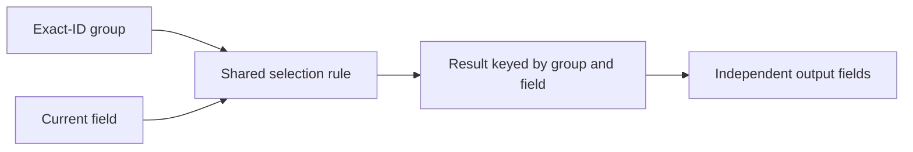
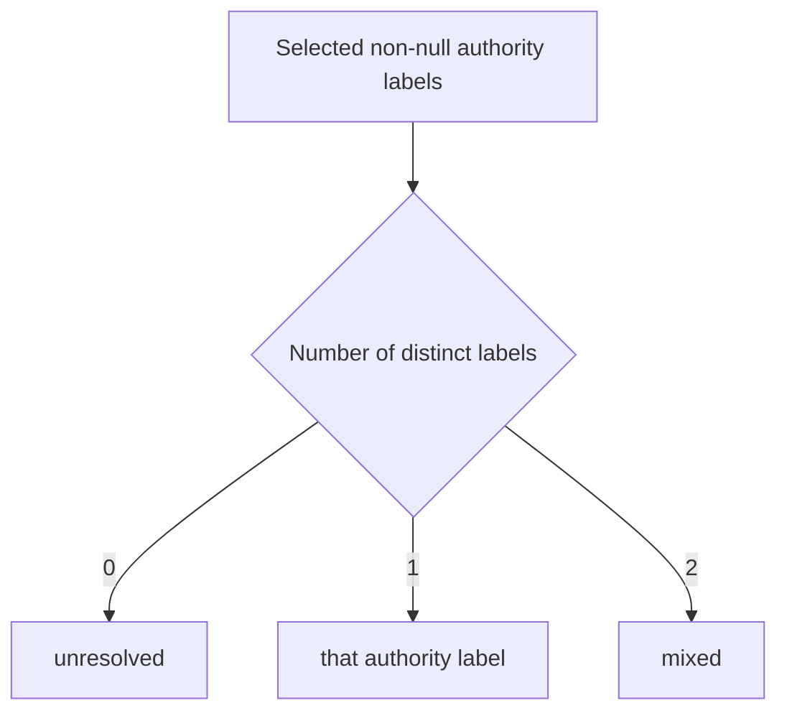
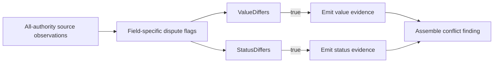
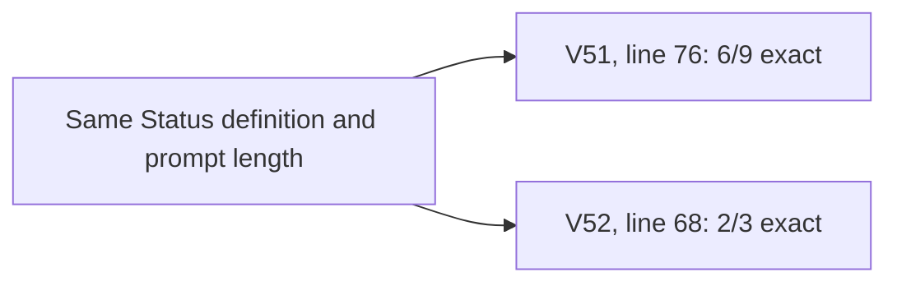

<a id="paper-prompt-composition"></a>
# Compression, Reuse and Instruction Locality

**Study context:** This thematic analysis belongs to the single [ArcGrav Authority Resolution Benchmark prompt-refinement trials study](./README.md), using one fixed fixture. Its trial contrasts describe observed outcomes, not isolated causal effects of individual edits.

## Abstract

Reuse, compression and placement shift different instruction dependencies. Shared procedures need bound subjects and owned results; compressed rules must retain case distinctions and output contributions; named predicates need explicit consumers. Moving an unchanged definition changes its position, not its meaning. The recorded contrasts show failures under multiple forms and no observed pass-rate improvement from relocation. The contribution is a way to preserve dependencies across rewrites, not a ranking of abstraction styles or prompt lengths.

## The construction distinction

**Composition** coordinates definitions, decisions and output obligations. **Reuse** shares a rule across applications. **Compression** shortens its expression. **Instruction locality** concerns its position relative to consumers. A rewrite can change several of these at once; each requires a separate account of what consumers must recover.

## Scope and evidence status

The record contains adaptive, multi-edit prompt revisions tested on one fixture. Exact-pass fractions describe those batches, not isolated causal effects or general reliability. Character counts measure prompt strings, not tokens, latency or cost. Diagrams depict required dependencies or recorded contrasts, not observed model internals.

## Observations and construction implications

### A reusable procedure still needs an explicit subject at each application

**Finding.** A shared selector for source `value` and `status` needs the current exact-ID group and field at each call. Its result must remain associated with that pair. Separate field procedures make the field implicit but still require independent field decisions.



**Evidence.** The specialized V10 form passed 1/3 trials; trial 34 nulls supported fields. The generic-loop V11 form passed 0/3; trial 36 loses a supported status. The extracted-selector V12 form passed 6/10; trial 39 is exact. Each revision bundles other changes, so these fractions do not rank specialization against reuse. [Supporting evidence 1](#evidence-1).

**Construction implication.** Reuse invariant logic with explicit `group` and `field` inputs and per-pair result ownership. Specialize when field-specific exceptions are clearer as local rules. Shared definitions avoid duplicated clauses; specialized blocks expose exceptions. Neither arrangement replaces the obligation to retain each supported field.

### Shorter wording and fewer consequential distinctions are different changes

**Finding.** Compression must preserve a task's case partition and output contributions. For a two-field authority summary, the distinct non-null selected authority labels determine the result; equal labels and a single present label both resolve to one authority.



**Evidence.** V8 condensed the authority cases (9,035 characters; 0/3): trials 27–28 lose supported status, while trial 29 omits uncertainties. V34 generalized separate value/status evidence clauses into one `{field}` template amid 29 changed units (7,140 characters; 0/2); trial 175 omits status-conflict evidence. V33 was 6/10, while V34–V38 totaled 0/13 across five different versions. These bundles do not isolate a length effect. [Supporting evidence 2](#evidence-2).

**Construction implication.** Before shortening a rule, check absent inputs, one present input, equal inputs and differing inputs. For a field template, specify which fields it covers and which evidence each contributes. Compact prose can be precise; length alone does not establish correctness.

### Naming a predicate moves its definition but does not complete its consumers

**Finding.** A named dispute predicate centralizes a condition, while every required output component remains a separate consumer. A value dispute and a status dispute may both require evidence within one conflict finding.



**Evidence.** V56 introduced shared dispute flags and consumer bindings, while clarifying the existing all-authority reporting scope (11/13). Trial 348 emitted `value: 8 (A), 9 (B)` but omitted the required status component. The output establishes a failed consumer obligation, not whether the predicate was miscomputed or its result was lost during assembly. [Supporting evidence 3](#evidence-3).

**Construction implication.** Define each predicate's evidence domain and bind every required consequence to it. Assemble field-specific components before combining them into one finding. Use separate predicates when consumers need different evidence domains.

### Moving a definition does not add a semantic qualification

**Finding.** Relocating an unchanged definition changes its distance from consumers, not the restriction it states. The `Status` declaration already says to use the source status column regardless of value.



**Evidence.** The `V052.A01` placement contrast keeps the declaration text unchanged. V51 and V52 are each 9,438 characters and have the same observed pass fraction. The comparison is small and adaptive: it shows no observed improvement, not equivalence across placements. [Supporting evidence 4](#evidence-4).

**Construction implication.** Put definitions before their consumers when that makes dependencies legible. Add a local qualifier only when the consumer needs a distinction that is not already specified. Evaluate added meaning separately from movement.

## Conclusion

Reuse, compression and placement redistribute distinct dependencies: input binding, case distinctions, consumer obligations and qualifications. Construct each around what its consumers must retain, then check the resulting outputs.

## Data and reproducibility

The notes retain exact excerpts from the [Evidence Ledger](./Data/Evidence_Ledger.json) and outcomes from the [Trial Audit](./Data/Trial_Audit.json). See the collection's [evidence scope](./README.md#scope-and-evidence-status) for trial definitions and shared limitations. No new trials are introduced.

<a id="evidence-1"></a>
### Evidence 1

`V010.A01`, after, snapshot 10, line(s) 60, 61:

```text
[Value]:
=> Resolve only source `value` members within one exact-ID group:
```

`V011.A14`, after, snapshot 11, line(s) 102:

```text
  - Visit [Fields] independently in listed order:
```

`V012.A05`, after, snapshot 12, line(s) 73, 74:

```text
[Select]:
- Inputs are one group and one current field
```

V10 expands field procedures and is 1/3; V11 uses a generic loop and is 0/3; V12 extracts a shared selector and is 6/10. Trial 34 under expansion nulls unambiguous selected fields; trial 36 under the loop loses the supported sibling; trial 39 under the shared selector is exact. These contrasts bundle several construction changes. `V030.A01` and `V031.A06` further contrast stored maps with source-defined choices; reference identity owns the observed binding failures, while this observation concerns application inputs.

<a id="evidence-2"></a>
### Evidence 2

`V008.A09`, after, snapshot 8, line(s) 88:

```text
    - `authority`: sole selected authority or "mixed" when different or "unresolved" when none
```

`V034.A12`, before, snapshot 33, line(s) 106, 107:

```text
      1. If value disputed include "value: " then all explicit source value observations
      2. If status disputed include "status: " then all explicit source status observations
```

`V034.A12`, after, snapshot 34, line(s) 94:

```text
      - "{field}: " then all explicit source data joined ", "
```

V8 is 9,035 characters and 0/3: trials 27–28 lose the supported status; trial 29 has correct records but empty uncertainties. V34 is 7,140 characters and 0/2 after a 29-unit bundle: trial 174 loses status and emits a missing-status finding; trial 175 also omits status conflict content. V33 is 6/10 and V34–V38 total 0/13. The exact case compression and component generalization are different textual changes.

<a id="evidence-3"></a>
### Evidence 3

`V056.A10`, before, snapshot 55, line(s) 104:

```text
      1. If value disputed include "value: " then all explicit source value observations
```

`V056.A10`, after, snapshot 56, line(s) 111:

```text
      1. If [Dispute].ValueDiffers include "value: " then all explicit source value observations
```

Trial 348, `findings[conflict:item_1]`: `evidence="value: 8 (A), 9 (B)"`.

`V056.A01`–`V056.A14` introduce reusable dispute flags, defaults and consumers and clarify the existing all-authority reporting scope; V56 is 11/13. Trial 348 omits the required status component despite these instructions. Predicate scope owns the all-authority comparison domain and rendering owns the missing component. The omitted component is a failed consumer obligation under explicit shared state.

<a id="evidence-4"></a>
### Evidence 4

`V052.A01`, before, snapshot 51, line(s) 76:

```text
- `Status`: source status column regardless of value
```

`V052.A01`, after, snapshot 52, line(s) 68:

```text
- `Status`: source status column regardless of value
```

`V052.A01`–`V052.A02` record declaration placement changes. V51 and V52 both contain 9,438 characters; their full pass counts are 6/9 and 2/3, the same fraction. The exact line above is unchanged. The confidence-materialization bundle in output obligations changes removal and local assignment as well as position, so it cannot substitute as evidence of a pure locality benefit. The broader locality construct is defined in [Semantic Locality](../../../Context_Triad/Semantic_Locality.md).

## Other analyses in this study

- [Reference identity and independent decisions](./Reference_Binding_and_Independent_Decisions.md): result identity and intermediate storage.
- [Inheritance, defaults and output obligations](./Inheritance_Defaults_and_Output_Construction.md): shared definitions at output producers.
- [Evidence ownership, assembly and rendering](./Evidence_Assembly_and_Exact_Rendering.md): component consumers of shared predicates.

## References

- *Evidence Ledger*. Primary prompt formulations, semantic annotations and historical lint reports. [Preserved JSON](./Data/Evidence_Ledger.json).

- *Trial Audit*. Primary raw responses, completion metadata and output verdicts. [Preserved JSON](./Data/Trial_Audit.json).
