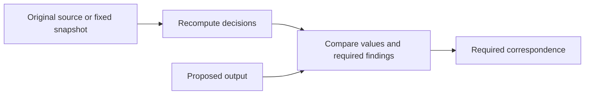
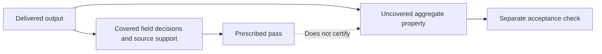
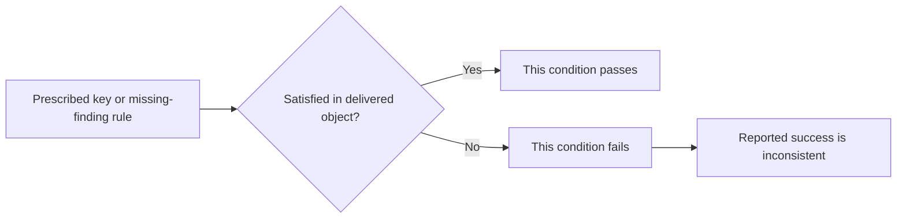
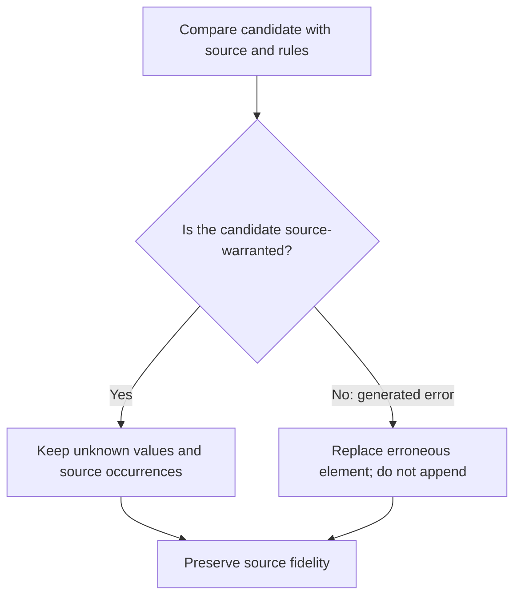

<a id="paper-construction-verification"></a>
# Construction Checks and Verification

**Study context:** This thematic analysis belongs to the single [ArcGrav Authority Resolution Benchmark prompt-refinement trials study](./README.md), using one fixed fixture. Its trial contrasts describe observed outcomes, not isolated causal effects of individual edits.

## Abstract

Verification has four boundaries: its reference, tested conditions, evidence of correct execution, and authority to repair. Recorded outputs distinguish an error outside validator coverage from a success flag contradicted by covered failures. Source-based review can specify stronger obligations without proving they were applied. Prompt construction must separate review, prescribed validation, and external acceptance while preserving legitimate outcomes.

## The construction distinction

**Construction review** compares a proposed result with its original source and task rules. **Prescribed validation** applies a defined set of tests. **External acceptance** judges the complete delivered response. A check therefore needs an inspected object, a reference, test conditions, and permitted corrections. These assessments can disagree without being interchangeable.

## Observations and construction implications

### A requested recheck specifies obligations, not observed execution

A request to recheck does not demonstrate that checking occurred correctly. Recomputing decisions from the source supplies a reference independent of the generated answer; comparing only generated summaries can retain a shared error.

The specified review contract is:



**Evidence.** Under the source-reconstruction instruction, trials 181 and 182 retained a null value but labeled the partial record explicit/high and omitted its required missing finding. V37 passed 0/2 exact trials after an 18-unit change bundle. Trial 374 omitted one relation finding; trial 378, after an explicit occurrence recheck was added, included both. V59 passed 29/30, including twenty consecutive exact passes at trials 388–407. The bundled changes do not isolate a recheck effect.

**Construction implication.** Name the original reference, each decision to recompute, and its dependent output obligations. For relations, check one finding per scoped source occurrence. Fix a snapshot or time boundary when source data may change. Assess correspondence in the returned output, not the presence of a review instruction.

[Supporting evidence 1](#evidence-1).

### A passing validator establishes only its covered properties

A validator may correctly apply its listed tests while an unchecked property remains wrong. Source support for selected fields and an aggregate label computed from those fields are separate obligations.



**Evidence.** Trial 387 returned the correct `status="active"` and required missing-value finding, but `records[item_2].authority="mixed"` instead of `"A"`. It reported `execution.validated=true`. The prescribed checks and canonical implementation cover field decisions and source support, not a direct comparison of that aggregate authority label. The error is outside the specified tests, not evidence that those limited tests malfunctioned.

**Construction implication.** Define what a passing flag certifies, then compare its coverage with acceptance requirements. A task reproducing a prescribed validator should retain its specified flag and report broader errors separately. A task requiring comprehensive correctness must authorize the additional checks.

[Supporting evidence 2](#evidence-2).

### A reported pass can contradict a covered requirement

A success flag is a returned claim, not independent proof of validation. When the delivered object violates a prescribed condition, `validated=true` conflicts with correct evaluation of that condition.



**Evidence.** Trial 195 omitted three required confidence keys while reporting `execution.validated=true`. Trials 181 and 182 omitted the prescribed missing-data finding for a null field and also reported true. Unlike trial 387's uncovered aggregate error, these violations fall inside validation coverage. The outputs do not reveal whether checks were skipped, misapplied, or followed by a change.

**Construction implication.** Compare the delivered keys and required findings with the declared tests, preferably through independent execution. Keep whole-response acceptance separate: trial 310's correct extracted JSON still failed strict acceptance because its delivery included additional assistant text.

[Supporting evidence 3](#evidence-3).

### Repair must preserve source-legitimate outcomes

Repair authority permits correction of a generated error, not alteration of a valid unresolved result or source-implied repetition. A passing validator cannot become a reason to invent evidence.



**Evidence.** V37 specifies replacement rather than appending, preservation of source occurrences and unresolved results, no new findings or validation tests from the check, and no repair solely to obtain a pass. Its NaN and source-implied duplicate-ID exceptions were not behaviorally tested. Trials 181 and 182 retained a legitimate null but lost its finding and mislabeled its metadata; the outputs do not identify a repair step as the cause.

**Construction implication.** State the correction target, allowed operation, and preserved invariants. Distinguish a duplicate generated during repair from repeated source occurrences. Neither blanket deduplication nor forced resolution is a safe substitute for source comparison. Changing source data or validator rules requires separate authority.

[Supporting evidence 4](#evidence-4).

## Scope and evidence status

Prompt wording establishes specified checks; trial responses establish observed discrepancies. The trials used one fixture and evolving, often bundled formulations, so neither causal effects of individual edits nor private checking steps are established. Verified static lint repairs belong to [reference identity](./Reference_Binding_and_Independent_Decisions.md); they do not certify behavioral correctness. Illustrative examples are not additional experiments.

## Conclusion

Verification becomes informative when its reference, coverage, execution evidence, and repair authority remain distinct. A reported pass has the scope of the checks actually warranted; a valid correction preserves what the source requires.

## Supporting evidence and reproducibility

Exact prompt lines come from the [Evidence Ledger](./Data/Evidence_Ledger.json); output values and verdicts come from the [Trial Audit](./Data/Trial_Audit.json). The [canonical specification](../../../../AgMark/Authority_Resolution_Benchmark/Legacy_Content/ARB_Spec.md) and [implementation](../../../../AgMark/Authority_Resolution_Benchmark/Legacy_Content/Authority_Resolution_Benchmark.py) define the prescribed task.

<a id="evidence-1"></a>
### Evidence 1 — requested review and relation coverage

`V037.A02`, after, snapshot 37, line 148:

```text
  1. Recompute each group-column [Choice] independently from source:
```

`V059.A01`, after, snapshot 59, line 185:

```text
  5. Recheck [Relate] emits exactly one finding per scoped relation occurrence
```

Trials 181 and 182 retained a null value but marked the partial record explicit/high and omitted the required `missing:item_2:value` finding. V37 was 0/2 exact after an 18-unit bundle. Trial 374 lacked one relation finding; trial 378 included both after the explicit occurrence recheck. V59 was 29/30 over trials 378–407, with its sole failure at trial 387; trials 388–407 were twenty exact passes. These sequential observations do not isolate the effect of one instruction.

<a id="evidence-2"></a>
### Evidence 2 — validator coverage

`V011.A25`, after, snapshot 11, line 237:

```text
  - Then independently require source support for each resolved field:
```

Trial 387, `records[item_2]`: `status="active"` (correct), `authority="mixed"` (expected `"A"`), and `execution.validated=true`. The required missing-value finding was present; aggregate authority was the sole parsed discrepancy. The final prompt and [canonical implementation](../../../../AgMark/Authority_Resolution_Benchmark/Legacy_Content/Authority_Resolution_Benchmark.py) test field decisions and source support without directly comparing the aggregate authority with its computed value. The construction review separately requests metadata checking. The Golden and specification remain unchanged.

<a id="evidence-3"></a>
### Evidence 3 — covered failures and delivery acceptance

Trial 195, `findings[instruction-content:item_3:note]`: `confidence="[ABSENT]"`. Three required confidence keys were omitted despite `execution.validated=true`; the prescribed schema check requires them. Trials 181 and 182 likewise reported true while omitting the missing-value finding required for their null field. These are covered violations, unlike trial 387's unchecked aggregate label.

Static lint confirmed six reference-structure diagnostic removals, reported separately in the [reference identity paper](./Reference_Binding_and_Independent_Decisions.md). Trial 310 had a correct extracted JSON payload plus extra assistant text: its full response failed strict acceptance. The [rendering paper](./Evidence_Assembly_and_Exact_Rendering.md) owns that response-envelope analysis.

<a id="evidence-4"></a>
### Evidence 4 — correction limits

`V037.A10`, after, snapshot 37, line 158:

```text
  - Replace erroneous elements without appending copies
```

`V037.A12`, after, snapshot 37, line 159:

```text
  - Preserve source occurrences and legitimate unresolved results
```

`V037.A15`, after, snapshot 37, line 161:

```text
- This check emits no findings and adds no validation conditions
```

`V037.A17`, after, snapshot 37, line 162:

```text
- Never repair data merely to make validation pass
```

`V037.A13`–`V037.A14` additionally preserve selected scalar NaN and source-implied duplicate finding IDs. These branches and replacement-versus-append behavior were not tested as repairs; they are specification analysis. Trials 181 and 182 show a retained null with inconsistent findings and metadata, without exposing the private construction sequence.

## Other analyses in this study

- [Reference identity and independent decisions](./Reference_Binding_and_Independent_Decisions.md): static repairs and aggregate operands.
- [Inheritance, defaults and output obligations](./Inheritance_Defaults_and_Output_Construction.md): required keys and metadata.
- [Collection membership, multiplicity and order](./Collection_Membership_Multiplicity_and_Order.md): source occurrence preservation.
- [Evidence ownership, assembly and rendering](./Evidence_Assembly_and_Exact_Rendering.md): full-response acceptance.

## References

- *Evidence Ledger*. Prompt formulations, semantic annotations, and historical lint reports. [Preserved JSON](./Data/Evidence_Ledger.json).
- *Trial Audit*. Raw responses, completion metadata, and verdicts. [Preserved JSON](./Data/Trial_Audit.json).
