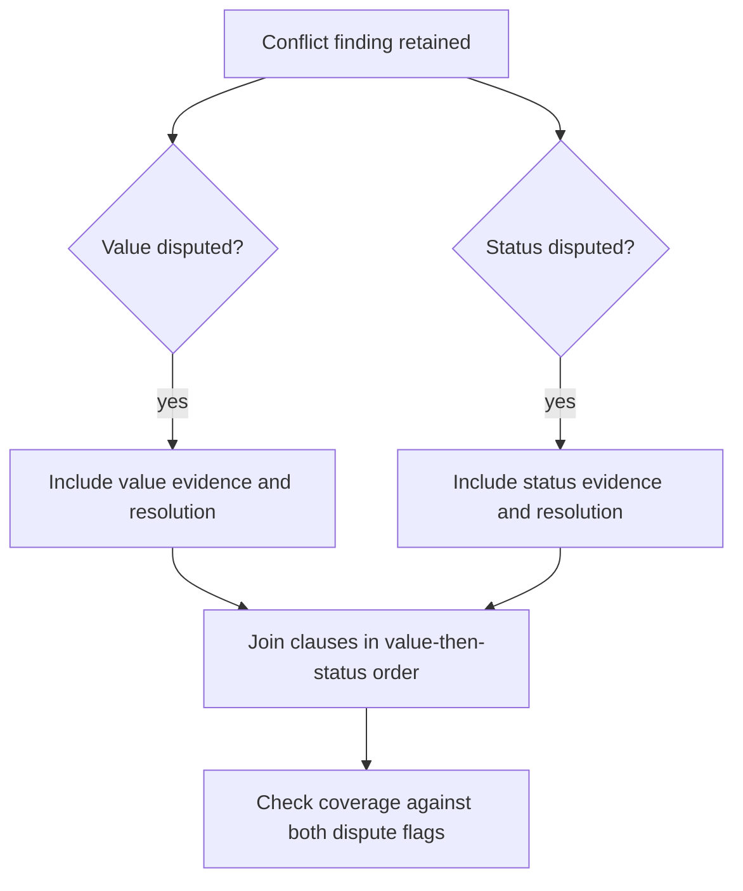
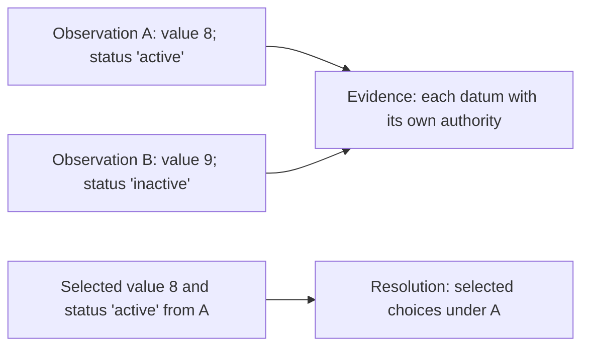
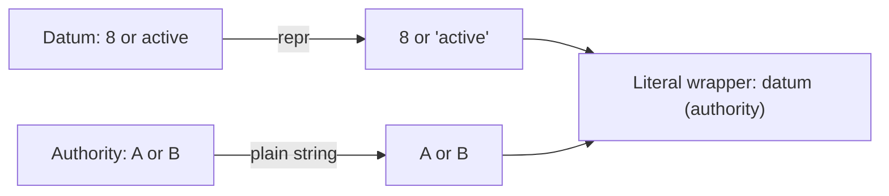
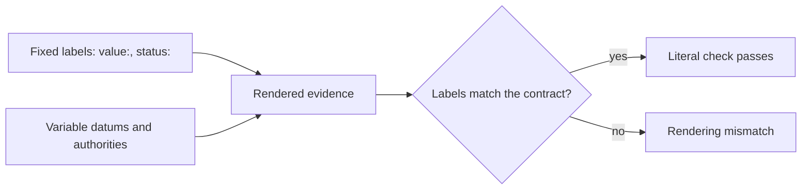
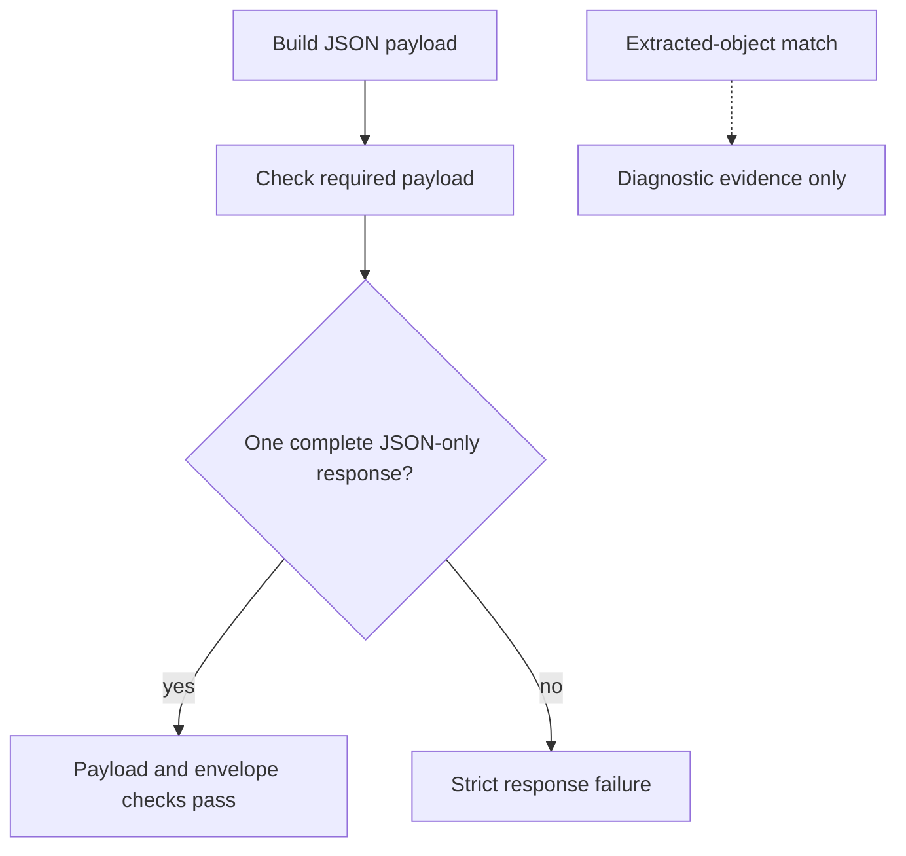

<a id="paper-evidence-rendering"></a>
# Evidence Ownership, Assembly and Rendering

**Study context:** This thematic analysis belongs to the single [ArcGrav Authority Resolution Benchmark prompt-refinement trials study](./README.md), using one fixed fixture. Its trial contrasts describe observed outcomes, not isolated causal effects of individual edits.

## Abstract

A correctly selected finding can still fail during assembly or rendering. Recorded failures include missing field clauses, quoted source labels, changed literal capitalization and extra text accompanying correct JSON. Five observations distinguish component coverage, evidence provenance, operand conversion, fixed template text and the response envelope. Each requires its own construction and acceptance rule.

## Core distinction

**Evidence ownership** pairs each displayed datum with its source. **Assembly** includes and orders the required components of a finding. **Rendering** converts operands, preserves literal text and delivers the complete response in the accepted form. These are within-finding and delivery obligations; [collection membership](./Collection_Membership_Multiplicity_and_Order.md) governs whether the finding itself is emitted.

The examples compare exact prompt excerpts in the [Evidence Ledger](./Data/Evidence_Ledger.json) with recorded outputs in the [Trial Audit](./Data/Trial_Audit.json). Bundled prompt edits and observed responses establish specification distinctions and failure cases, not isolated effects of individual instructions. Internal model steps are unobserved. Exact formatting matters when the consumer's contract requires it.

## Observations

### A retained finding can omit required components

**Finding.** Finding membership and component completeness are independent. A conflict finding may exist while one disputed field is absent from both its evidence and resolution.



**Evidence.** The fixture requires a value clause and a status clause when both fields are disputed. Trials 283 (`V50`) and 348 (`V56`) emitted only value clauses; trial 375 (`V58`) emitted only status clauses. Trial 164 already had the correct number of conflict findings but incomplete status coverage. `V051.A02` and `V051.A03` split a generic field template into explicit inclusion rules. Omissions persisted under later explicit formulations, so clause enumeration made requirements visible without ensuring compliance. The output does not show whether a missing clause was skipped or lost during assembly. [Supporting evidence 1](#evidence-1).

**Construction implication.** Derive required clauses from each dispute condition, attach the corresponding evidence and resolution, then check coverage after joining. Use task-derived coverage for open-ended syntheses rather than assuming a fixed pair of fields.

### Evidence provenance and decision provenance are different bindings

**Finding.** Each displayed observation retains its own source; a resolution names the authority supporting the selected choice. Applying the winning authority to every alternative erases the recorded disagreement.



**Evidence.** Trial 272 displays `8 (A), 9 (B)` and `'active' (A), 'inactive' (B)` in evidence, while its resolution selects `A` for both fields. `V051.A05` binds each observation's datum and authority; `V051.A13` binds each choice's datum and authority. Trials 283 and 348 also retain source-labelled value evidence while omitting status, separating provenance from coverage. This is a correctly paired result, not a measured gain from either wording change. Relabeling `9 (B)` as `9 (A)` would corrupt the evidence even if the selected value stayed 8. [Supporting evidence 2](#evidence-2).

**Construction implication.** Bind source labels at the level of the displayed claim: observation sources for alternatives, choice authorities for decisions. Define a separate provenance rule for synthesized or aggregated claims.

### Conversion rules belong to individual operands

**Finding.** A datum's quoted representation does not make its adjacent authority a quoted value. The two operands have separate rendering rules.



**Evidence.** Trials 324 and 355 placed repr-style quotes around evidence authorities, as in `8 ('A')`, although resolution authority labels remained unquoted. `V055.A01` explicitly changed the authority conversion to `!s`; trial 355 still showed the quoting error. `V058.A01` then added a no-quotes guard. The other observed failures under V58 involved component omission and sibling-null status; they do not establish an adverse effect of that guard. [Supporting evidence 3](#evidence-3).

**Construction implication.** Specify each operand's conversion (`!r` for datum representation, `!s` for plain authority text) separately from parentheses and separators. Avoid applying a second conversion to already serialized data. Check the final evidence string, not just the selected authority.

### Fixed labels are part of an exact-output contract

**Finding.** Exact labels are literal template material. Capitalization changes can invalidate otherwise correct evidence and decisions.



**Evidence.** Trial 293 emitted `Value:` and `Status:` in evidence and `Value=` and `Status=` in resolution, where lowercase labels were required. Its values and selected authorities were otherwise correct. `V033.A03` specified the literal `"value: "` prefix. The failure is textual, not a mistaken source choice; the record does not isolate an instruction that would prevent its recurrence. [Supporting evidence 4](#evidence-4).

**Construction implication.** Mark labels, case, punctuation and separators as fixed; substitute only the variable operands. Test literal equality for exact fixtures. Allow natural variation when the consumer accepts equivalent prose.

### Payload correctness and response-envelope correctness are separate

**Finding.** A correct parsed JSON object can still fail when the complete assistant response violates message or text boundaries.



**Evidence.** Trial 310's extracted JSON matched the expected object with zero parsed differences, but the completion contained two assistant messages and 228 extra characters. The strict verdict failed. Other multi-message cases were trials 51, 66, 179 and 221; some also had object discrepancies. `V011.A29` required one line, and `V034.A29` prescribed compact JSON without surrounding whitespace. These rules and the observed extra message must be assessed separately; neither proves that another envelope instruction would prevent recurrence. [Supporting evidence 5](#evidence-5).

**Construction implication.** Specify the payload and complete-response envelope together: for example, “Return exactly one JSON object as the complete response.” Validate the full completion, including message count and exact text; treat extraction as diagnosis, not acceptance. A conversational interface allowing explanatory text has a different envelope contract.

## Conclusion

Component coverage, claim-level provenance, operand conversion, literal labels and response boundaries are distinct obligations. Construct and validate each against the consumer's contract.

## Data and reproducibility

The notes below substantiate the construction observations above. Exact prompt lines come from the [Evidence Ledger](./Data/Evidence_Ledger.json); output values come from the [Trial Audit](./Data/Trial_Audit.json).

<a id="evidence-1"></a>
### Evidence 1

`V051.A02`, before, snapshot 50, line(s) 103:

```text
      - "{field}: " then all explicit source data joined ", "
```

`V051.A02`, after, snapshot 51, line(s) 103:

```text
      1. If value disputed include "value: " then all explicit source value observations
```

`V051.A03`, after, snapshot 51, line(s) 104:

```text
      2. If status disputed include "status: " then all explicit source status observations
```

Trial 283, `findings[conflict:item_1]`: `evidence="value: 8 (A), 9 (B)"`, `resolution="value=8 prevailed under authority A"`.

The required strings contain both value and status components. Trials 283 and 348 contain only the value component, despite different explicit formulations; trial 375 instead omits the value component. Trial 164 already has correct combined-finding cardinality but incomplete status coverage. `V051.A02`–`V051.A21` jointly specialize component inclusion, provenance and templates. These failures distinguish component coverage from membership.

<a id="evidence-2"></a>
### Evidence 2

`V051.A05`, before, snapshot 50, line(s) 104:

```text
      - "{datum!r} ({authority})"
```

`V051.A05`, after, snapshot 51, line(s) 107:

```text
        - Use that observation's datum and authority
```

`V051.A13`, after, snapshot 51, line(s) 118:

```text
      - Use each choice's datum and authority
```

Trial 272, `findings[conflict:item_1]`: `evidence="value: 8 (A), 9 (B); status: 'active' (A), 'inactive' (B)"`, `resolution="value=8 prevailed under authority A; status='active' prevailed under authority A"`.

This output pairs 8/active with `A` and 9/inactive with `B`, while its resolution selects `A`. The excerpts articulate observation ownership versus choice ownership. The excerpts occur among interacting evidence-assembly changes. Record-level aggregate authority is analyzed separately in reference identity.

<a id="evidence-3"></a>
### Evidence 3

`V055.A01`, before, snapshot 54, line(s) 107:

```text
        - "{datum!r} ({authority})"
```

`V055.A01`, after, snapshot 55, line(s) 107:

```text
        - "{datum!r} ({authority!s})"
```

`V058.A01`, after, snapshot 58, line(s) 115:

```text
        - Add no repr quotes around authority
```

Trial 355, `findings[conflict:item_1]`: `evidence="value: 8 ('A'), 9 ('B'); status: 'active' ('A'), 'inactive' ('B')"`.

Trials 324 and 355 put repr-style quotes around authority labels in evidence, while their selected-authority resolution strings remain correct and unquoted. Trial 355 occurs after the `!s` conversion; V58 adds a no-repr-quotes guard and is 1/3 overall. Its failures at trials 375 and 377 concern component omission and sibling-null status, not an observed adverse effect of the quote guard. The quotation pattern and the unrelated failures must not be conflated.

<a id="evidence-4"></a>
### Evidence 4

`V033.A03`, after, snapshot 33, line(s) 106:

```text
      1. If value disputed include "value: " then all explicit source value observations
```

Trial 293, `findings[conflict:item_1]`: `evidence="Value: 8 (A), 9 (B); Status: 'active' (A), 'inactive' (B)"`, `resolution="Value=8 prevailed under authority A; Status='active' prevailed under authority A"`.

The required labels are lowercase `value` and `status`; trial 293 uses `Value` and `Status` with otherwise correct underlying values. The quoted component rule shows literal `value: ` text in the specification. The comparison is between the specified literal and the emitted label. Exact acceptance makes the difference consequential.

<a id="evidence-5"></a>
### Evidence 5

`V011.A29`, after, snapshot 11, line(s) 256:

```text
  - One line
```

`V034.A29`, after, snapshot 34, line(s) 182:

```text
=> Default json.dumps; compact separators; no surrounding whitespace
```

Trial 310 contains the exact expected parsed object, zero parsed differences, two assistant messages and 228 characters of additional assistant text. Its strict verdict is failure. Other multi-message cases are 51, 66, 179 and 221; some also contain object discrepancies. Diagnostic extraction preserves those failures. The full completion, pagination, message-count and byte-comparison criteria are defined in the [collection lead](./README.md#scope-and-evidence-status).

## Other analyses in this study

- [Predicate and comparison scope](./Predicate_Scope_and_Decision_Separation.md): which observations are reportable.
- [Collection membership, multiplicity and order](./Collection_Membership_Multiplicity_and_Order.md): which whole objects are emitted.
- [Construction checks and verification](./Construction_Checks_and_Verification.md): what a check actually establishes.

## References

- *Evidence Ledger*. Primary prompt formulations, semantic annotations and historical lint reports. [Preserved JSON](./Data/Evidence_Ledger.json).

- *Trial Audit*. Primary raw responses, completion metadata and output verdicts. [Preserved JSON](./Data/Trial_Audit.json).
