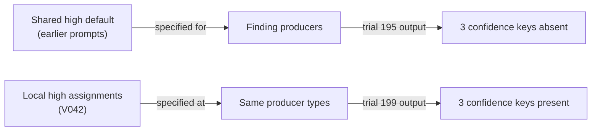
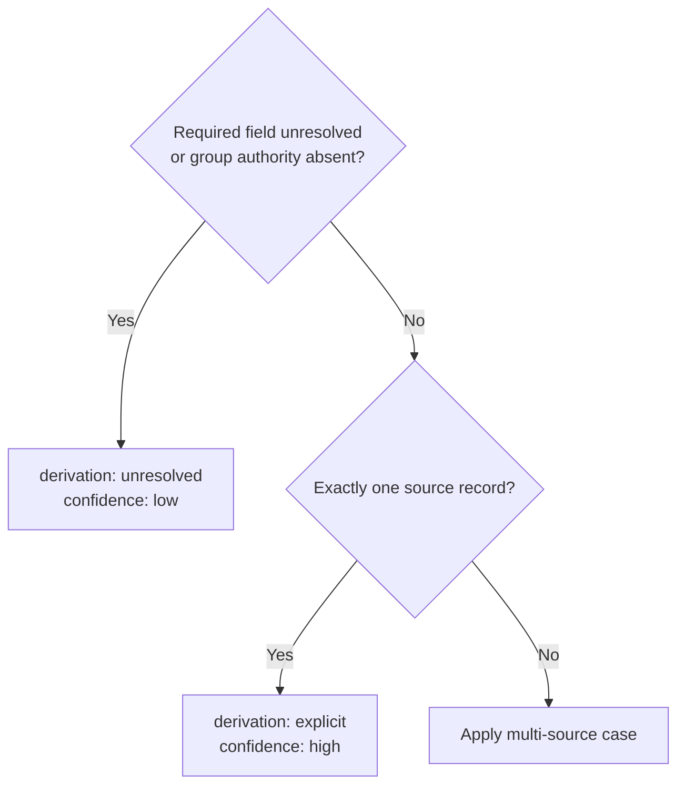
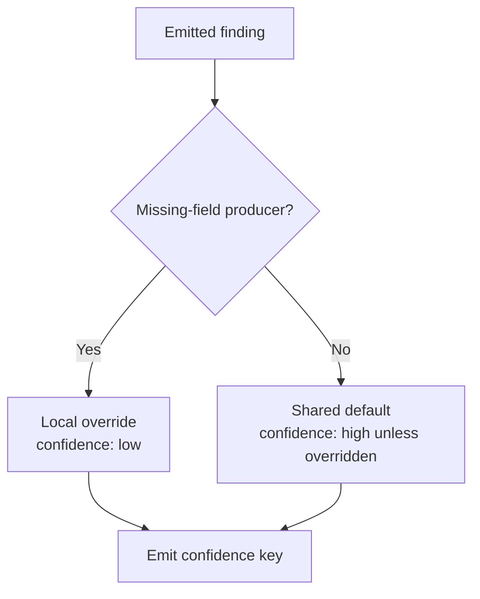

<a id="paper-output-construction"></a>
# Inheritance, Defaults and Output Obligations

**Study context:** This thematic analysis belongs to the single [ArcGrav Authority Resolution Benchmark prompt-refinement trials study](./README.md), using one fixed fixture. Its trial contrasts describe observed outcomes, not isolated causal effects of individual edits.

## Abstract

A required output field needs both a value rule and a path into each emitted object. Recorded responses sometimes omit inherited high-confidence keys, yet correctly materialize an inherited category. A local low-confidence override also survives when unrelated defaulted keys are absent. Other responses misclassify records where ordinary and exceptional conditions overlap. These observations separate **key materialization**, **shared derivation**, **branch precedence**, and **override scope**. The construction implication is to trace each obligation through its producer, without assuming that local repetition always improves correctness.

## The construction distinction

**Materialization** means emitting a required key. **Assignment** determines its value. **Inheritance** supplies a shared rule; a **default** supplies a fallback within a defined scope; an **override** replaces that fallback for a matching case. A field can be present with the wrong value or absent from an otherwise correct finding.

This paper concerns object production and assignment. [Predicate scope](./Predicate_Scope_and_Decision_Separation.md) concerns how the underlying classification is chosen.

## Scope and evidence status

The trials use one fixture and adaptively revised prompts. Bundled edits and output associations do not isolate causes. Diagrams show specified dependencies or recorded prompt–output contrasts, not hidden model operations. The [collection lead](./README.md#scope-and-evidence-status) defines the shared evidence limits.

## Observations and construction implications

<a id="a-shared-assignment-can-exist-without-its-key-being-emitted"></a>
### A shared assignment can leave a required key absent

An inherited high-confidence rule can coexist with otherwise correct findings that omit the `confidence` key.



`V042.A01` removes the shared high-confidence default; `V042.A02` and `V042.A03` assign high confidence at the instruction-content and resolved-relation producers. Trial 195 has no other parsed discrepancy; trial 199 emits the missing keys. Any absent confidence key occurs in 6/198 earlier outputs and 0/209 later outputs. V42 is 9/13 exact overall. The three changes form one bundle, so this contrast does not isolate an effect of locality.

**Construction implication.** For model-emitted objects, identify how every producer obtains and emits each required key. Check key presence separately from value correctness. A deterministic serializer may already materialize shared fields; duplicating assignments in that case can introduce drift.

[Supporting evidence 1](#evidence-1).

<a id="inheritance-is-usable-when-the-derivation-remains-available-to-each-producer"></a>
### Shared derivation works when producers supply its inputs

An inherited category can be emitted correctly when a producer supplies the identifier used by a deterministic rule.


`V011.A10` replaces a shared prefix rule with a local category literal. `V012.A01` restores a shared derivation. Trial 39 is exact under the restored rule. Trial 47 has correct categories but a processed-count error; trial 36 still loses status under local category assignments. V11 is 0/3 exact and V12 is 6/10, with 30 and 19 coded units respectively. These bundled versions do not estimate an inheritance advantage.

**Construction implication.** Factor stable derivations when each producer provides their inputs. A local literal is useful when the derivation would otherwise be ambiguous. Successful inheritance of `category` does not establish that `confidence`, or every other inherited key, will be materialized.

[Supporting evidence 2](#evidence-2).

<a id="an-ordinary-case-must-not-absorb-an-exceptional-case-that-also-matches-it"></a>
### Overlapping conditions require branch precedence

A single-source record can still have unresolved data. Its unresolved-data rule must take precedence over the ordinary singleton rule.



`V003.A15` makes this order explicit. Nevertheless, trials 181 and 182 classify a partially unresolved second record as `explicit` with high confidence; trial 181 also has `value=null`. Trial 271 labels a complete singleton `resolved` instead of `explicit`. The errors show both exception and ordinary-case failures, not which internal branch the model followed.

**Construction implication.** Define the overlap and assign related metadata through one selected branch. Test unresolved requirements before source count when the task specifies that priority. Ordering expresses the contract; its presence alone does not guarantee compliance.

[Supporting evidence 3](#evidence-3).

<a id="a-defaults-scope-and-an-overrides-scope-can-be-preserved-differently"></a>
### A local override can survive missing defaults elsewhere

The scope of a low-confidence exception differs from that of a shared high-confidence fallback. Both still require an emitted `confidence` key.



`V012.A19` and `V034.A03` specify inherited high confidence; the Missing producer uses low. Trial 195 emits low for `missing:item_2:value` while omitting three inherited-high keys elsewhere. That exact missing finding appears in 395/407 outputs, always with low confidence when present. The other 12 outputs omit it; this is a conditional value diagnostic, not a complete-output success rate.

**Construction implication.** Name the class covered by a default and the condition selecting each override. Apply overrides per matching object, then materialize the key. Use a universal rule if no exceptions exist; order exceptions if several overlap.

[Supporting evidence 4](#evidence-4).

## Conclusion

Shared rules can reduce duplication, but each producer must materialize required fields. Specify precedence for overlapping cases, scope defaults and overrides, and inspect key presence independently of value selection.

## Data and reproducibility

The [Evidence Ledger](./Data/Evidence_Ledger.json) supplies exact prompt excerpts and snapshot lines; the [Trial Audit](./Data/Trial_Audit.json) supplies response diagnostics. `[ABSENT]` denotes a missing property in the diagnostic projection, not an emitted string.

<a id="evidence-1"></a>
### Evidence 1

`V042.A01`, before, snapshot 41, line(s) 43:

```text
  - `confidence`: "high"
```

`V042.A02`, after, snapshot 42, line(s) 131:

```text
  - `confidence`: "high"
```

`V042.A03`, after, snapshot 42, line(s) 141:

```text
    - `confidence`: "high"
```

Trial 195, `findings[instruction-content:item_3:note]`: `confidence="[ABSENT]"`. Trial 199, `findings[instruction-content:item_3:note]`: `confidence="high"`.

The before line is removed from the shared finding default; the after lines are added to instruction-content and resolved-relation producers. Trial 195 also omits confidence from both relation findings and has no other parsed discrepancy. Trial 199 includes all three keys. Any missing confidence key occurs in 6/198 earlier outputs and 0/209 later outputs; V42 overall is 9/13. The three-unit bundle changes removal and assignment location together.

<a id="evidence-2"></a>
### Evidence 2

`V011.A10`, before, snapshot 10, line(s) 39:

```text
- Finding category is its ID prefix before first colon
```

`V011.A10`, after, snapshot 11, line(s) 89:

```text
    - `category`: "instruction-content"
```

`V012.A01`, after, snapshot 12, line(s) 45:

```text
  - `category`: ID prefix before first colon
```

Trial 39 is an exact pass under the restored category-inheritance rule. Trial 47 under the same formulation has correct categories and only a processed-count discrepancy. Trial 36 under local category assignments still loses status. Full batches are V11 0/3 and V12 6/10, with 30 and 19 coded units respectively. Correct outputs occur under a shared derivation rule, while local assignments coexist with failures.

<a id="evidence-3"></a>
### Evidence 3

`V003.A15`, after, snapshot 3, line(s) 149:

```text
    - Set metadata by exactly one case in order:
```

`V003.A15`, after, snapshot 3, line(s) 150:

```text
      1. Either field unresolved or no recognized group authority:
```

`V003.A15`, after, snapshot 3, line(s) 153:

```text
      2. Otherwise group contains exactly one source record:
```

Trial 181, `records[item_2]`: `value=null`, `derivation="explicit"`, `confidence="high"`. Trial 271, `records[item_3]`: `derivation="resolved"`.

The required metadata is unresolved/low for the partial second record and explicit for the complete singleton third record. Trial 182 repeats the first discrepancy. The earlier excerpt already had missing-field logic; `V003.A15` makes case order and confidence consequences explicit. The failed responses occur despite later explicit rules. The overlapping conditions require separate treatment.

<a id="evidence-4"></a>
### Evidence 4

`V012.A19`, after, snapshot 12, line(s) 46:

```text
  - `confidence`: "high" unless overridden
```

`V034.A03`, after, snapshot 34, line(s) 43:

```text
  - `confidence`: "high"
```

Trial 195, `findings[missing:item_2:value]`: `confidence="low"`.

Snapshot 34 lines 41–43 place the high default under `Findings inherit`; lines 104–109 define the Missing producer with local low confidence. Trial 195 retains that low value while omitting three inherited-high keys. The exact `missing:item_2:value` finding appears in 395/407 outputs, and its confidence is present and low in all 395; twelve outputs omit the finding. This diagnostic counts the emitted value conditional on the finding being present, across changing prompts.

## Other analyses in this study

- [Predicate and comparison scope](./Predicate_Scope_and_Decision_Separation.md): the classification that supplies a value.
- [Collection membership, multiplicity and order](./Collection_Membership_Multiplicity_and_Order.md): how emitted objects contribute to larger results.
- [Compression, reuse and instruction locality](./Compression_Reuse_and_Instruction_Locality.md): factoring stable definitions without losing dependencies.

## References

- *Evidence Ledger*. Primary prompt formulations, semantic annotations and historical lint reports. [Preserved JSON](./Data/Evidence_Ledger.json).
- *Trial Audit*. Primary raw responses, completion metadata and output verdicts. [Preserved JSON](./Data/Trial_Audit.json).
