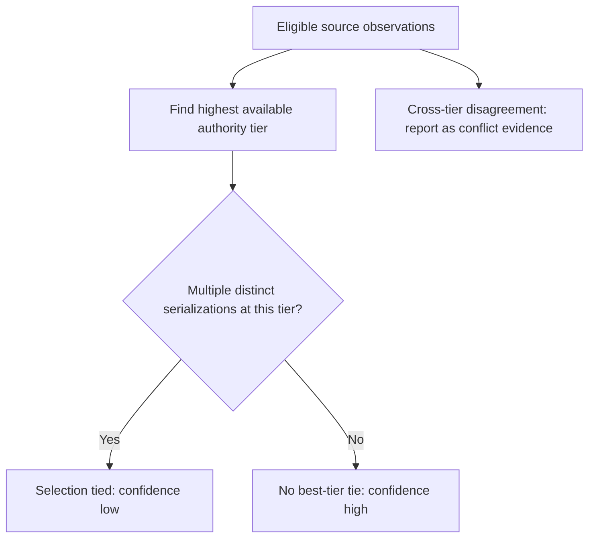
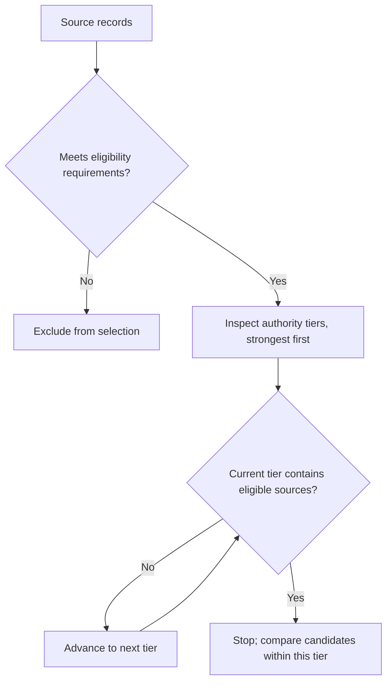
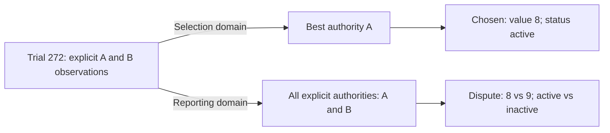
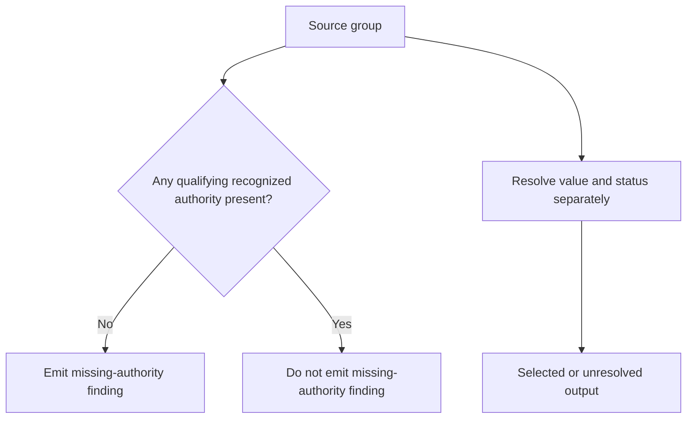
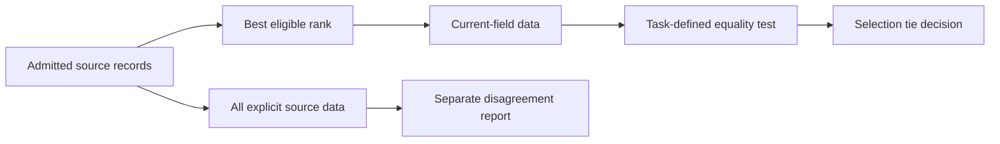

<a id="paper-predicate-scope"></a>
# Predicate and Comparison Scope

**Study context:** This thematic analysis belongs to the single [ArcGrav Authority Resolution Benchmark prompt-refinement trials study](./README.md), using one fixed fixture. Its trial contrasts describe observed outcomes, not isolated causal effects of individual edits.

## Abstract

A predicate's domain and comparison operands determine which observations and differences can change a decision or label. The authority-resolution trials distinguish **eligibility from preference**, **cross-rank disagreement from a best-tier tie**, **reporting from selection**, and **missing source evidence from unresolved output**. Recorded errors crossed these boundaries even when relevant evidence was retained. Bind each predicate to its comparison domain and output consequence; the trial contrasts are associations, not isolated wording effects.

## Core distinction

**Eligibility** admits candidates. **Preference** ranks eligible candidates. **Selection** compares candidates at the best available rank. **Reporting** can use a broader evidence domain. **Missing-evidence diagnostics** inspect qualified source presence, not the state of the selected output. This paper owns these predicate domains; [output obligations](./Inheritance_Defaults_and_Output_Construction.md) owns whether warranted fields appear.

## Scope

The fixed fixture contains recognized authority labels `A`, `B` and `C`. Its `high` and `low` confidence labels are task-defined categories, not calibrated probabilities. Prompt revisions were iterative and sometimes bundled. Equal-best-tier ties and disagreements involving unrecognized authorities were not independently tested. Explicit scope rules also coexisted with incomplete output assembly.

## Observations

### 1. Cross-rank disagreement is not a best-tier tie

**Finding.** A conflict can be reportable without making the selected value tied. In this task, `confidence="low"` applies when distinct data serializations occur **at the same best authority**, not whenever lower-ranked evidence disagrees.



**Evidence.** Trial 264 reported correct conflict evidence and resolution for `conflict:item_1` but labeled confidence `low`; trial 272 labeled it `high`. Present non-high confidence for that exact ID occurred in 20/271 earlier outputs and 0/136 later outputs (21/271 and 0/136 for any conflict finding). `V050.A01` restricted ties to the same best authority. Earlier rank guards had not prevented recurrence; V50's full result was 17/22. The sequence does not isolate the edit's effect.

**Construction.** State the label-producing domain inside the rule: “Tie iff distinct data serializations occur at the same best authority.” Specify lower-rank disagreement reporting separately. A risk-assessment task may instead lower confidence for credible dissent at any rank; the confidence rule must follow that task's meaning. [Evidence 1](#evidence-1).

### 2. Preference rank does not determine eligibility

**Finding.** Trial 8 retained data from a recognized, lower-ranked `C` source but returned `authority="unresolved"` and a missing-authority finding. Trial 11 returned `authority="C"`. A weaker eligible source remains available when stronger tiers are empty.



**Evidence.** `V004.A04` explicitly made rank a preference rather than an eligibility rule. `V010.A06` and `V010.A07` distinguished empty-tier fallback from stopping at a nonempty tier. Trial 8 also emitted `missing:item_3:authority` despite recognized `C`. Trial 34 still contained erroneous null selections after expanded tier instructions. The fixture did not test an equal-best-tier tie, so that fallback boundary is a rule consequence, not an observed success.

**Construction.** Define admissibility before ranking: “Accept licensed reports; among accepted reports prefer the newest.” Advance only past empty tiers; compare sources within the first nonempty tier. If a task imposes a minimum quality threshold, enforce that threshold as eligibility rather than silently treating lower preference as exclusion. [Evidence 2](#evidence-2).

### 3. Selection and disagreement reporting use different domains

**Finding.** The best eligible authority determines the selected value. A disagreement report can still include less-preferred observations. The losing source is **reportable** without becoming **decisive**.



**Evidence.** Trial 272's `conflict:item_1` evidence named value `8 (A)` versus `9 (B)` and status `active (A)` versus `inactive (B)`, while its resolution chose `A` for both. `V056.A06` made reporting independent of rank and eligibility filtering; earlier text already said “at any authority,” so the change clarified scope. Trial 348 omitted status from both conflict strings despite the wider rule. The output does not show whether the predicate or its assembly failed; unrecognized-authority handling was not exercised.

**Construction.** Give each output its own predicate: “Choose from the highest eligible authority; report explicit differences across all supplied authorities.” Then require the evidence and resolution to contain every disputed component. Confidentiality or evidentiary rules may narrow the reporting domain; even a correct domain cannot guarantee complete rendering. [Evidence 3](#evidence-3).

### 4. Unresolved selection does not establish missing source evidence

**Finding.** Trial 140 emitted a missing-authority diagnostic despite a recognized `A` source; trial 8 did the same despite recognized `C`. Missing authority concerns **source presence**. Unresolved selection is a distinct output state.



**Evidence.** Trial 140's `missing:item_2:authority` falsely claimed no resolvable explicit authority although its group contained `A`; that output also mishandled status and resolutions. Trial 8 provides a second false absence claim for `C`. `V004.A10` checked source records against `[Rank]`; `V031.A15` specified that unresolved output authority alone did not require missing evidence. The examples establish invalid diagnostics, not the model's internal shortcut. Present-but-data-empty and tied-best-source cases are deductions, not additional observed fixtures.

**Construction.** Test the relevant source property: “Emit authority missing only if no source record in the group has an eligible authority.” Evaluate selection separately, including cases where an eligible authority yields no determinable value. If eligibility requires authentication or usable support, include those qualifications in the source predicate. [Evidence 4](#evidence-4).

<a id="comparison-operands-and-equivalence"></a>
### 5. Comparison operands and equivalence are distinct from scope

**Finding.** Rank determines which observations compete; the comparison operand and equality rule determine what counts as a tie. A difference in unrelated metadata need not imply different data. This fixture also separates a best-tier tie from cross-rank disagreement reporting.



**Evidence.** `V007.A03` changes the operand from selected-rank candidates to their data; `V056.A05` specifies sorted-key serialization for a dispute predicate. Trial 264 reports cross-rank evidence and the correct choice but incorrectly labels conflict confidence `low`; trial 272 labels it `high`. The outputs cannot distinguish a mistaken comparison from downstream confidence assignment. Equal-best-tier ties and metadata-only differences were not independently tested. [Evidence 5](#evidence-5).

**Construction.** Specify the compared property, candidate population and equivalence rule where their differences matter. Keep the selection-tie criterion separate from the reporting-disagreement criterion.

## Conclusion

For each decision, specify **eligible observations**, **comparison operands and equivalence**, **decision rule**, and **output consumer**. Keep reporting and missing-evidence predicates independent of selection status; verify both the resulting labels and the evidence actually emitted.

## Supporting evidence

Exact prompt formulations come from the [Evidence Ledger](./Data/Evidence_Ledger.json); trial values come from the [Trial Audit](./Data/Trial_Audit.json). The records below preserve formulation contrasts, output witnesses, counts and material limitations.
<a id="evidence-1"></a>
### Evidence 1

`V050.A01`, before, snapshot 49, line(s) 74:

```text
- Tie iff multiple distinct best serializations
```

`V050.A01`, after, snapshot 50, line(s) 74:

```text
- Tie iff multiple distinct data serializations occur at the same best authority
```

Prompt snapshot 50, line 112 (context, not a separate edit):

```text
    - `confidence`: "low" iff [Choice].Value or [Choice].Status tied otherwise "high"
```

Trial 264, `findings[conflict:item_1]`: `confidence="low"`. Trial 272, `findings[conflict:item_1]`: `confidence="high"`.

Trial 264's conflict evidence and resolution are otherwise correct. Present non-high confidence on exact ID `conflict:item_1` occurs in 20/271 earlier outputs and 0/136 later outputs. Counting any `category="conflict"` finding with present non-high confidence gives 21/271 and 0/136: trial 160 emits two per-field conflicts and is counted once only in the broader series. Neither series counts absent keys or absent findings. Earlier lower-rank guards (`V002.A04`, `V031.A14`) coexist with recurrence at trial 157. V50's full result is 17/22, including 10/10 followed by 6/10.

<a id="evidence-2"></a>
### Evidence 2

`V004.A04`, after, snapshot 4, line(s) 101:

```text
- Rank controls preference rather than eligibility
```

`V010.A06`, after, snapshot 10, line(s) 70:

```text
    - Empty collection: continue to next authority
```

`V010.A07`, after, snapshot 10, line(s) 71:

```text
    - Nonempty collection: stop scanning authorities
```

Trial 8, `records[item_3]`: `authority="unresolved"`. Trial 11, `records[item_3]`: `authority="C"`.

The recognized label is `C`. Trial 8 additionally emits `missing:item_3:authority`. `V004.A08` restricts selected comparisons to the same chosen rank. The empty-tier and nonempty-tier instructions specify fallback semantics; the fixture has no equal-best tie that tests them. Expanded tier scanning still coexists with erroneous null selections in trial 34.

<a id="evidence-3"></a>
### Evidence 3

`V056.A06`, before, snapshot 55, line(s) 100:

```text
  - Disputed iff multiple distinct sorted-key serializations of all explicit data at any authority
```

`V056.A06`, after, snapshot 56, line(s) 103:

```text
- Include all authorities without ranking or eligibility filtering
```

Trial 272, `findings[conflict:item_1]`: `evidence="value: 8 (A), 9 (B); status: 'active' (A), 'inactive' (B)"`, `resolution="value=8 prevailed under authority A; status='active' prevailed under authority A"`.

The evidence includes `A` and `B`; the resolution selects `A`. The earlier wording already says “at any authority,” so the contrast clarifies scope rather than introducing it for the first time. Trial 348, under the later named-dispute formulation, omits status from both strings while retaining the value component. That omission does not reveal whether its predicate was misapplied or its result lost in assembly. Unrecognized-source handling remains a written scope requirement without an exercised fixture case.

<a id="evidence-4"></a>
### Evidence 4

`V004.A10`, after, snapshot 4, line(s) 156:

```text
    - Then authority only if no source record in group has authority in [Rank]
```

`V031.A15`, after, snapshot 31, line(s) 134:

```text
- An unresolved output authority alone does not require authority-missing evidence
```

Trial 140, `findings[missing:item_2:authority]`: `evidence="Record 'item_2' has no resolvable explicit 'authority' value"`.

The source group contains recognized authority `A`; trial 140 also loses status and misstates other resolutions. Trial 8 provides another false authority-missing finding for recognized `C`. These outputs make invalid source-absence claims. Recognized-but-data-empty and same-best-tie cases demonstrate the distinction deductively; they are not additional observed fixtures.

<a id="evidence-5"></a>
### Evidence 5 — operand binding and equivalence

`V007.A03`, before, snapshot 6, line 84:

```text
- Compare only selected-rank candidates:
```

`V007.A03`, after, snapshot 7, line 85:

```text
- Compare only selected-rank candidate data:
```

`V056.A05`, after snapshot 56, line 102:

```text
- True iff its explicit source data have multiple distinct default json.dumps(sort_keys=True) serializations
```

Trial 264 (V49) labels `conflict:item_1.confidence="low"` despite choosing authority `A` over the disagreeing `B` source; trial 272 (V50) labels it `"high"`. That contrast shows an incorrect label, not an isolated operand-equivalence failure. No equal-best-tier or metadata-only difference case tests the specified comparison rules. The textual edits occur in different bundled transitions.

## Other analyses in this study

- [Input and Execution Integrity](./Input_and_Execution_Integrity.md): admission and input authority boundaries before source comparison.
- [Inheritance, defaults and output obligations](./Inheritance_Defaults_and_Output_Construction.md): key presence versus label classification.
- [Evidence ownership, assembly and rendering](./Evidence_Assembly_and_Exact_Rendering.md): turning included observations into complete text.

## References

- *Evidence Ledger*. Primary prompt formulations, semantic annotations and historical lint reports. [Preserved JSON](./Data/Evidence_Ledger.json).

- *Trial Audit*. Primary raw responses, completion metadata and output verdicts. [Preserved JSON](./Data/Trial_Audit.json).

