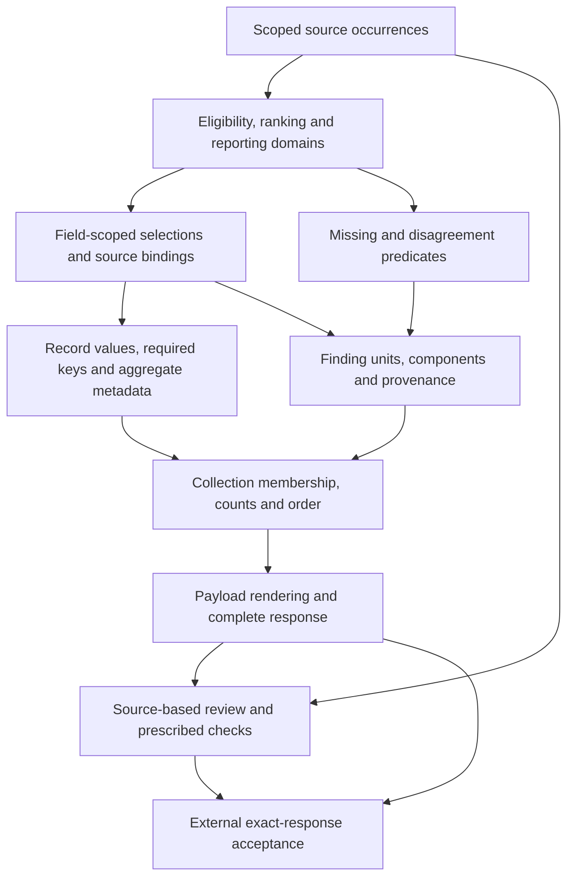

# ArcGrav Authority Resolution Benchmark — Prompt Refinement Trials

## Abstract

This report examines **one adaptive series of prompt-refinement trials** for the **ArcGrav Authority Resolution Benchmark (ARB)**. On one fixed authority-resolution fixture, successive prompt formulations were evaluated against a strict exact-response contract. The preserved audit records **407 completed verdicts: 236 exact passes and 171 failures**. Eight thematic analyses examine where input boundaries, rules, source decisions, output construction and verification diverged in observed responses. They are **eight views of one study**, not eight independent experiments. The resulting construction distinctions are task-conditional interpretations, not controlled estimates of individual edits or demonstrated cross-task improvements.

## Study question and scope

**Prompt construction** specifies a task's subjects, eligible evidence, comparisons, intermediate results, output obligations and checks. Its useful unit is a *meaningful distinction*: one that can change a decision, a required output or the interpretation of a test. A line of text may express several such distinctions; several lines may jointly express one.

The study asks: **Which relationships must remain explicit for an intended transformation to be specified, carried into its outputs and assessed?** For example, a source's recognized authority is not the same as a selected output authority; a finding's existence is not the same as its component completeness; an inherited field value is not the same as an emitted key. These are construction questions, not general appeals to longer or more explicit prompts.

Performance can concern decision correctness, required-content coverage, serialization, consistency, substantive utility and resource cost. These historical trials measure **strict exact-response acceptance** and diagnoses specific output discrepancies. It does not measure general task utility, runtime or token efficiency, or reliable transfer to other tasks.

## Fixed benchmark fixture and scoring context

**Historical metric:** This study uses strict *complete-response exact acceptance* recorded in its trial audit. The [currently registered ARB](../../../../AgMark/Authority_Resolution_Benchmark/README.md) uses field-accuracy scoring; its results and this study's exact-pass counts are not interchangeable.

The common fixture asks a model to resolve source records under an authority ordering, report source disagreements and missing information, construct findings and relations, and return a strictly specified JSON response. It has **four scoped source-record occurrences grouped under three record IDs**. The required result includes three records, five findings—one combined conflict, one missing-value finding, one instruction-content finding and two relation findings—and one uncertainty entry. The task's `execution.processed` count is **4** (source occurrences before grouping), while `execution.resolved` is **3** (emitted grouped records, including an incomplete one). These are fixture-specific populations, not interchangeable definitions of “processed” or “resolved.”

The recognized source-authority labels are `A`, `B` and `C`. Preference among eligible sources determines a selected field value; reporting can also include observations from nonwinning sources. The task's `high` and `low` confidence labels are defined by its rules, not calibrated probability estimates. One record has no resolvable value but does have a supported `active` status from `A`. Its partial state exposes the difference between a field decision, record metadata, a missing finding and aggregate authority.

The [canonical specification](../../../../AgMark/Authority_Resolution_Benchmark/Legacy_Content/ARB_Spec.md) and [Golden implementation](../../../../AgMark/Authority_Resolution_Benchmark/Legacy_Content/Authority_Resolution_Benchmark.py) define the required behavior. The analyses examine task-construction *relationships* using this fixed task; their exact labels and counts are not prescriptions for unrelated prompts.

## The construction path

The following is a map of **specified dependencies**, not a reconstruction of the model's private steps:

Each arrow marks a consumer that needs a correctly scoped input or contribution. The same source observation can have different roles: it may be eligible for selection, reportable as a disagreement, or relevant to an absence check. A correct upstream decision does not ensure that its consumer emits a required key, includes every member or renders the response exactly.

## Eight analyses within one study

The following eight thematic analyses organize **this study's observations** by construction responsibility, not chronologically by prompt version. Each presents response witnesses, anchored formulations and conditional implications. They share the same trial population, so a repeated trial citation is not an additional experiment.

| Analysis | Construction boundary and representative evidence |
| --- | --- |
| [Input and Execution Integrity](./Input_and_Execution_Integrity.md) | Distinguish instruction-like source text from governing instructions, admission and exception outcomes from validation, decoded values from derived states, and diagnostics from interventions. Trials 1/16 differ in instruction-content finding membership while retaining the same supported fields; trials 181/182 retain null data but mislabel metadata. Admission and exception branches remain specification-only in this fixture. |
| [Reference Identity and Independent Decisions](./Reference_Binding_and_Independent_Decisions.md) | Bind a selection to its exact record, field and source; preserve supported siblings; compute aggregate authority from **selected** field authorities rather than consulted sources. Trials 229/230 contrast lost and retained status, and trial 387 illustrates a wrong aggregate despite a correct status. Six historical reference warnings were removed by verified static repairs. |
| [Predicate and Comparison Scope](./Predicate_Scope_and_Decision_Separation.md) | Separate eligibility from preference, best-tier ties from cross-tier disagreement, reporting from selection, and missing source authority from unresolved output. Trials 264/272 contrast `low` and `high` confidence on a reportable cross-rank conflict. |
| [Inheritance, Defaults and Output Obligations](./Inheritance_Defaults_and_Output_Construction.md) | Distinguish deriving a value from **emitting its key**; specify override scope and precedence where ordinary and exceptional branches overlap. Trial 195 omitted three required confidence keys while reporting validation success, even though another local low-confidence override was present. |
| [Collection Membership, Multiplicity and Order](./Collection_Membership_Multiplicity_and_Order.md) | Specify producer-to-member contributions, the unit of emission, source-occurrence counts, accumulation and stable ordering separately. Trial 302 retained a missing finding but returned an empty uncertainty array; trial 160 split one required conflict into two findings. |
| [Evidence Ownership, Assembly and Rendering](./Evidence_Assembly_and_Exact_Rendering.md) | Distinguish a retained finding from its component coverage, the source of each observation from the source of a chosen decision, value conversion from literal labels, and parsed JSON from the complete response. Trial 310 matched the extracted object but failed strict acceptance because of extra assistant text. |
| [Compression, Reuse and Instruction Locality](./Compression_Reuse_and_Instruction_Locality.md) | Reused rules still require subject parameters and output consumers; compression must preserve consequential cases; moving unchanged text is not adding a qualification. Bundled version outcomes do not rank concise, specialized or generic forms, and the V51/V52 placement contrast showed no observed pass-rate improvement. |
| [Construction Checks and Verification](./Construction_Checks_and_Verification.md) | Distinguish a requested recheck from verified execution, prescribed test coverage from complete correctness, and authorized repair from alteration of valid data. Trial 387's erroneous aggregate was outside the specified validator tests; trial 195's missing keys violated covered requirements despite `validated=true`. |

Analytical boundaries matter where these analyses intersect. Input integrity establishes **what material may govern the task and what source data remain admissible**; predicate scope determines **which admitted evidence is eligible to decide a label**; output construction determines **whether that label is emitted**. Collection membership determines **which findings exist**; evidence assembly determines **what each finding contains**. Reference identity establishes producer-to-consumer binding; verification determines **what a check can establish** about the resulting output. The same trial can inform more than one boundary without counting as more than one experiment.

## A cross-layer example

The partially unresolved `item_2` shows why “make the instructions more explicit” is too coarse to be a construction diagnosis.

1. **Select fields independently.** The unsupported `value` remains `null`, but the `status` supported by `A` must remain `active`. Trial 229 lost that status; trial 230 retained it. Record incompleteness does not cancel a supported sibling.
2. **Compute metadata from the selected results.** With `A` as the sole non-null selected field authority, aggregate authority must be `A`. Trial 387 instead returned `mixed`, while its status and missing-value finding were correct.
3. **Emit and collect the required evidence.** The missing-value finding must exist, and its evidence must contribute to `uncertainties`. Trial 302 emitted the finding but left the collection empty; trial 306 included the contribution.
4. **Validate the applicable obligations.** A reported `validated=true` does not prove strict response correctness. An aggregate rule outside the validator's coverage and a missing key inside its coverage require different diagnoses.

These are separate response witnesses across changing prompts, **not four observed stages of one execution**. The resulting construction contracts are also separate: field-scoped selection, aggregate operands and cases, producer-to-collection membership, and checks with defined coverage. A task with genuinely joint fields, a recomputed collection after repairs or a different authority policy needs corresponding changes to those contracts.

## What the observations support

The analyses use three evidential categories:

- **Specification analysis** identifies requirements, missing qualifications and consequences of exact prompt wording. Ledger atom IDs locate interpretive textual contrasts, not independently controlled interventions.
- **Observed behavior** records an output, its exact verdict or a diagnostic discrepancy under a particular formulation. A later correct response does not by itself show which wording change caused it.
- **Verified static effects** describe historical lint differences under a recorded tool. Five undefined-member and one binder warning were removed in the reference-language repair; this does not certify behavioral success.

The common pattern is **obligation versus point of application**. The prompt may define a default without materializing a field, define a finding without assembling all its components, or define a validator whose coverage is narrower than external acceptance. A useful construction implication names the relevant producer, domain, consumer, contribution or check. It then states when that relationship is appropriate—not merely that an instruction should be longer, nearer its use or more formal.

## Scope and evidence status

The record is an **adaptive, sequential series on one fixed fixture**, not a controlled factorial experiment. Prompt versions often change multiple semantic units at once; trial counts, stopping decisions and successive errors are not independent estimates of individual edits' effects. Some annotations share a single changed line. The 500 reviewed semantic units are interpretive and non-exhaustive; their IDs identify evidence locations rather than proven causal mechanisms. Diagrams express specified dependencies or observable contrasts, not hidden cognition.

Not every rule was tested in a discriminating fixture case. Equal-best-tier ties, source-implied duplicate finding IDs, equal-key ordering, multi-entry uncertainty ordering, some unrecognized-authority cases and specified repair exceptions remain incompletely or independently untested. Later reductions in targeted discrepancy counts do not establish cross-task reliability or prove that a particular formulation would dominate alternatives.

**Strict acceptance** requires the completed, untruncated, fully paginated **single visible assistant response** to match the expected response exactly. The expected response has SHA-256 `23f6a620cae6431fd97c538bced0b70c86cd02526db627ca7b5079e0b7322d41`. Extracting an otherwise correct JSON object from multiple messages is diagnostic only. Trial 310, for example, had the correct extracted object but two assistant messages and 228 extra characters. Similarly, a reported `execution.validated=true` is a statement inside the output, not independent proof of covered tests or whole-response acceptance.

Trials 55–407 record `gpt-5.6-luna`, low reasoning and `fork_turns=none`; authoritative setting snapshots for the first 54 are absent. V26, V47 and V60 were not tested. Trial 211 lacks a create receipt but has completed-read and result evidence. No settings are reconstructed and no additional trials are asserted here.

## Data and reproducibility

Two preserved machine-readable inputs anchor this single study:

| Preserved input | Bytes | SHA-256 |
| --- | ---: | --- |
| [Trial Audit](./Data/Trial_Audit.json) | 2,379,112 | `60d03c09c5ccc8ec905d6e4862c180e74c25780b0ebe0aefafb734fd28414384` |
| [Evidence Ledger](./Data/Evidence_Ledger.json) | 6,820,389 | `c71d17128f5f38bc1675df759fc30bd66d3de1a3224d5d6baea19f0a91f33241` |

The **Trial Audit** holds 407 completed verdicts: **236 exact passes** and **171 failures**. The **Evidence Ledger** contains **57 tested prompt hashes**, **56 transitions**, **500 reviewed semantic units**, **944 exact excerpt anchors** and **4,025 mechanical changed-line events with residuals**. Six semantic units have verified lint effects; the remaining 494 have specification-analysis grades. These counts describe different objects and must not be used as a common denominator.

To inspect a paper's evidence, use `atoms[].atom_id`, `before_exact` and `after_exact`, and the inclusive one-based ranges within `prompt_snapshots[].text`. An excerpt quoted in a paper may be one line selected from a larger anchored span; inspect the complete prompt context. Locate outputs by `trials[].trial` and `actualVisibleOutput`, and match them to prompts through `promptSha256`. The decoded output values in the papers are diagnostic projections; `[ABSENT]` denotes a missing property rather than a literal response value. All raw responses, excerpt anchors and mechanical line locations were verified in the preserved audit.

The canonical benchmark specification and implementation remain the comparison authority. Each thematic analysis gives the relevant trial IDs, formulation excerpts, contrasting outcomes, denominators and limitations alongside the claim it supports.

## Implications and transfer limits

Any application outside this benchmark requires new testing. When adapting these observations to a new task, first identify **what the source contains** and **what each consumer requires**. State separately: the eligible and reportable evidence populations; the subject and dependencies of each decision; the fields each output producer must materialize; the units and contributors of each collection; the components and exact text required by the consumer; and the properties each check actually covers. Test the correspondence at each boundary. This is a method for exposing task-specific obligations, not a claim that one amount of detail or one notation is always optimal.

## Related research

- [Instructional Representation](../../../Instructional_Representation.md) addresses instruction structure and its distinction from executable programs.
- [Interpretive Efficiency](../../../ArcGrav_Interpretive_Efficiency.md) addresses the cost of recovering meaning from a representation.
- [Semantic Locality](../../../Context_Triad/Semantic_Locality.md) addresses positional relationships and controlled locality measurement.

## References

External work gives broader context for prompt optimization, format sensitivity and sequential inference; it is not experimental evidence for the individual contrasts in this collection.

- Johari, R., Pekelis, L., & Walsh, D. J. (2019). *Always Valid Inference: Bringing Sequential Analysis to A/B Testing*. Revised version of the 2015 preprint. [arXiv:1512.04922v3](https://arxiv.org/abs/1512.04922v3).
- Pryzant, R., Iter, D., Li, J., Lee, Y., Zhu, C., & Zeng, M. (2023). *Automatic Prompt Optimization with “Gradient Descent” and Beam Search*. Proceedings of EMNLP. [ACL Anthology](https://aclanthology.org/2023.emnlp-main.494/).
- Sclar, M., Choi, Y., Tsvetkov, Y., & Suhr, A. (2024). *Quantifying Language Models' Sensitivity to Spurious Features in Prompt Design or: How I learned to start worrying about prompt formatting*. ICLR 2024. [arXiv:2310.11324v2](https://arxiv.org/abs/2310.11324v2).
