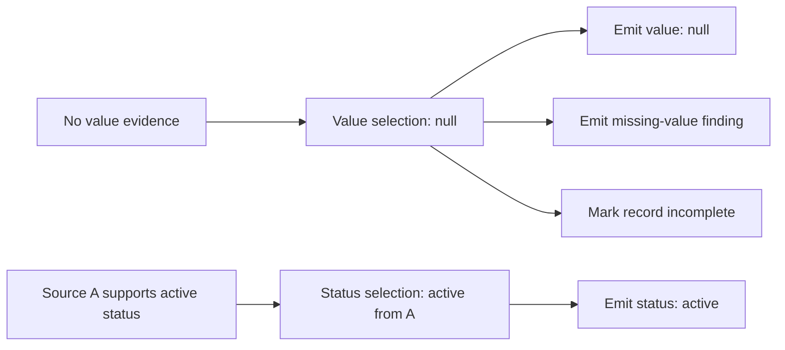
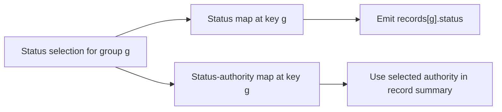
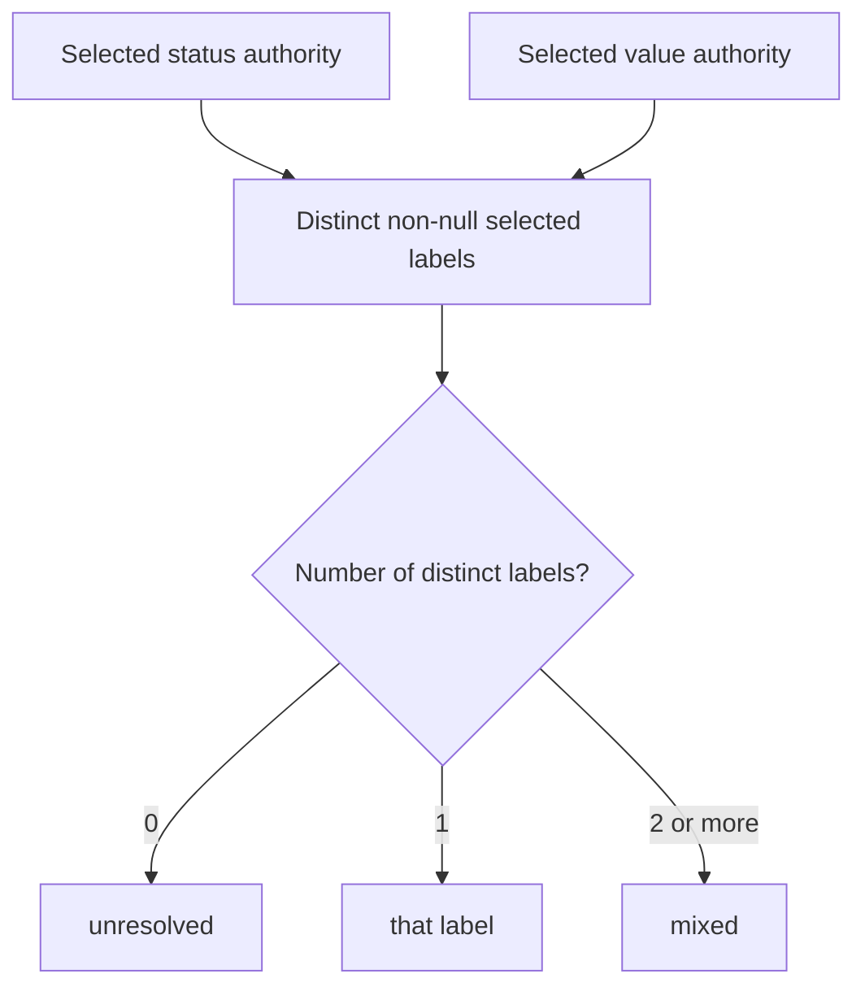
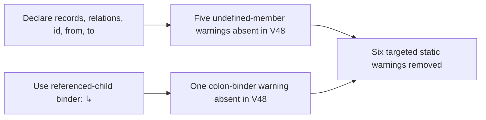

<a id="paper-reference-binding"></a>
# Reference Identity and Independent Decisions

**Study context:** This thematic analysis belongs to the single [ArcGrav Authority Resolution Benchmark prompt-refinement trials study](./README.md), using one fixed fixture. Its trial contrasts describe observed outcomes, not isolated causal effects of individual edits.

## Abstract

Reference identity determines which field, decision or source a later instruction consumes. Recorded outputs lost a supported field when its sibling was unresolved, repeated that loss under separate audit maps, and misaggregated authority even when a field selection was correct. Historical declaration and binding repairs removed six reference warnings without establishing behavioral accuracy. The construction contract is field-scoped selection, explicit producer-to-consumer binding and a separate aggregate rule.

## The construction distinction

**Reference identity** binds an expression to a group, field, source occurrence or selected decision. **Decision independence** means a field uses only its authorized dependencies; a later summary may combine independently selected results. Storage names identify where results belong. Consumer bindings identify which result each output uses.

This paper addresses identity and result flow. [Predicate scope](./Predicate_Scope_and_Decision_Separation.md) addresses the evidence eligible for a decision.

## Observations and construction implications

### An unresolved field does not erase a supported sibling

**Finding.** In the recorded fixture, `item_2` has no supported value, but source `A` supports status `active`. The required record retains both `value=null` and `status="active"`, even when the record is incomplete.



**Evidence.** Trial 229 (V45) emitted `status=null`, `authority="unresolved"` and a spurious missing-status finding. Trial 230 (V46) retained `status="active"` and `authority="A"`. Trial 255 later repeated the status loss. The status-null diagnostic occurred in 71/229 outputs before trial 230 and 4/178 afterward. V46 changed 19 coded units, including missing-field gates; the sequence does not isolate the effect of naming. Earlier preservation wording and explicit maps also failed. [Supporting evidence 1](#evidence-1).

**Construction implication.** Give each independently resolved field a stable selection identity. Bind its emitted value and field-specific diagnostics to that selection; compute record-level incompleteness separately. Preserve genuine joint constraints, such as the linked endpoints of a date interval.

### Storage identity and consumer binding are different contracts

**Finding.** V30 declared separate maps for value, status, selected authorities and tie states, keyed by group ID. Supported status was still lost in recorded outputs. A storage declaration specifies a container; a consumer binding specifies the result used at each read.



The diagram shows the **required producer-to-consumer path**, not a trace of model internals.

**Evidence.** Trials 151 and 156 (V30) emitted `status=null` and `authority="unresolved"` for `item_2`, with invented missing-status and missing-authority findings. V30 achieved 1/6 exact passes; the subsequent named-choice formulation achieved 2/5. These were bundled formulations, not an isolated comparison of maps and named decisions. [Supporting evidence 2](#evidence-2).

**Construction implication.** Specify each intermediate result's producer, group key and consumers together. At emission, read the matching field and authority rather than relying on a general storage instruction. Maps suit reusable or changing observations; source-defined choices may simplify stable inputs. The recorded outcomes do not rank those representations.

### Aggregate authority needs selected operands and a rule

**Finding.** In this fixture, record authority summarizes the **selected field authorities**, not every source consulted. Thus a correct field selection can coexist with a wrong aggregate. The rule counts distinct non-null labels from the selected status and value decisions.



**Evidence.** Trial 305 emitted `mixed` when both selected authorities were `A`. Trial 387 emitted `mixed` when status was correctly `active` from `A` and value authority was null; the required aggregate was `A` in both cases. V54 later made null, equal and unequal pair cases explicit, yet the trial 387 error occurred afterward. This is an aggregation failure, not sibling-field loss. [Supporting evidence 3](#evidence-3).

**Construction implication.** Name the selected operands, define the absent/equal/different cases and calculate the summary without altering its inputs. When a task instead asks for all consulted sources, define that different population explicitly.

### Static reference repairs require separate behavioral checks

**Finding.** The recorded reference-language linter distinguishes missing member declarations from incorrect binding notation. The V46-to-V48 repairs removed five undefined-member warnings and one wrong-binder warning.



**Evidence.** The V46 and V48 lint reports both had zero errors, 37 quoted-element warnings and `conformance="unknown"`. The six specified warnings were absent in V48 under the recorded tool (package 0.2.0, API 2). Behavioral results remained separate: V46 achieved 14/16 exact passes, V48 achieved 9/16, and trial 255 still lost a supported status. These results establish the static diagnostic change, not a behavioral gain or loss from the repairs. [Supporting evidence 4](#evidence-4).

**Construction implication.** Declare members in the scope required by the reference language and use its accepted binding operator. Verify diagnostic removal with that tool; test selected and emitted field values independently. Ordinary prose need not follow the language's declaration syntax.

## Conclusion

Reference identity must survive selection, storage, emission and aggregation. Supported-field loss, wrong summaries and invalid reference syntax require distinct construction contracts and distinct checks.

## Data and reproducibility

The notes below substantiate the construction observations above. Exact prompt lines come from the [Evidence Ledger](./Data/Evidence_Ledger.json); output values come from the [Trial Audit](./Data/Trial_Audit.json).

<a id="evidence-1"></a>
### Evidence 1

`V046.A05`, before, snapshot 45, line(s) 77:

```text
  - `status`: status-column [Choice] datum
```

`V046.A05`, after, snapshot 46, line(s) 77:

```text
  - `status`: datum of [Choice].Status
```

Trial 229, `records[item_2]`: `value=null`, `status=null`, `authority="unresolved"`. Trial 230, `records[item_2]`: `value=null`, `status="active"`, `authority="A"`.

Trial 229 also invents a missing-status finding; trial 230 does not. The status-null diagnostic is 71/229 before trial 230 and 4/178 afterward (later trials 255, 284, 296 and 377). The named-choice transition includes 19 coded units, including missing-field gates. Earlier preservation wording (`V002.A03`, `V003.A01`) and explicit maps (`V030.A01`–`V030.A10`, trials 151 and 156) did not prevent the same loss.

<a id="evidence-2"></a>
### Evidence 2

`V030.A01`, after, snapshot 30, line(s) 59:

```text
- Key maps by exact group ID
```

`V031.A06`, after, snapshot 31, line(s) 58:

```text
- Independently defined for one group and one source column
```

Trial 151, `records[item_2]`: `status=null`, `authority="unresolved"`. Trial 156, `records[item_2]`: `status=null`, `authority="unresolved"`.

Both outputs also invent missing-status and missing-authority findings. The map bundle (`V030.A01`–`V030.A10`) includes independence, read-only emission and field bindings but achieves 1/6 exact passes; the following named-choice prompt achieves 2/5. The failure recurs despite explicit separate storage in these bundled alternatives.

<a id="evidence-3"></a>
### Evidence 3

`V054.A01`, before, snapshot 53, line(s) 84:

```text
  - `authority`: distinct non-null authorities of [Choice].Status and [Choice].Value ↳
```

`V054.A01`, after, snapshot 54, line(s) 84:

```text
  - `authority`: selected authorities of [Choice].Status and [Choice].Value ↳
```

`V054.A04`, after, snapshot 54, line(s) 87:

```text
    - Both equal non-null: that label
```

Trial 387, `records[item_2]`: `status="active"`, `authority="mixed"`.

Trial 387 requires authority `A`, not `mixed`; its status is correct and this aggregate label is the sole parsed discrepancy. Trial 305 similarly gives the first record `mixed` despite both selected fields being supported by `A`. The first case involves one null selected authority; the second involves equal non-null authorities. `V054.A02`–`V054.A05` enumerate those cases, but trial 387 occurs after that formulation. These outputs support separate aggregate analysis, not another instance of sibling-field loss.

<a id="evidence-4"></a>
### Evidence 4

`V048.A06`, before, snapshot 46, line(s) 93:

```text
=> Per group inspect both [Fields]:
```

`V048.A06`, after, snapshot 48, line(s) 98:

```text
=> Per group inspect both [Fields] ↳
```

`V048.A01`–`V048.A05` declare `records`, `relations`, `id`, `from` and `to`. In `lint_evidence`, five `AG-MEMBER-UNDEFINED` warnings and one `AG-BINDING-REFERENCE-COLON` warning present in V46 are absent in V48. Both reports have zero errors, 37 quoted-element warnings, an unavailable-spellcheck notice and `conformance="unknown"`. Provenance: tree `65cf9ff48c36dfbb8acfd2c8e5f38e9fff07a100`, package 0.2.0, API 2. V46 is 14/16 and V48 9/16; trial 255 still loses the supported status. The six diagnostic removals are verified static effects.

## Other analyses in this study

- [Predicate and comparison scope](./Predicate_Scope_and_Decision_Separation.md): which observations a decision compares.
- [Compression, reuse and instruction locality](./Compression_Reuse_and_Instruction_Locality.md): the coordination costs of stored and shared results.

## References

- *Evidence Ledger*. Primary prompt formulations, semantic annotations and historical lint reports. [Preserved JSON](./Data/Evidence_Ledger.json).

- *Trial Audit*. Primary raw responses, completion metadata and output verdicts. [Preserved JSON](./Data/Trial_Audit.json).
